# Steam Game Organizer — AGENTS.md

[](CHANGELOG.md)
[](README.md)
[](ruff.toml)
[](tests/)

> [!IMPORTANT]
> **Windows is the only platform.** There is no second environment to keep green. The Flatpak/SteamOS target is gone. Anything that branches on platform should raise or return a refusal rather than keep a second implementation.

---

## 📖 How to use this document

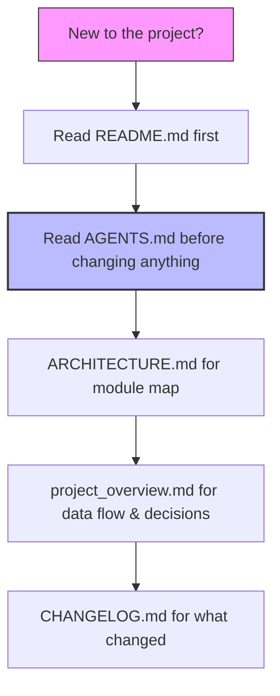

This file is the operating manual for contributing to the project. Read it **before** modifying any module.

---

## ⚠️ Before changing anything

> [!WARNING]
> **Read before changing.** Before modifying a module, read `AGENTS.md`, `ARCHITECTURE.md`, and `project_overview.md` for relevant context. Understand the frozen build, logging, and test hygiene rules first.

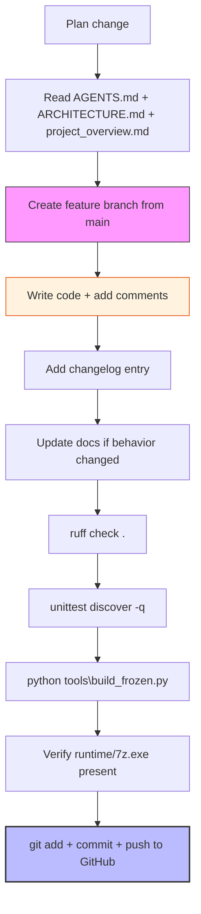

> [!IMPORTANT]
> **New rule — comment on every change, update GitHub on every change.** Whenever any file is changed in this project:
> 1. **A comment is added** — every changed file must include a comment explaining what changed and why. Inline comments (`#`) state *why* a specific line does something (bug, edge case, platform quirk). Docstrings (`"""`) state *what* a module/class/function does and its contract. See [**Comment style**](#comment-style) below.
> 2. **The project is updated on GitHub** — after the change is reviewed, committed locally, and verified (lint + tests + build), push to GitHub so the public repository always reflects the current state. Never leave work committed locally only. See [**Git / GitHub workflow**](#git--github-workflow).

| Rule | What it means |
|------|---------------|
| **Changelog first/with change** | Add a dated entry to the top of `## 9.33` in [`CHANGELOG.md`](CHANGELOG.md) at the same time as code changes. Never defer. |
| **Comment on every change** | Every changed file must include a comment explaining what changed and why. |
| **Build artifacts** | Never edit files in `dist/` or vendored runtime site-packages. Treat them as read-only outputs. |
| **Frozen exe required** | If you change any source code, rebuild with `python tools\build_frozen.py` before considering complete. |
| **Tests must not pollute repo state** | Use [`tests/tk_support.py:sandbox_app`](tests/tk_support.py) for tests that create `AppConfig`/windows/writes. Use `tests/tk_support.py:close_root()` to tear down Tk roots. |
| **Path safety** | Resolve paths with `.resolve()` and validate against allowed roots (library root, app root) for user/URI/archive inputs. Reject traversal. |
| **Atomic writes** | Follow temp-file + `os.replace` with retries for config/state files. |
| **No screenshots left behind** | Delete any `*.png` screenshots created during checks. |
| **Windows only** | Don't add POSIX-specific code paths; refuse or raise as per project rules. |
| **Update GitHub on every change** | Push every committed change to GitHub so the public repository stays current. |

---

## 🛠️ Prerequisites & Setup

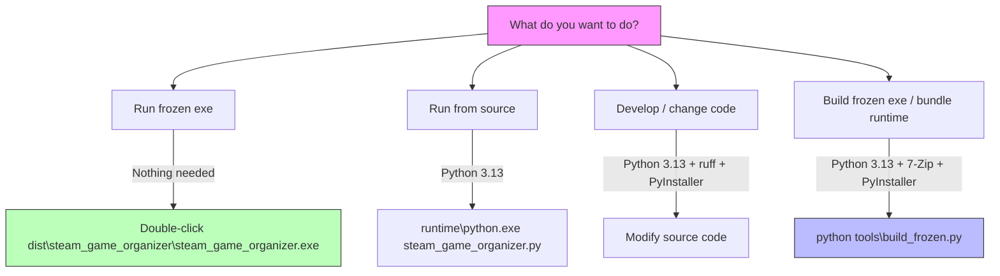

Different ways to run the app need different things installed:

| You want to… | What you need | How to get it |
|--------------|---------------|---------------|
| **Run the frozen exe** (`dist\steam_game_organizer\steam_game_organizer.exe`) | **Nothing.** It ships with Python 3.13, Tcl/Tk, and 7-Zip bundled inside `runtime/`. Double-click and go. | Download the latest release from GitHub, or build it yourself (see **Build** below). |
| **Run from source** (`runtime\python.exe steam_game_organizer.py`) | Python 3.13 (the bundled runtime works if you already built it). | [python.org](https://www.python.org/downloads/windows/) — install for all users, check "Add Python to PATH". |
| **Develop / change code** | Python 3.13 + `ruff` (lint) + `PyInstaller` (frozen build). | See **Development toolchain** below. |
| **Build the frozen exe / bundle runtime** | Python 3.13 + 7-Zip (for `runtime\7z.exe`) + PyInstaller. | See **Build** and **Bundled runtime** below. |

### Development toolchain

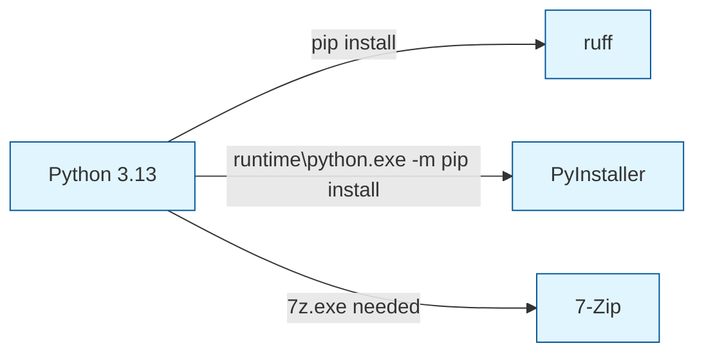

Install these on your Windows machine if you plan to modify code:

1. **Python 3.13** — [python.org](https://www.python.org/downloads/windows/). During install, check **"Add Python to PATH"** and **"Install for all users"**.
2. **ruff** — [github.com/astral-sh/ruff](https://github.com/astral-sh/ruff/releases). Quick install:
   ```powershell
   pip install ruff
   ```
3. **PyInstaller** — [pyinstaller.org](https://pyinstaller.org/en/stable/). Installed inside the bundled runtime:
   ```powershell
   runtime\python.exe -m pip install pyinstaller
   ```
4. **7-Zip** — [7-zip.org](https://www.7-zip.org/download.html). Required for `runtime\7z.exe` (archive extraction) and for building the frozen exe. Install to the default location (`C:\Program Files\7-Zip`) so [`tools/bundle_runtime.py`](tools/bundle_runtime.py) can find it automatically.

### Verify your setup

```powershell
python --version           # should be Python 3.13.x
ruff --version             # should print a version
7z                         # should print 7-Zip help
```

---

## 🏗️ Build — frozen exe pipeline

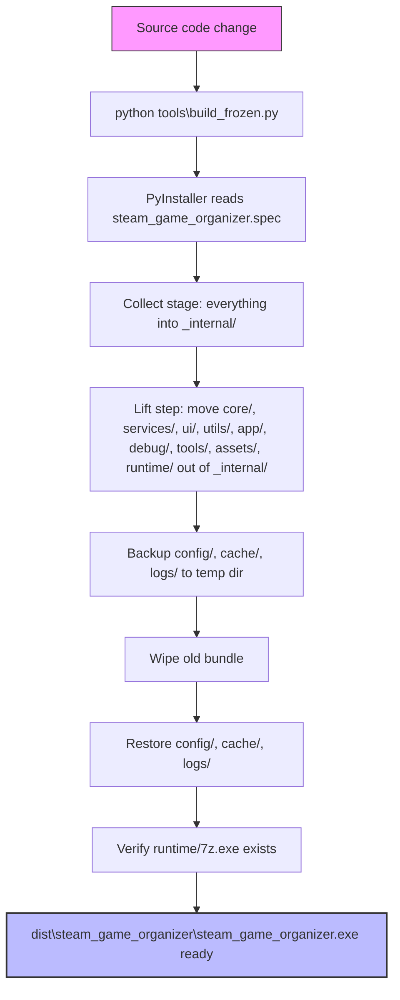

After any code change, rebuild the exe:

```powershell
python tools\build_frozen.py
```

> [!IMPORTANT]
> **MANDATORY:** Always rebuild the exe after any code change. The user runs only the frozen exe in `dist/steam_game_organizer/`, never from source.

[`tools/build_frozen.py`](tools/build_frozen.py) runs PyInstaller on [`steam_game_organizer.spec`](steam_game_organizer.spec), then moves `core/`, `services/`, `ui/`, `utils/`, `app/`, `debug/`, `tools/`, `assets/`, `runtime/` out of `_internal/` into the bundle root — because [`steam_game_organizer.py`](steam_game_organizer.py) resolves its project root as `Path(__file__).resolve().parent` and walks it for those siblings. Leaving them in `_internal/` puts `runtime/7z.exe` one folder out of reach and every extraction reports no archiver.

- Before wiping the old bundle it backs up `config/`, `cache/`, `logs/` into a temp dir and restores them after, so user settings, artwork cache, and logs survive a rebuild. If there was no previous bundle it seeds `config/settings.json` from the source tree so the frozen app has the same defaults as source.
- It retries `rmtree` up to 5 times because Windows Defender or an indexer can hold a DLL open long enough to fail the first pass, and clears read-only attributes on locked files. It verifies `runtime/7z.exe` exists in the bundle before reporting success.
- The spec is a **onedir** build (`console=False`, `exclude_binaries=True`): the exe sits beside its bundle, DLLs land in `_internal/`, and `base_library.zip` holds the stdlib. Do not change to onefile — a onefile build repacks the interpreter into a temp folder on every launch.

---

## 📦 The bundled runtime

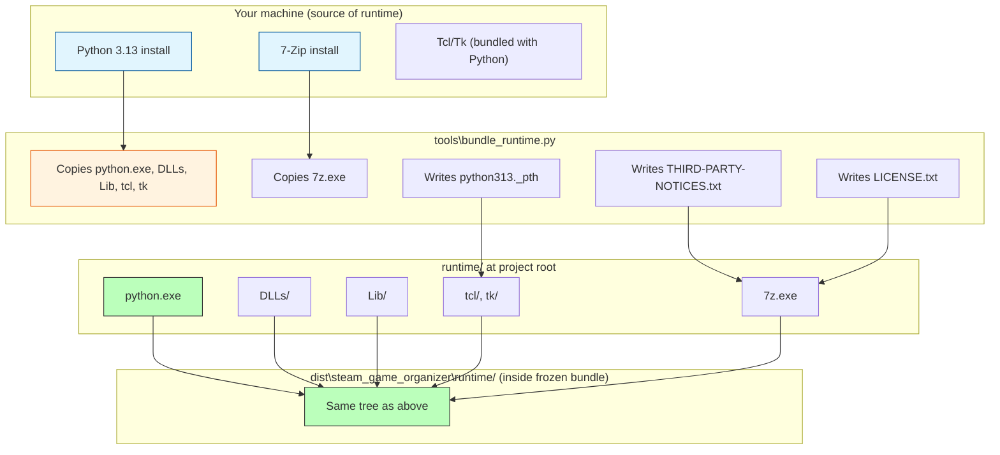

`runtime/` at the project root is a **vendored product, not this project's code**: [`tools/bundle_runtime.py`](tools/bundle_runtime.py) copies a Python (with Tcl/Tk, so the setup wizard opens) and a 7-Zip into it from the machine's own installs. The same tree ships inside the frozen bundle as `dist/steam_game_organizer/runtime/`.

> [!TIP]
> **It must ship.** Nothing a user's PC needs is installed, so a `.gitignore` entry or a build step that drops `runtime/` breaks every copied folder. `.gitignore` deliberately has no entry for it.

| Item | Requirement |
|------|-------------|
| `runtime/7z.exe` | Required. `build_frozen.py` verifies it exists before reporting success; without it extraction tools report no archiver. |
| Lint / version scan | Excluded (`runtime` and `dist`). `ruff.toml` excludes them; [`tests/test_release_structure.py`](tests/test_release_structure.py) skips them in `NOT_SOURCE`, because their files declare Python's and 7-Zip's versions — findings that are not this project's to fix. |
| Interpreter path | The bundled `python313._pth` makes `sys.path` exactly what the file says, so the script's own folder is *not* added the way a normal launch adds it — the entry point inserts it itself. Any new entry point or tool meant to run under the bundled interpreter has to do the same, or it dies with `ModuleNotFoundError` on a copy. |

---

## 📝 Logging

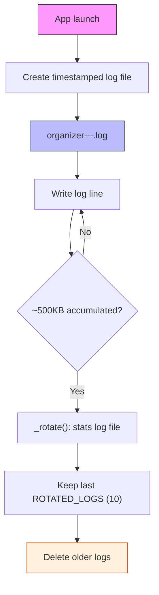

Each launch writes its own timestamped log file under `logs/` (`organizer-<VERSION>-<YYYYMMDD>-<HHMMSS>.log`), so old runs are never overwritten and a reader can tell which run produced which log. The last `ROTATED_LOGS` (10) run logs are kept; older ones are removed. Each file rotates by size (`AppLogger.MAX_BYTES` = 5 MB, keeping `.1` and `.2` rolled files).

[`core/logger.py`](core/logger.py) `AppLogger` supports a level threshold (`set_level`) and optional console output (`console=True`, used for headless CLI mode so `--extract`/`--diagnostics`/`--health` show logs on stdout). `install_excepthook()` routes uncaught exceptions through the logger instead of a default traceback. All writes are thread-locked and a failed write is swallowed so logging never kills the run.

---

## 🧪 Test logs never touch the real logs directory

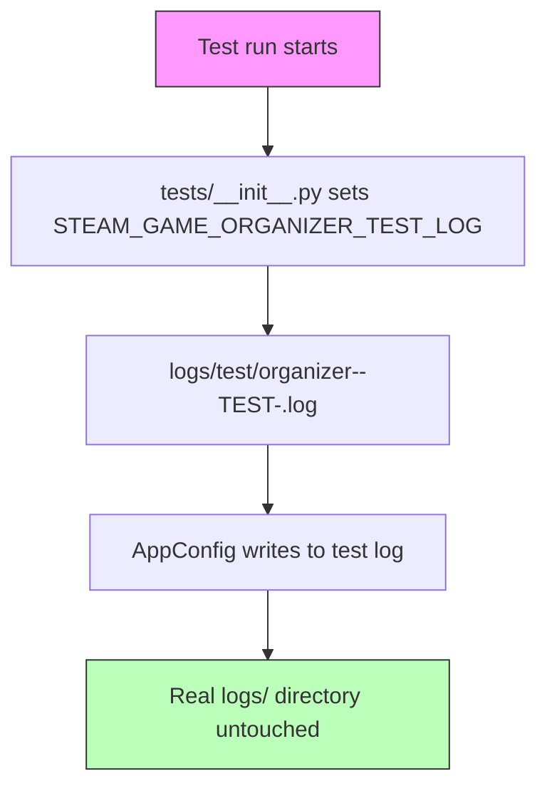

[`tests/__init__.py`](tests/__init__.py) sets `STEAM_GAME_ORGANIZER_TEST_LOG` to `<project root>/logs/test/organizer-<VERSION>-TEST-<timestamp>.log` so every `AppConfig` created during a test run writes there instead of the real `logs/` directory. Test runs never pollute the user's log history, and real runs are easy to tell apart. The env var is set with `setdefault` so an explicit export still takes precedence.

---

## 🪟 Platform

```mermaid
flowchart TD
    A[Windows 10 or later] --> B[os.startfile]
    A --> C[CREATE_NO_WINDOW]
    A --> D[7z.exe bundled in runtime/]
    B --> E[Windows-only app]
    C --> E
    D --> E
    
    subgraph "NOT supported"
    X1[Flatpak / SteamOS]
    X2[xdg-open]
    X3[xdg-mime]
    X4[/proc/meminfo]
    X5[/home/ paths]
    end
    
    style E fill:#bfb,stroke:#333,stroke-width:2px
    style X1 fill:#fcc,stroke:#c00
    style X2 fill:#fcc,stroke:#c00
    style X3 fill:#fcc,stroke:#c00
    style X4 fill:#fcc,stroke:#c00
    style X5 fill:#fcc,stroke:#c00
```

> [!IMPORTANT]
> **Windows is the only platform.** Run the suite here, where it is expected to be green:

```powershell
runtime\python.exe -m unittest discover -q
```

**Full screen only.** The app maximizes itself on start (`MainWindow._maximize()` uses `state('zoomed')`), and the user runs it full screen.

The geometry tests intentionally run at fixed non-fullscreen sizes (`1280x800`, `1100x680`) — that is how they verify the app works at `minsize()`, which is reachable. They unzoom the window first (`root.state('normal')`) because on Windows the zoomed state sticks and `geometry()` is otherwise ignored. **Do not remove those fixed sizes from the geometry tests; they are the point.** The "full screen only" rule is about production behavior, not about the geometry tests.

There is no second environment to keep green. The Flatpak/SteamOS target is gone. Anything that branches on platform should now raise or return a refusal rather than keep a second implementation.

---

## ✅ Test result

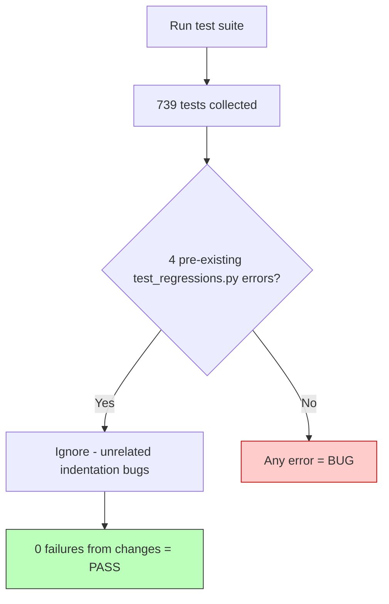

> [!IMPORTANT]
> **Expected:** `OK` with no skips. PyInstaller is installed in the bundled runtime (`runtime\Lib\site-packages`) so the frozen-build layout check runs. A skip that is *not* expected is a bug: find the dependency it cannot satisfy and make it report the condition deterministically (`_write_stub`, a patched finder, `event.widget` rather than a screen coordinate), or fail with a message naming the cause.

A missing tkinter is a broken install and [`tests/test_ui_geometry.py`](tests/test_ui_geometry.py) raises rather than skips.

---

## 🧹 Test hygiene

### A test must be able to fail

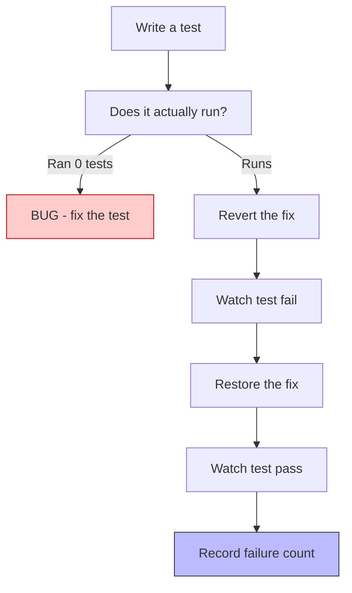

A safety net that is collected but not executed is worse than none, because it is reported as present. [`tests/test_contrast.py`](tests/test_contrast.py) was once a script with a `main()` that discovery ran zero tests from. When adding a check, confirm it actually ran — `Ran 0 tests` in a module you just wrote is a bug.

Two traps this project has hit, both of which produce *noise* rather than signal:

- A colour option that the widget never paints. Tk leaves every widget carrying `SystemButtonFace` for `highlightbackground` and `SystemDisabledText` for `disabledforeground`, and 201 of those had a highlight thickness of 0. Read `highlightthickness` before flagging a highlight, and skip state colours on a widget class that has no such state.
- A check that reads the wrong thing. Asserting on a widget's text when the value lives in a tag will never see it. `tag_names()` is where a Tk colour lives.

Assert on the parsed code (`ast`), not the file text: comments are not in the AST, which is the point. A precondition inside a test cannot hold in the condition the test describes — clearing the precondition reports a broken precondition, not a missing message. Proof is worthless if the "before" state was never observed failing; record the failure count, not just that it failed.

### Test doubles must be runnable on the host

A fake `7z` written as a shebang script with no extension is invisible to `shutil.which()` on Windows and cannot be started if found, so the lookup falls through to whatever real tool is installed and the test quietly asserts against the machine. [`tests/test_services.py:_write_stub`](tests/test_services.py) writes each stub in whatever form the platform can execute; use it rather than writing scripts directly.

### The suite must not write this project's own state

```mermaid
flowchart TD
    A[Test creates AppConfig normally] --> B[Inherits real config/, cache/, logs/]
    B --> C[MainWindow.show() writes to logs/]
    C --> D[MainWindow.scan() saves settings]
    D --> E[scan-state.json written]
    E --> F[Undo journal written]
    F --> G[ArtworkService deletes from cache/]
    G --> H[RACE on settings.json if concurrent runs]
    
    subgraph "Correct way: sandbox_app"
    SA[tests/tk_support.py:sandbox_app]
    SA --> SB[Roots AppConfig in temp tree]
    SB --> SC[Real config/ untouched]
    end
    
    style H fill:#fcc,stroke:#c00
    style SC fill:#bfb,stroke:#333
```

`AppConfig` derives every path it writes from its project root, and `Application` builds one from `Path(__file__).resolve().parents[1]` — this repository. A test that constructs either one the ordinary way inherits the developer's own `config/`, `cache/` and `logs/`, and ordinary code paths write to all of them: `MainWindow.show()` appends a line to `logs/organizer.log` on every screen change, `MainWindow.scan()` saves settings, a finished scan records `scan-state.json`, an organize run records into the undo journal, and `ArtworkService.__init__` *deletes* from the artwork cache directory it is handed.

> [!WARNING]
> That is not theoretical. Two suite runs were started at once, they raced on the real `config/settings.json`, and one of them left it holding `convert_archives: false` — which silently turns off zip/rar -> 7z conversion on the next real run. **If settings.json looks wrong after a test run, it is a test that wrote it, not OneDrive.**

Build windows and configs through [`tests/tk_support.py:sandbox_app`](tests/tk_support.py), which roots the `AppConfig` in a temporary tree. Do **not** snapshot the real files and restore them afterwards: two concurrent runs restore each other's writes, which is the defect itself rather than a fix for it.

[`tests/test_project_state_guard.py`](tests/test_project_state_guard.py) is what keeps it that way — it snapshots every file under `config/`, exercises `AppConfig`, `save()`, `remember_category()`, the scan summary, the undo journal and a real window against a temporary tree, and fails if any byte or mtime moved. Its root is a one-line seam (`PROJECT_UNDER_TEST`) precisely so it can be pointed at the real `config/` and watched failing; do that before believing a change here is safe.

---

## 🧹 Lint

```powershell
ruff check .
```

`ruff.toml` is the contract, and each ignored rule carries its reason in the file. Two things to know before reading the output:

- The `match` identifier parser bug (ruff 0.16.10) that misread statements beginning with `match` as pattern matches was cleared in 9.10 by renaming those locals to `steam_match`; `ruff.toml` documents the ignore as historical. Do not reintroduce a bare `match=` assignment expecting the six phantom reports to vanish on their own.
- E701/E702 are not selected. Semicolons are this codebase's house style; enabling them reported 2456 sites that are the style rather than a fault.

---

## 📸 Screenshots: capture, analyse, delete

Visual checks are real and useful, but a screenshot left on disk is a stale picture of a UI that has since changed. Always delete screenshots in the same step they are used. Capture, analyse, delete — never leave one for "later". There must be no `*.png` in the project root when work is finished.

The screenshot tools are Linux-only (`spectacle`, `rm`); the geometric and contrast audits run everywhere:

```powershell
runtime\python.exe tools\analyze_screenshot.py _shot_1.png   # palette + off-palette content analysis
runtime\python.exe tools\layout_audit.py                     # clipping, off-window widgets, sibling overlap
```

Run both at every window size the app permits — the minimum included, because `minsize()` makes small sizes reachable. [`tests/test_contrast.py`](tests/test_contrast.py) reports WCAG contrast ratios for every colour pair the app paints; run it after any theme change.

Hard-coded widget heights are the usual cause of off-window controls at short window heights. Prefer flexible rows with a smaller floor over fixed heights.

---

## ⏱️ Long-running commands

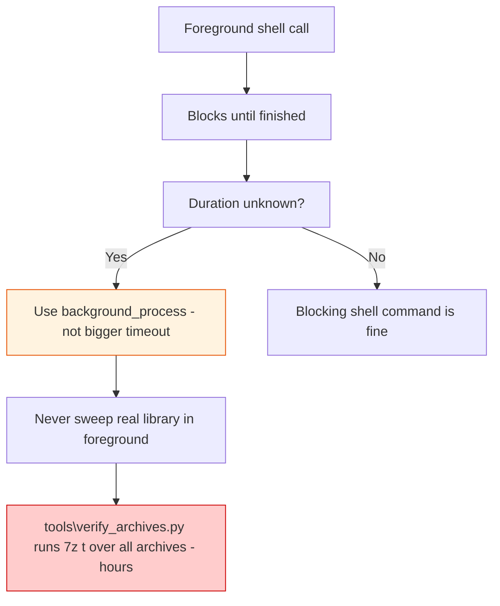

A foreground shell call blocks until it finishes. Anything whose duration is not known in advance must be a tracked background process, not a bigger timeout — a raised timeout only decides who gives up first.

> [!WARNING]
> Never sweep the real library in the foreground. The real library holds multi-gigabyte archives, and [`tools/verify_archives.py`](tools/verify_archives.py) runs `7z t` over every one of them — hours of work.

- Is this one archive intact? Pass one path.
- Does the library hold up? A background job, started deliberately.

Scope the work before starting it. The full suite is ~80s — short enough to run in the foreground deliberately, long enough to be a background job once several are queued, but not both at once, and not as one giant chained command that also does unrelated work afterwards. Keep verification separate from reporting so a completed check is visible before the next one starts.

---

## 🔄 Proving a test can fail

Every regression here is proved by reverting its fix and watching the test fail, then restoring and watching it pass. Record the failure count, not just that it failed.

---

## 🔀 Git / GitHub workflow

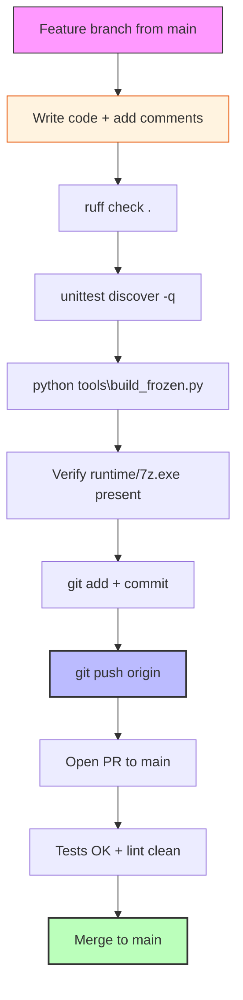

This project lives on GitHub at `https://github.com/smd3235/steam-game-organizer`. The `main` branch is the release line; work happens on feature branches and lands via pull request.

> [!IMPORTANT]
> **Update GitHub on every change.** After any file is changed, committed locally, and verified, push to GitHub so the public repository always reflects the current state. Never leave work committed locally only.

| Rule | What it means |
|------|---------------|
| **Branch before you change** | Create a branch from `main` for each body of work (`git checkout -b <name>`). Never commit directly to `main` unless it is a trivial docs-only fix. |
| **Comment on every change** | Every changed file must include a comment explaining what changed and why. |
| **Commit after every frozen rebuild** | Whenever [`python tools\build_frozen.py`](tools/build_frozen.py) completes successfully and `dist\steam_game_organizer\runtime\7z.exe` is verified present, commit the source change + the changelog entry + the rebuilt state. This gives GitHub a massive, searchable log of every build. |
| **Commit messages** | Use conventional style: `type(scope): short summary`. Types: `feat`, `fix`, `docs`, `build`, `refactor`, `test`, `chore`. Example: `build: rebuild frozen exe after archive cache changes`. |
| **Changelog with every commit** | Add a dated entry to the top of `## 9.33` in [`CHANGELOG.md`](CHANGELOG.md) at the same time as the code change. Never defer. |
| **Push regularly** | `git push origin <branch>` so your work is backed up on GitHub. Do not force-push `main`. |
| **Pull requests** | Open a PR from your branch to `main`. Tests must pass (`OK`, no skips) and lint must be clean (`ruff check .`) before merging. |
| **Do not commit build artifacts** | `runtime/`, `dist/`, `build/`, `cache/`, `logs/`, `config/`, `backup/` are excluded by `.gitignore`. Never add them. |

### Commit-after-build checklist

After any source change, in this order:

1. **Comment** — add a comment explaining the change in every modified file.
2. **Changelog** — add a dated entry under `## 9.33` (newest first).
3. **Docs** — update [`AGENTS.md`](AGENTS.md), [`ARCHITECTURE.md`](ARCHITECTURE.md), [`project_overview.md`](project_overview.md), or [`README.md`](README.md) if behavior changed.
4. **Lint** — `ruff check .` — must pass.
5. **Tests** — `runtime\python.exe -m unittest discover -q` — must report `OK` with no new skips.
6. **Build** — `python tools\build_frozen.py` — verify `dist/steam_game_organizer/runtime/7z.exe` exists.
7. **Commit + push** — `git add` the changed source, docs, and changelog; commit with a descriptive message; **push to GitHub** (`git push origin <branch>`) so the project on GitHub is updated — never leave work committed locally only.

---

## 📐 Keeping the project docs accurate

```mermaid
flowchart TD
    A[Change alters behavior / architecture / commands] --> B[Update affected doc(s)]
    B --> C[Same change as code - not later]
    C --> D[AGENTS.md - build/test/lint/run]
    C --> E[ARCHITECTURE.md - module map]
    C --> F[project_overview.md - data flow]
    C --> G[README.md - user-facing]
    
    style B fill:#f9f,stroke:#333
    style C fill:#bbf,stroke:#333
```

These four files are the project's map of itself. If a reader acts on them, they must match the code:

| File | Purpose |
|------|---------|
| [`AGENTS.md`](AGENTS.md) | How to build, test, lint, and run on Windows (the operating instructions) |
| [`ARCHITECTURE.md`](ARCHITECTURE.md) | What each module does and how they wire together (the service inventory) |
| [`project_overview.md`](project_overview.md) | What the app does, its data flow, key decisions, and the catalog page mechanics |
| [`README.md`](README.md) | User-facing run, workflow, other-PC, and development-check instructions |

> [!IMPORTANT]
> **Rule:** when a change alters behavior, architecture, commands, test counts, or the frozen build layout, update the affected doc(s) in the same change — not later. Behavior that moved from delete-to-Archive, a new service, a new CLI flag or URI handler, a changed test count, or a new tool all qualify.

> [!IMPORTANT]
> **MANDATORY — add a changelog note for every change.** [`CHANGELOG.md`](CHANGELOG.md) is the project's record of what changed and when. Every change to code, config, tools, or docs gets a dated entry under the current development version (right now `## 9.33`), formatted as:

```markdown
### YYYY-MM-DD — one-line summary of the change
```

A bullet list may follow, naming the files touched and the behavior before/after. The entry must be added in the same change as the code — not later, not from memory. Add entries to the **top** of the `## 9.33` section in chronological order (newest first). The version number only moves when a release is cut; until then everything lands under the unreleased section. If you changed it, it goes in the changelog.

---

## ✅ Definition of Done (Mandatory)

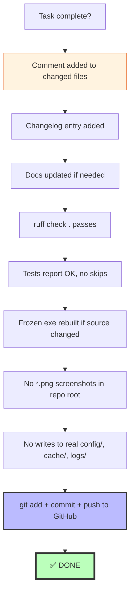

Before considering any task complete, you MUST verify:

- [ ] **Comment**: Added a comment explaining the change in every modified file.
- [ ] **Changelog**: Added a dated entry under `## 9.33` at the top of that section (newest first) in [`CHANGELOG.md`](CHANGELOG.md) describing the change.
- [ ] **Docs**: Updated [`AGENTS.md`](AGENTS.md), [`ARCHITECTURE.md`](ARCHITECTURE.md), [`project_overview.md`](project_overview.md), or [`README.md`](README.md) if behavior, architecture, commands, test counts, or frozen build layout changed.
- [ ] **Lint**: `ruff check .` passes.
- [ ] **Tests**: `runtime\python.exe -m unittest discover -q` reports `OK` with no new skips (PyInstaller test may run).
- [ ] **Build**: If any source code changed, rebuilt the exe with `python tools\build_frozen.py`.
- [ ] **Hygiene**: No `*.png` screenshots left in repo root, no writes to real `config/`, `cache/`, or `logs/` (use [`tests/tk_support.py:sandbox_app`](tests/tk_support.py) in tests).
- [ ] **GitHub**: Committed and pushed to GitHub so the public repository reflects the change.

**Quick verification after any change:** `ruff check .` passes, `runtime\python.exe -m unittest discover -q` reports `OK` (PyInstaller is installed in the bundled runtime so the frozen-build test runs), each doc still describes what the code actually does, and [`CHANGELOG.md`](CHANGELOG.md) has a new dated entry for the change.

---

## 🏷️ Comment style

- Docstrings (`"""`) state *what* a module/class/function does and its contract.
- `#` comments state *why* a specific line does something (bug, edge case, platform quirk) — inline with implementation.
- Do not convert `#` comments into docstrings; they are not interchangeable.
- Every changed file must include at least one comment explaining what changed and why.
