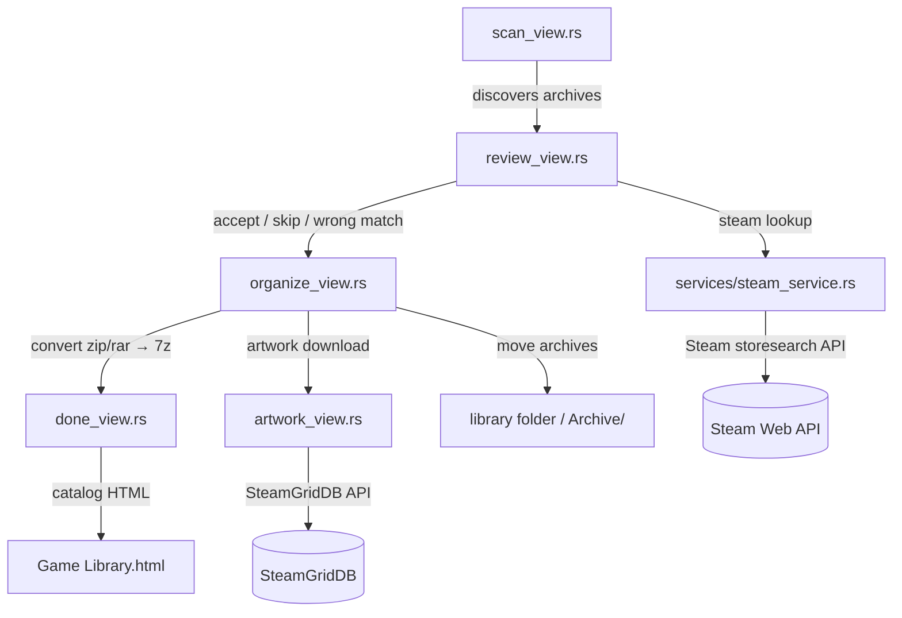
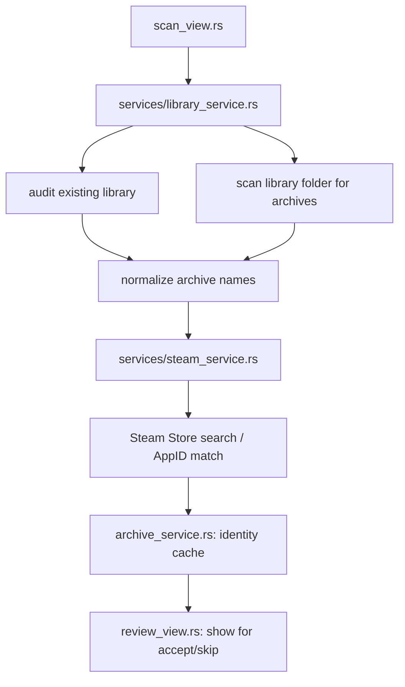
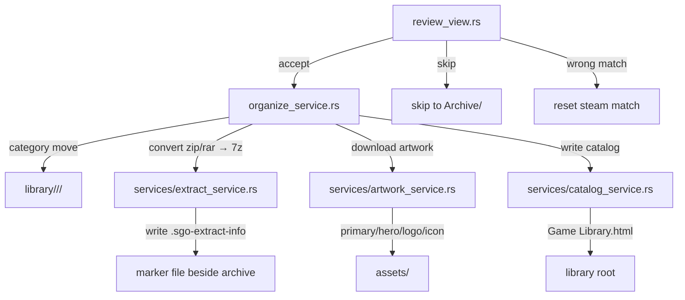
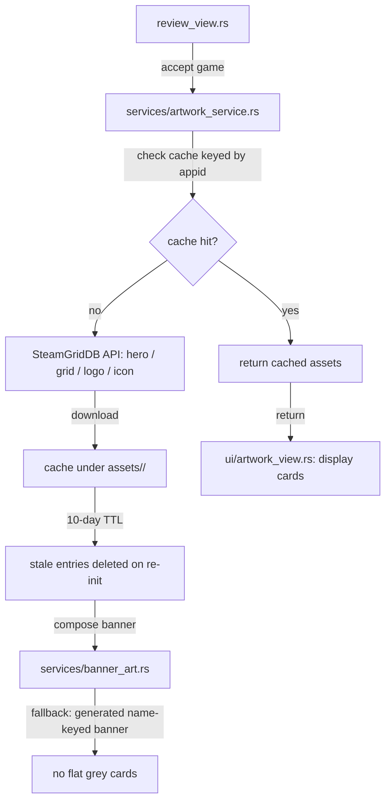
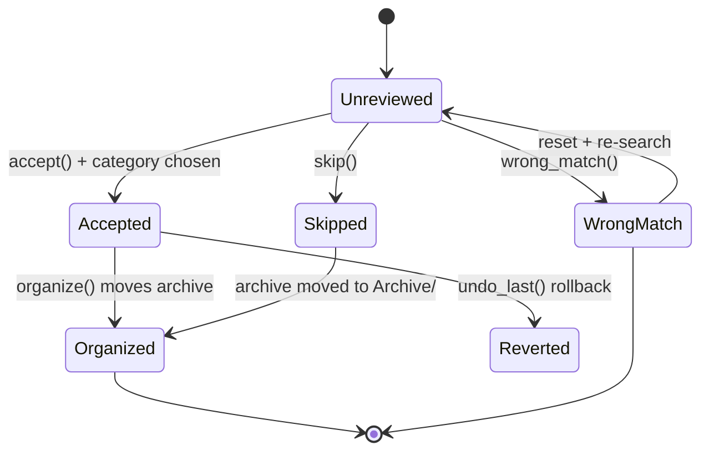
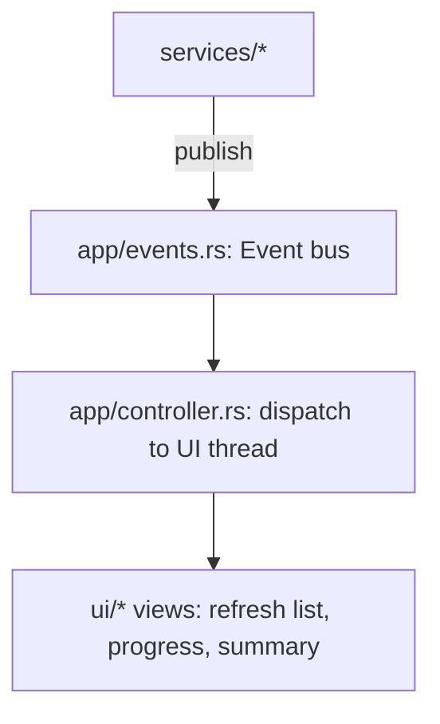

# Architecture — Steam Game Organizer

---

## 📖 Table of contents

| If you want to… | Go to section |
|-----------------|---------------|
| Read this doc first (start here) | [📖 How to use this document](#-how-to-use-this-document) |
| Find where a behavior lives | [🗺️ Layer map](#-layer-map) |
| Trace a service call through the app | [🚪 Entry point & wiring](#-entry-point--wiring) |
| Read what a specific module does | [🔧 core](#-core) · [🛠️ services](#-services) · [🖼️ ui](#-ui) · [🛠️ tools](#-tools) |
| See service interactions and safety invariants | [🔗 Service interactions](#-service-interactions) |

---

## 🗂️ Documentation map

This file is one of four project docs. If a reader acts on any of them, they must match the code — update all four together when behavior changes.

| File | Purpose | Link |
|------|---------|------|
| **AGENTS.md** | Operating manual: how to build, test, lint, run, commit, and push on Windows | [`AGENTS.md`](AGENTS.md) |
| **ARCHITECTURE.md** | Module map and service inventory: what each module does and how they wire together | [`ARCHITECTURE.md`](ARCHITECTURE.md) |
| **project_overview.md** | What the app does, its data flow, key decisions, catalog page mechanics | [`project_overview.md`](project_overview.md) |
| **README.md** | User-facing install, run, workflow, other-PC, and development-check instructions | [`README.md`](README.md) |
| **CHANGELOG.md** | Dated change log (newest first) | [`CHANGELOG.md`](CHANGELOG.md) |

**Rule:** when a change alters behavior, architecture, commands, test counts, or frozen build layout, update the affected doc(s) in the same change — not later. See [📐 Keeping Project Docs Accurate](#-keeping-project-docs-accurate) in [`AGENTS.md`](AGENTS.md).

---

## 📖 How to use this document

This file is the service inventory: what each module does and how they wire together. Read it when you need to find where a behavior lives or which services a change touches. It complements [`AGENTS.md`](AGENTS.md) (how to build, test, lint, run) and [`project_overview.md`](project_overview.md) (data flow, key decisions, catalog mechanics).

---

## ⚠️ Rules at a glance

These come from [`AGENTS.md`](AGENTS.md) and apply here too:

- **Windows only** — no POSIX paths, no `xdg-open`, `/home/`, flatpak. Anything branching on platform should raise or refuse rather than keep a second implementation.
- **Comment on every change** — every changed file must include a comment explaining what changed and why.
- **Push to GitHub on every change** — commit + verify (lint + tests + build) then push; never leave work committed locally only.
- **Changelog with every change** — add a dated entry under [`CHANGELOG.md`](CHANGELOG.md) at the same time as the code change.

---

## 🦀 Rust Conversion (complete)

This project has been converted from Python to Rust, **one file at a time**, tracked on the `Rust-Conversion` branch. All source code is now in Rust under `src/`.

| Status | Meaning |
|--------|---------|
| `rust` | File is a `.rs` module in `src/` |

Rust source lives in `src/` alongside this doc. `Cargo.toml` is at the project root. `cargo build --release` produces a self-contained `.exe` at `target/release/steam-game-organizer.exe`.

---

## 🗺️ Layer map

The app is organized in four layers. Data flows from the entry point into `app/` composition, which owns the services; services talk to `core/` for config/constants/models/URI/logging; `ui/` owns the windows; `tools/` are build/repair scripts.

| Layer | Directory | What it owns |
|-------|-----------|--------------|
| Entry point | `src/` | `src/bin.rs` — CLI flags, protocol-handler target; `src/entry.rs` — CLI dispatch logic |
| Composition / lifecycle | `src/app/` | `application.rs` (builds services, owns window), `controller.rs` (phase orchestration, journals moves), `jobs.rs` (cancellable workers), `events.rs` (progress observer) |
| Core | `src/core/` | `config.rs`, `constants.rs`, `models.rs`, `uri_actions.rs`, `logger.rs`, `state.rs`, `exceptions.rs`, `diagnostics.rs` |
| Business services | `src/services/` | `archive_service.rs`, `batch_extract_service.rs`, `catalog_service.rs`, `catalog_status.rs`, `extract_service.rs`, `installer_detect.rs`, `library_service.rs`, `organizer_service.rs`, `rollback_service.rs`, `setup_service.rs` |
| UI | `src/ui/` | `main_window.rs` (shell + nav rail), `scan_view.rs`, `review_view.rs`, `organize_view.rs`, `artwork_view.rs`, `done_view.rs`, `setup_window.rs`, `phase_timeline.rs`, `extract_result_window.rs`, `batch_extract_window.rs`, `theme.rs`, `widgets/` |
| Build / repair scripts | `tools/` | Visual audits, backup tools, misc |
| Tests | `src/*/tests/` | Inline `#[cfg(test)]` modules in each Rust module |

---

## 🚪 Entry point & wiring

`src/bin.rs` is the process entry point. It accepts these flags:

| Flag | Behavior |
|------|----------|
| `--setup` | Opens the three-folder setup wizard (library root, extract folder, app folder) |
| `--uri steamgameorganizer://...` | Parses a protocol request via `src/core/uri_actions.rs` |
| `--version` | Prints the app name |
| `--diagnostics` | Runs `src/core/diagnostics.rs` health output |
| `--health` | Health check output |
| `--mock` | Mock Steam backend (no network) |
| no flags | Launches egui `MainWindow`, maximized |

**Composition root:** `src/app/application.rs` builds all services (`catalog`, `extract`, `library`, `organizer`, `rollback`, `setup`) and owns the main window. `src/app/controller.rs` orchestrates the phases (cleanup → dedupe → cross-category duplicate sweep → discover → audit → catalog) and journals every move via `rollback_service.rs` so the whole run can be undone. Progress is published on `src/app/events.rs`; cancellable work runs through `src/app/jobs.rs`.

**Core dependency direction:** services read `src/core/config.rs` for project-root-derived paths and `src/core/constants.rs` for version/archive-extensions/categories. `src/core/uri_actions.rs` owns `SCHEME` and `SYSTEM_PATHS` (the folders a typed destination may not sit inside) and parses `steamgameorganizer://` URIs into `ExtractRequest` objects. `src/core/logger.rs` provides `AppLogger`; `src/core/state.rs` provides `StateStore`; `src/core/exceptions.rs` provides `OrganizerError` and `CancellationError`.

**Service interactions:**

| Service | Interacts with | Safety invariants |
|---------|---------------|-------------------|
| `catalog_service.rs` | `src/core/config.rs`, `src/core/constants.rs`, `services/banner_art.rs`, `services/catalog_status.rs` | `LibrarySummary` index retained so screens can ask placement questions without re-walking; `_COLLECT_CACHE` cleared on regeneration |
| `extract_service.rs` | `src/core/constants.rs`, `src/core/uri_actions.rs` | Archive integrity confirmed — no silent data loss; `.sgo-extract-info` markers written beside extracted content |
| `organizer_service.rs` | `src/core/config.rs`, `src/core/constants.rs`, `services/archive_service.rs`, `services/library_service.rs` | Never deletes — `rmtree` only a fallback when `library_root` is unknown; `_manifest_cache` keyed by `(path, size, mtime_ns)` |
| `library_service.rs` | `src/core/config.rs`, `services/artwork_service.rs`, `services/organizer_service.rs` | Whole-library audit: Steam link normalization, artwork refresh, empty-category sweep to `Archive/` |
| `rollback_service.rs` | `src/core/config.rs`, `services/organizer_service.rs` | JSON transaction journal: `last-organization.json`; restores archived files to source on Undo; ownership gating via `created_game_dir` |
| `setup_service.rs` | `src/core/config.rs`, `src/core/uri_actions.rs` | Validates three folders (library with no games, app with no entry point, extract folder inside library are refused); registers `steamgameorganizer://` under `HKCU` (registry write injectable for tests) |
| `steam_service.rs` | `src/core/constants.rs`, `src/core/uri_actions.rs` | Direct Steam Store search/details API with mock backend; `_appid_in_archive_cache` keyed by `(path, size, mtime_ns)` |
| `artwork_service.rs` | `src/core/config.rs` | Cached Steam artwork retrieval with source fallback; 10-day expiry cache; stale entries deleted on re-init |
| `banner_art.rs` | `src/core/constants.rs` | Composes the banner image; falls back to generated name-keyed banner so no card is ever a flat grey block |
| `installer_detect.rs` | `src/core/constants.rs` | Recognizes Windows installer archives (`setup.exe` + `.bin`, or mountable `.iso`) → `Needs Install` |

---

## 🔧 core

| Module | Role | Key invariants |
|--------|------|----------------|
| [`src/core/config.rs`](src/core/config.rs) | Settings, library paths, extract folders. `AppConfig.load()` auto-resolves `library_root` to the folder beside the app when the stored path does not exist — the library always lives next to the app whatever drive letter a borrowed HD gets. Every path the app writes is derived from the project root, so a test can point `AppConfig` at a temp tree instead of writing the developer's real `config/`, `cache/` and `logs/`. | Atomic writes via temp-file + `std::fs::rename` with retry on `PermissionError` for OneDrive locks |
| [`src/core/constants.rs`](src/core/constants.rs) | `USER_AGENT`, archive extensions, categories, compression and memory-threshold tables, `APP_NAME`, `ENTRY_POINT`, `NO_WINDOW`, reserved directory set. Values that appear in multiple places live here once — e.g. `DEFAULT_ZIP_PASSWORD`. | `DEFAULT_ZIP_PASSWORD` used consistently across archive/organizer/controller/test_services |
| [`src/core/models.rs`](src/core/models.rs) | Plain-data containers with no logic: `GameArchive`, `SteamMatch`, `ArtworkResult`, `ConversionResult`, `OrganizationDecision`, `ScanResult`, `AppState`. | No business logic — pure data containers |
| [`src/core/library_summary.rs`](src/core/library_summary.rs) | `LibrarySummary` frozen struct — pure-data index of what the library already looks like (categories, genre placement, developer precedent, archive sizes, total games), built from the catalog walk so screens can ask placement questions without re-walking. No I/O, no logging, no service state. | `built_at > 0` means indexed; `categories_for_genres()` and `precedent_for()` answer placement questions from retained data only |
| [`src/core/naming_utils.rs`](src/core/naming_utils.rs) | Pure naming and folder helpers extracted from `OrganizerService`: `safe_name()`, `release_label()`, `game_name()`, `asset_prefix()`, `modified_at()`, `path_promotion_key()`, `promotion_key()`, `unique_dir()`. Sanitize Windows filenames, parse Steam release dates, build game folder names, compute promotion sort keys, and find non-colliding directory names. No service state, no logging. | `safe_name()` returns "Unnamed Game" for forbidden-only input; `unique_dir()` appends `(n)` on collision; `modified_at()` returns 0 on stat failure |
| [`src/core/uri_actions.rs`](src/core/uri_actions.rs) | Parses `steamgameorganizer://` URIs into `ExtractRequest` objects (or refuses them). Owns `SCHEME` and `SYSTEM_PATHS`. Also handles `setup`, `refresh-catalog`, `open-folder`, and `open-extracted`. | Every field treated as hostile input — source must resolve inside the configured library root, must exist with an archive extension, destination must not sit inside a system folder or the library itself |
| [`src/core/logger.rs`](src/core/logger.rs) | `AppLogger` — timestamped, component-tagged logging; thread-locked; failed writes are swallowed so logging never kills the run. `install_excepthook()` routes uncaught exceptions through the logger. | One timestamped log file per launch under `logs/`; rotates by size (5 MB, keeping `.1` and `.2` rolled files); last 10 rotated logs kept |
| [`src/core/state.rs`](src/core/state.rs) | `StateStore` — thread-safe in-memory app state. | `get()` returns a clone so callers can rearrange without touching concurrent state |
| [`src/core/exceptions.rs`](src/core/exceptions.rs) | `OrganizerError`, `CancellationError`. | `CancellationError` propagates through all worker layers without being swallowed |
| [`src/core/diagnostics.rs`](src/core/diagnostics.rs) | Diagnostics and health report output. | Backs `--diagnostics` and `--health` CLI flags; prints environment info, Rust version, 7-Zip availability, runtime paths |

---

## 🛠️ services

| Module | Role | Key invariants |
|--------|------|----------------|
| [`src/services/archive_service.rs`](src/services/archive_service.rs) | Archive discovery and scan telemetry; installer sniff cached per archive identity. | Mock backend returns four deterministic archives (`Alpha Forge`, `Gamma Quest`, `Delta Realm Incremental`, `Epsilon Online`) |
| [`src/services/batch_extract_service.rs`](src/services/batch_extract_service.rs) | Plans and runs batch extractions outside the library: smallest-first sort, `(n)` collision handling, installer archives routed to `Needs Install`, skip-if-already-extracted. | Skip logic skips games already unpacked to the destination |
| [`src/services/catalog_service.rs`](src/services/catalog_service.rs) | Generates `Game Library.html` + banner art; holds embedded HTML/CSS/JS; `LibrarySummary` index; clears `_COLLECT_CACHE` on regeneration. | Single self-contained HTML file (embedded CSS + vanilla JS, no build step, no external requests) |
| [`src/services/catalog_status.rs`](src/services/catalog_status.rs) | Writes `Game Library.status.js` after every batch/run; `.sgo-extract-info` marker helpers (`read_extract_marker`, `resolve_extracted_root`, `archive_has_changed_since_extraction`, `get_launch_target`, `update_extract_marker`, `mark_setup_done`); `discover_game_launchers()` scans extracted root (max depth 3, 250 candidates) filtering non-game executables. | Launcher discovery filters installers/uninstallers/crash handlers/redistributables/helper tools; scores by depth/name/size |
| [`src/services/extract_service.rs`](src/services/extract_service.rs) | Finds the archive tool and performs extraction; writes `.sgo-extract-info`; preserves `launch_target`/`setup_done`/`installed_at` across re-extract. Collects destination files once via `rglob("*")` and reuses across installer detection and wrapper flattening. | Finds tool via `find_tool()` / `find_unrar()` — checking `PATH` then real install folders (`C:\Program Files\7-Zip`, `%ProgramFiles%\WinRAR`) |
| [`src/services/installer_detect.rs`](src/services/installer_detect.rs) | Recognizes Windows installer archives (setup.exe + .bin, or mountable .iso) → `Needs Install`. | Archives that unpack to an installer repack are routed to a `Needs Install` subfolder with an amber badge |
| [`src/services/library_service.rs`](src/services/library_service.rs) | Whole-library audit (Steam link normalization, artwork refresh); `_sweep_empty_categories()` moves empty game folders/categories to `Archive/`; `convert_pending_archives()` accepts pre-computed candidates to avoid double-walking. | Empty game folders and empty categories moved to `Archive/` rather than deleted |
| [`src/services/organizer_service.rs`](src/services/organizer_service.rs) | Category moves, collision-safe filenames, zip/rar → 7z conversion; empty source folders moved to `Archive/` not deleted; `_manifest_cache` keyed by `(path, size, mtime_ns)`. | Older copies and re-categorized leftovers go to `Archive/` (with `(n)` collision suffixes) for review before deleting |
| [`src/services/rollback_service.rs`](src/services/rollback_service.rs) | JSON transaction journal: writes/reads `last-organization.json`, restores archived files to source on Undo, prunes emptied folders this run created into `Archive/` (never deletes a folder it didn't make). | Ownership gating via `created_game_dir` — pre-existing folders belong to the user whatever they hold |
| [`src/services/setup_service.rs`](src/services/setup_service.rs) | Setup wizard checks and answers: validates the three folders (library with no games, app with no entry point, extract folder inside library are refused), saves library root + extract folder, registers `steamgameorganizer://` under `HKCU` (registry write is injectable for tests). | Registry write reads the value back afterwards to confirm the write succeeded |

---

## 🖼️ ui

| Module | Role | Key invariants |
|--------|------|----------------|
| [`src/ui/main_window.rs`](src/ui/main_window.rs) | egui application shell with top bar + view stack (scan/review/organize/artwork/done). | Maximizes itself on start — full screen only |
| [`src/ui/scan_view.rs`](src/ui/scan_view.rs) | Discover archives — shows live timeline of cleanup, dedupe, repair, discover, audit, catalog. | Hard-coded widget heights avoided — flexible rows with smaller floor |
| [`src/ui/review_view.rs`](src/ui/review_view.rs) | Accept / override / skip per detected game. | `approve_all()` only approves archives with `steam.found` — skipped archives remain in Incoming |
| [`src/ui/organize_view.rs`](src/ui/organize_view.rs) | Category moves — progress bar, stage pill, confirm bar. | Fraction calculation accounts for `stage_progress` and `archive_bytes` |
| [`src/ui/artwork_view.rs`](src/ui/artwork_view.rs) | Download artwork — per-game card with archive info and Open buttons. | Displays folder path and assets status per archive |
| [`src/ui/done_view.rs`](src/ui/done_view.rs) | Moved / failed / skipped report with Open buttons. | Offers save run report via file dialog |
| [`src/ui/setup_window.rs`](src/ui/setup_window.rs) | Three-folder setup wizard dialog; the protocol handler runs with no main window so this is the only thing that has to appear. | Prefills text boxes from `steamgameorganizer://setup` URI links |
| [`src/ui/phase_timeline.rs`](src/ui/phase_timeline.rs) | Row of stage chips showing every step of a run at once (cleanup, dedupe, repair, discover, audit, catalog). | Chips cycle pending → active → done → failed |
| [`src/ui/extract_result_window.rs`](src/ui/extract_result_window.rs) | Single-archive extraction progress dialog. | Shows progress bar, stage label, activity feed |
| [`src/ui/batch_extract_window.rs`](src/ui/batch_extract_window.rs) | Batch extraction queue window — hours of 7z needs a visible queue. | Confirm on evidence (count, archive size, destination) before starting |
| [`src/ui/theme.rs`](src/ui/theme.rs) | Palette colors + shared egui widgets (`pill`, `separator`); re-exports palette. | Theme colours reach a view only through explicit import — no star imports |
| [`src/ui/widgets/`](src/ui/widgets/) | `metadata_panel`, `game_list`, `game_card`, `category_evidence_panel`, `artwork_panel`. | Widget state (checked/unchecked, highlighted/dimmed) tracked separately from model |

Theme colours reach a view only through an explicit import. They were star-imports until 9.8, which meant every view silently depended on every colour anyone had ever added.

---

## 🛠️ tools

Development and installation scripts, not part of the application:

| Tool | Role |
|------|------|
| [`tools/`](tools/) | Build and repair scripts. `diff_backups.rs` shows differences between two backup manifests. |

---

## 🔄 Data flow diagrams

The app runs one scan → review → organize → done flow per run. These diagrams show how data moves between layers.

### Scan → Review → Organize → Done

### Scan phase internals

### Review → Organize flow

---

## 🔧 Error handling patterns

Three mechanisms exist for surfacing problems; use the right one:

| Mechanism | When to use | Where |
|-----------|-------------|-------|
| `egui` dialog / `println!` | User must see it now (missing library folder, no free space, wrong match) | `ui/review_view.rs`, `ui/organize_view.rs`, `ui/setup_window.rs` |
| `src/core/logger.rs` `AppLogger` | Background info that belongs in `logs/` (archive skipped, artwork failed, Steam lookup resolved) | All `services/` modules |
| `raise CancellationError` | User cancelled the run; unwind the worker cleanly | `app/controller.rs`, `app/jobs.rs`, `services/*` |
| `raise OrganizerError` | Unexpected but recoverable condition | `core/exceptions.rs` |

**Never** `except Exception: pass` without logging or showing something — a swallowed exception leaves the user with a silent half-done run. Log at `WARN` or show a dialog so the user knows something didn't happen.

---

## 🖼️ Artwork download flow

Artwork rules:
- **Primary**: one hero image per game
- **Additional**: grid, logo, icon, background variants
- **Cache**: keyed by Steam AppID, 10-day TTL, stale entries deleted on re-init
- **Fallback**: generated name-keyed banner so no card is ever a flat grey block

---

## 🎯 Review / accept / skip state machine

Decision rules:
- **Accept**: requires `steam.found == True`; writes category + Steam identity to `controller.remember_category()`
- **Skip**: moves archive to `Archive/` without Steam identity
- **Wrong Match**: resets `steam = SteamMatch()`, `decision.accepted = False`, `decision.skipped = False`, `category = "Unsorted"`; user re-searches

---

## 📡 Event bus pattern (`src/app/events.rs`)

Progress and state changes are published on an event bus so the UI stays in sync without direct service-to-view coupling:

Events carry: screen name, archive, steam match, artwork, stage, message. UI views subscribe via `on_progress` / `on_verified` callbacks passed from `review_view.rs` / `organize_view.rs` into `controller.verify_all()` / `controller.organize()`.

---

## 🛑 Cancellation pattern (`CancellationError`)

Cancellation is cooperative, not forceful:

1. **Job creation**: `src/app/jobs.rs:JobContext` holds an `AtomicBool` cancel flag
2. **Checkpoints**: long-running work calls `ctx.checkpoint()` which returns `Err(CancellationError)` if cancelled
3. **Propagation**: `CancellationError` bubbles up through all worker layers (`services/*`, `app/controller.rs`) without being swallowed
4. **UI response**: cancel button sets state to `"stopping"`, worker exits on next checkpoint, `done()` callback runs with cancelled status

Never `except CancellationError: pass` — it must propagate so the run stops cleanly.

---

## 🗄️ Identity & normalization rules

| Rule | Behavior |
|------|----------|
| `identity_key` | Lowercase alphanumerics only — `"Ball x Pit Risen Ballbylon"` and `"ball.x.pit.risen.ballbylon"` match |
| Release group stripping | `tenoke-`, `dodi-`, `fitgirl-`, etc. stripped from start AND end of filename |
| Edition word stripping | `Ultimate Edition:`, `Director's Cut:`, `Game of the Year` stripped from start |
| Subtitle stripping | `Game Name - Subtitle` → `Game Name` |
| Leading article | `"The "`, `"A "`, `"An "` stripped for Steam search |
| `"X, The" → "The X"` | Steam Store index order preserved |

Identity keys are used to group multi-archive games (part1.zip + part2.zip → one `identity_key`) so accepting one accepts all.

---
