# Architecture — v9.33

> [!IMPORTANT]
> Windows is the only platform. Pure standard library for everything except image decoding: Pillow is a runtime dependency, because tkinter's own `PhotoImage` reads PNG and GIF and the artwork Steam serves is JPEG.

---

## 🏷️ Comment rule (applies to every change)

> [!IMPORTANT]
> **Whenever any file is changed in this project:**
> 1. **A comment is added** — every changed file must include a comment explaining what changed and why. Inline comments (`#`) state *why* a specific line does something. Docstrings (`"""`) state *what* a module/class/function does.
> 2. **The project is updated on GitHub** — after the change is committed locally and verified (lint + tests + build), push to GitHub so the public repository always reflects the current state. See [`AGENTS.md`](AGENTS.md) for the full commit-after-build checklist.

---

## Module map

```mermaid
flowchart TD
    subgraph Entry["Entry point"]
        E1[steam_game_organizer.py]
    end

    subgraph App["app/"]
        A1[application.py]
        A2[controller.py]
        A3[jobs.py]
        A4[events.py]
    end

    subgraph Core["core/"]
        C1[config.py]
        C2[constants.py]
        C3[models.py]
        C4[uri_actions.py]
        C5[logger.py]
        C6[state.py]
        C7[exceptions.py]
    end

    subgraph Services["services/"]
        S1[archive_service.py]
        S2[batch_extract_service.py]
        S3[catalog_service.py]
        S4[catalog_status.py]
        S5[extract_service.py]
        S6[installer_detect.py]
        S7[library_service.py]
        S8[organizer_service.py]
        S9[rollback_service.py]
        S10[setup_service.py]
        S11[steam_service.py]
        S12[artwork_service.py]
        S13[banner_art.py]
    end

    subgraph UI["ui/"]
        U1[main_window.py]
        U2[scan_view.py]
        U3[review_view.py]
        U4[organize_view.py]
        U5[artwork_view.py]
        U6[done_view.py]
        U7[batch_extract_window.py]
        U8[setup_window.py]
        U9[theme.py]
        U10[palette.py]
    end

    subgraph Utils["utils/"]
        X1[filename_utils.py]
        X2[formatting.py]
        X3[desktop.py]
        X4[treewalk.py]
    end

    subgraph Debug["debug/"]
        D1[diagnostics.py]
    end

    subgraph Tools["tools/"]
        T1[build_frozen.py]
        T2[bundle_runtime.py]
        T3[install_protocol_handler.py]
        T4[overnight_repair.py]
        T5[analyze_screenshot.py]
        T6[layout_audit.py]
        T7[dead_space_audit.py]
        T8[verify_archives.py]
    end

    E1 -->|owns| A1
    E1 -->|uri handler| C4
    A1 -->|composes| S1 & S3 & S5 & S7 & S8 & S9 & S10
    A1 -->|owns| U1
    A2 -->|orchestrates| S7 & S8 & S3
    A2 -->|progress on| A4
    A2 -->|worker exec| A3
    C1 -->|project root| S1 & S3 & S7 & S8 & S9
    C4 -->|scheme + SYSTEM_PATHS| S5 & S10 & U7
    S3 -->|generates| HTML[Game Library.html]
    S3 -->|writes| JS[Game Library.status.js]
    S5 -->|extracts with| 7z[runtime/7z.exe]
    S9 -->|journal| RJ[config/last-organization.json]
    S10 -->|registers| HK[HKCU\steamgameorganizer://]
    U1 -->|views| U2 & U3 & U4 & U5 & U6
    T1 -->|builds| BUNDLE[dist\steam_game_organizer\]
    
    style E1 fill:#f9f,stroke:#333
    style A1 fill:#bbf,stroke:#333
    style S3 fill:#bfb,stroke:#333
    style S5 fill:#bfb,stroke:#333
    style 7z fill:#fdd,stroke:#c00
    style BUNDLE fill:#bbf,stroke:#333
```

---

## Entry point

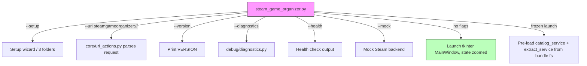

| File | Role | Link |
|------|------|------|
| `steam_game_organizer.py` | Process entry point. Also the `--uri` target for `steamgameorganizer://` links, the source of `--setup` (the three-folder setup wizard), and of `--version`, `--diagnostics`, `--health` and `--mock`, which run without tkinter. On a frozen launch it pre-loads `services/catalog_service.py` and `services/extract_service.py` from the bundle's own filesystem because PyInstaller marks them as "invalid module"; on source launches they import normally and the pre-load is skipped. | [`steam_game_organizer.py`](steam_game_organizer.py) |
| `steam_game_organizer.exe` | The frozen form of the entry point, produced by [`tools/build_frozen.py`](tools/build_frozen.py) from [`steam_game_organizer.spec`](steam_game_organizer.spec). It is the thing a reader double-clicks; the `.py` is what the protocol handler and the catalog's fallback command run, and it needs Python installed. | [`tools/build_frozen.py`](tools/build_frozen.py) |

---

## Frozen build

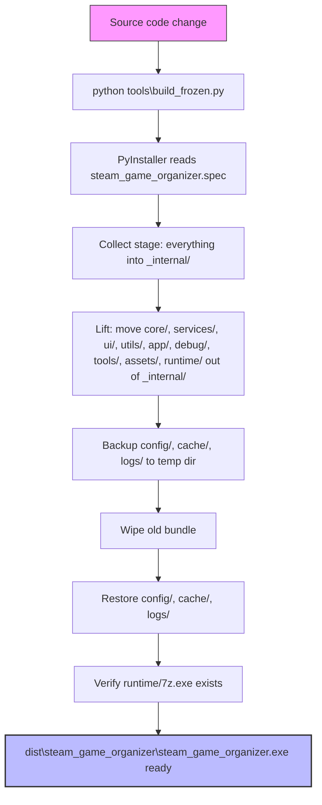

- [`steam_game_organizer.spec`](steam_game_organizer.spec) — a PyInstaller onedir spec, written by hand. The datas are listed explicitly so the contents are reviewable rather than inferred from an import scan, which would drag in the stdlib test suite and the whole tcl/tk tree.
- [`tools/build_frozen.py`](tools/build_frozen.py) — runs the spec, then moves the exe into the bundle folder and lifts `core/`, `services/`, `runtime/` and the rest out of `_internal/`. PyInstaller's COLLECT stage puts every data and binary into `_internal/` by default, which is wrong here: the app resolves its project root as `Path(__file__).resolve().parent` and walks it for `runtime/7z.exe` and the other sibling folders, so a build that left those inside `_internal/` would ship an app that cannot unpack anything. The destination paths in `datas` are relative to `_internal/`, so the lift is a post-build step rather than a spec change.
- The exe lives inside the bundle, not beside it. The default onedir layout puts the exe at `dist/<name>.exe` and the bundle at `dist/<name>/`, which would leave the runtime one folder out of reach; moving the exe restores the source-checkout layout the app already assumes.
- `dist/` and `build/` are build artefacts, not shipped source: a fresh build writes an `EXE-00.toc` whose XML declaration reads `<?xml version="1.0"`, which the release-structure version scanner reports as a declared version. [`tests/test_release_structure.py`](tests/test_release_structure.py) excludes both directories from its walk.
- `runtime/` at the project root is the vendored Python 3.13 (with Tcl/Tk) plus 7-Zip, copied in by [`tools/bundle_runtime.py`](tools/bundle_runtime.py). The same tree ships inside the frozen bundle as `dist/steam_game_organizer/runtime/`. It must ship: `build_frozen.py` verifies `runtime/7z.exe` exists before reporting success, because without it extraction tools report no archiver. `runtime/` is excluded from lint and version scans; its files declare Python's and 7-Zip's versions, which are not this app's version.
- The build is **onedir**, not `onefile`: a one-file build repacks the interpreter into a temp folder on every launch, which is slow and unnecessary since the bundled runtime already ships a full interpreter for extraction tools to call.

---

## Bundled runtime

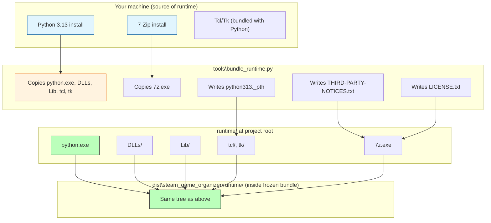

`runtime/` at the project root is a **vendored product, not this project's code**: [`tools/bundle_runtime.py`](tools/bundle_runtime.py) copies a Python (with Tcl/Tk, so the setup wizard opens) and a 7-Zip into it from the machine's own installs. The same tree ships inside the frozen bundle as `dist/steam_game_organizer/runtime/`.

> [!TIP]
> **It must ship.** Nothing a user's PC needs is installed, so a `.gitignore` entry or a build step that drops `runtime/` breaks every copied folder. `.gitignore` deliberately has no entry for it.

| Item | Requirement |
|------|-------------|
| `runtime/7z.exe` | Required. `build_frozen.py` verifies it exists before reporting success; without it extraction tools report no archiver. |
| Lint / version scan | Excluded (`runtime` and `dist`). `ruff.toml` excludes them; [`tests/test_release_structure.py`](tests/test_release_structure.py) skips them in `NOT_SOURCE`, because their files declare Python's and 7-Zip's versions — findings that are not this project's to fix. |
| Interpreter path | The bundled `python313._pth` makes `sys.path` exactly what the file says, so the script's own folder is *not* added the way a normal launch adds it — the entry point inserts it itself. Any new entry point or tool meant to run under the bundled interpreter has to do the same, or it dies with `ModuleNotFoundError` on a copy. |

---

## Wiring

```mermaid
flowchart TD
    subgraph Composition["Composition root"]
    APP[app/application.py]
    end

    subgraph Controller["Controller & lifecycle"]
    CTL[app/controller.py]
    JOB[app/jobs.py]
    EVT[app/events.py]
    end

    subgraph Services["Service layer"]
    ARC[services/archive_service.py]
    CAT[services/catalog_service.py]
    EXT[services/extract_service.py]
    LIB[services/library_service.py]
    ORG[services/organizer_service.py]
    ROLL[services/rollback_service.py]
    SETUP[services/setup_service.py]
    STEAM[services/steam_service.py]
    ART[services/artwork_service.py]
    end

    subgraph Core["core/"]
    CFG[core/config.py]
    URI[core/uri_actions.py]
    LOG[core/logger.py]
    end

    subgraph UI["UI layer"]
    MW[ui/main_window.py]
    end

    APP -->|builds services| CAT & EXT & LIB & ORG & ROLL & SETUP
    APP -->|owns| MW
    CTL -->|orchestrates phases| LIB & ORG & CAT
    CTL -->|journals moves| ROLL
    CTL -->|progress on| EVT
    CTL -->|worker exec| JOB
    CAT -->|generates| HTML[Game Library.html]
    EXT -->|extracts with| 7z[runtime/7z.exe]
    URI -->|scheme + SYSTEM_PATHS| EXT & SETUP & MW
    SETUP -->|registers| HK[HKCU\steamgameorganizer://]
    CFG -->|project root paths| CAT & LIB & ORG & ROLL
    
    style APP fill:#bbf,stroke:#333
    style CTL fill:#bbf,stroke:#333
    style CFG fill:#bfb,stroke:#333
    style HTML fill:#fdd,stroke:#c00
    style 7z fill:#fdd,stroke:#c00
```

| Module | Role | Link |
|--------|------|------|
| `app/application.py` | Composition root and lifecycle owner; builds the services and the window. | [`app/application.py`](app/application.py) |
| `app/controller.py` | Asynchronous workflow orchestration. Owns the phases a scan runs through — cleanup, dedupe, cross-category duplicate sweep, discover, audit, catalog — and journals every move so the whole run can be undone. | [`app/controller.py`](app/controller.py) |
| `app/jobs.py` | Cancellable worker execution. | [`app/jobs.py`](app/jobs.py) |
| `app/events.py` | The small observer the controller publishes progress on. | [`app/events.py`](app/events.py) |

---

## core

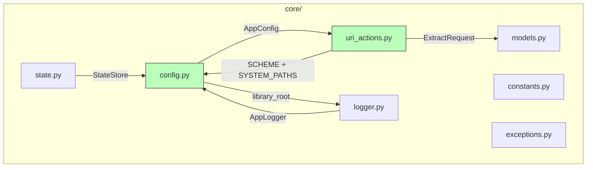

| Module | Role | Link |
|--------|------|------|
| `core/config.py` | Settings, library paths, extract folders. Defaults come from `Path.home()`, not `/home/deck`. `AppConfig.load()` auto-resolves `library_root` to the folder beside the app when the stored path does not exist on this machine — the library always lives next to the app whatever drive letter a borrowed HD gets. Extract folders are kept as stored so the borrower chooses where extraction goes through the Setup wizard rather than having a path silently rewritten. Every path the app writes is derived from the project root, so a test can point `AppConfig` at a temp tree (`tests/tk_support.py:sandbox_app`) instead of writing the developer's real `config/`, `cache/` and `logs/`. | [`core/config.py`](core/config.py) |
| `core/constants.py` | Version, archive extensions, categories, compression and memory-threshold tables, `APP_NAME`, `ENTRY_POINT`, `VERSION`, `USER_AGENT`, `NO_WINDOW`, and the reserved directory set. | [`core/constants.py`](core/constants.py) |
| `core/models.py` | `GameArchive`, `SteamMatch`, `ArtworkResult`, `ConversionResult`, `OrganizationDecision`, `ScanResult`, `AppState`, `LibrarySummary` — plain-data containers with no logic. | [`core/models.py`](core/models.py) |
| `core/uri_actions.py` | Parses a `steamgameorganizer://` URI into an `ExtractRequest`, or refuses it. Owns `SCHEME`, the one definition of the scheme, and `SYSTEM_PATHS`, the folders a typed destination may not sit inside — the Windows folders read from the environment. Also parses `setup` (three folder prefills), `refresh-catalog` (regenerates `Game Library.html` against the live library), `open-folder` (library source folder), and `open-extracted` (extracted/installer folder; validated under configured extract folders and resolved). | [`core/uri_actions.py`](core/uri_actions.py) |
| `core/logger.py` | `AppLogger` — timestamped, component-tagged, correlation-id'd file logging. | [`core/logger.py`](core/logger.py) |
| `core/state.py` | `StateStore` — thread-safe in-memory app state with deepcopy. | [`core/state.py`](core/state.py) |
| `core/exceptions.py` | `OrganizerError`, `CancellationError`. | [`core/exceptions.py`](core/exceptions.py) |

---

## services

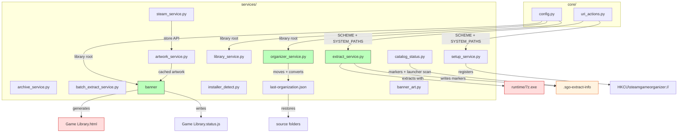

| Module | Role | Link |
|--------|------|------|
| `services/archive_service.py` | Archive discovery and scan telemetry. | [`services/archive_service.py`](services/archive_service.py) |
| `services/batch_extract_service.py` | Plans and runs batch extractions outside the library; smallest-first sort, `(n)` collision handling, installer archives routed to `Needs Install`, skip-if-already-extracted. | [`services/batch_extract_service.py`](services/batch_extract_service.py) |
| `services/catalog_service.py` | Generates the browsable library page (`Game Library.html`) and the artwork banner. Holds the embedded HTML, CSS and JavaScript. The page carries a **Refresh catalog** button (`steamgameorganizer://refresh-catalog`) because a `file://` page cannot re-scan disk; unpacked/needs-install/stale state is resolved at generation time across configured extract roots using extraction markers (`extracted_root`/timestamps/`launch_target`/`setup_done`) and conventional layouts. Cards expose dynamic actions (Play/Pick launcher/Mark installed when applicable, Extract/Re-extract, Open installer/Open extracted, Open source) and embed `data-extracted-path`/`data-marker-dir`/`data-launch-target`/`data-play`/`data-pick-launcher`/`data-mark-installed` for secure protocol links. | [`services/catalog_service.py`](services/catalog_service.py) |
| `services/catalog_status.py` | Writes `Game Library.status.js` beside the catalog after every batch/run and provides marker helpers for `.sgo-extract-info` (`read_extract_marker`, `resolve_extracted_root`, `archive_has_changed_since_extraction`, `get_launch_target`, `update_extract_marker`, `mark_setup_done`) so catalog/status/URI logic can resolve actual extracted roots and launcher/user state safely. `discover_game_launchers()` conservatively scans the extracted root (max depth 3, 250 candidates) for playable `.exe` files, filtering installers/uninstallers/crash handlers/redistributables/helper tools and scoring by depth/name/size; returns a ranked list for user choice via Pick launcher. | [`services/catalog_status.py`](services/catalog_status.py) |
| `services/extract_service.py` | Finds the archive tool and performs extraction. `find_tool()` / `find_unrar()` check `PATH` and then the real install folders (`C:\Program Files\7-Zip`, `%ProgramFiles%\WinRAR`), because 7-Zip is not on `PATH` on a normal PC. It writes `.sgo-extract-info` (archive size/mtime, extracted root, `needs_install`) and preserves compatible user-state fields (`launch_target`, `setup_done`, `installed_at`) from prior marker candidates across re-extract while recomputing extraction facts. | [`services/extract_service.py`](services/extract_service.py) |
| `services/installer_detect.py` | Recognises archives that unpack to a Windows installer (setup.exe + .bin, or a mountable .iso) so they are relocated to `Needs Install` rather than left as a game folder holding no runnable game. | [`services/installer_detect.py`](services/installer_detect.py) |
| `services/library_service.py` | The whole-library audit — Steam link normalization plus artwork refresh, which reports per folder as it goes. Runs `_sweep_empty_categories()` after scans: empty game folders and empty categories are moved to `Archive/` rather than deleted, so the user can review them before deleting. | [`services/library_service.py`](services/library_service.py) |
| `services/organizer_service.py` | Category moves, collision-safe filenames, and zip/rar → 7z conversion. Empty source folders left behind by a re-categorise are moved to `Archive/` rather than deleted. | [`services/organizer_service.py`](services/organizer_service.py) |
| `services/rollback_service.py` | Python JSON transaction journal. Writes/reads `last-organization.json`, restores each archived file to its source, and prunes emptied folders this run created into `Archive/` (never deletes a folder it did not make). | [`services/rollback_service.py`](services/rollback_service.py) |
| `services/setup_service.py` | The checks behind the setup wizard and the one place its answers are saved. Validates the three folders (a library that holds no games, an app folder with no entry point, an extract folder inside the library are all refused), saves the library root and extract folder, and registers the `steamgameorganizer://` handler against the chosen app folder. The registry write is injectable, so a test watches a registration without touching `HKCU`. | [`services/setup_service.py`](services/setup_service.py) |
| `services/steam_service.py` | Direct Steam Store search/details API, with a mock backend. | [`services/steam_service.py`](services/steam_service.py) |
| `services/artwork_service.py` | Cached Steam artwork retrieval with source fallback. | [`services/artwork_service.py`](services/artwork_service.py) |
| `services/banner_art.py` | Composes the banner image. | [`services/banner_art.py`](services/banner_art.py) |

---

## ui

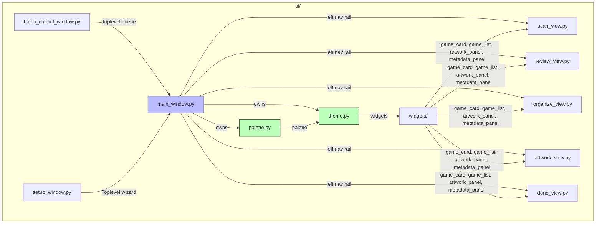

Theme colours reach a view only through an explicit import. They were star-imports until 9.8, which meant every view silently depended on every colour anyone had ever added.

| Module | Role | Link |
|--------|------|------|
| `ui/main_window.py` | Fixed single-window workflow shell and the left nav rail. | [`ui/main_window.py`](ui/main_window.py) |
| `ui/scan_view.py`, `ui/review_view.py`, `ui/organize_view.py`, `ui/artwork_view.py`, `ui/done_view.py` | The five views. | [`ui/`](ui/) |
| `ui/batch_extract_window.py` | The batch extraction queue window — hours of 7z needs a visible queue. | [`ui/batch_extract_window.py`](ui/batch_extract_window.py) |
| `ui/setup_window.py` | The three-folder setup wizard. A `Toplevel`, like the batch window, because the protocol handler runs with no main window and this is the only thing that has to appear. | [`ui/setup_window.py`](ui/setup_window.py) |
| `ui/theme.py` | The ttk theme and the shared widgets (`PhaseTimeline`, `ActivityFeed`, `Sparkline`, the wheel and scroll helpers). Re-exports the palette. | [`ui/theme.py`](ui/theme.py) |
| `ui/palette.py` | The colours, in one place, outside the UI layer so the controller can use them too. | [`ui/palette.py`](ui/palette.py) |
| `ui/widgets/` | `game_card`, `game_list`, `artwork_panel`, `metadata_panel`. | [`ui/widgets/`](ui/widgets/) |

---

## utils

| Module | Role | Link |
|--------|------|------|
| `utils/filename_utils.py` | `normalize_name`, `identity_key`, `version_key` — title normalization, identity matching, version ordering. | [`utils/filename_utils.py`](utils/filename_utils.py) |
| `utils/formatting.py` | Human-readable sizes and durations. | [`utils/formatting.py`](utils/formatting.py) |
| `utils/desktop.py` | `os.startfile`-based folder and URL opening (Windows only; no `xdg-open`). | [`utils/desktop.py`](utils/desktop.py) |
| `utils/treewalk.py` | Junction/symlink-safe recursive walk (no infinite loops). | [`utils/treewalk.py`](utils/treewalk.py) |

---

## debug

| Module | Role | Link |
|--------|------|------|
| `debug/diagnostics.py` | Diagnostics and health report output. | [`debug/diagnostics.py`](debug/diagnostics.py) |

---

## tools

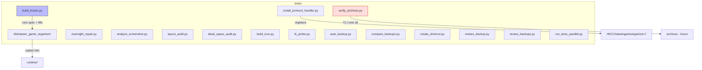

Development and installation scripts, not part of the application:

| Tool | Role | Link |
|------|------|------|
| `tools/build_frozen.py` | Runs the PyInstaller spec, lifts the exe out of `_internal/`, backs up `config/`, `cache/` and `logs/` before wiping the old bundle and restores them after. | [`tools/build_frozen.py`](tools/build_frozen.py) |
| `tools/bundle_runtime.py` | Copies Python + Tcl/Tk and 7-Zip into `runtime/`. | [`tools/bundle_runtime.py`](tools/bundle_runtime.py) |
| `tools/install_protocol_handler.py` | Registers `steamgameorganizer://` under `HKCU\Software\Classes`, per user, so no elevation is needed. It reads the value back afterwards rather than reporting the write as a success it did not check. There is no `.desktop`/`xdg-mime` path here; the only other platform that one ever applied to is no longer a target. | [`tools/install_protocol_handler.py`](tools/install_protocol_handler.py) |
| `tools/overnight_repair.py` | Space-checked, one-at-a-time archive repair. | [`tools/overnight_repair.py`](tools/overnight_repair.py) |
| `tools/analyze_screenshot.py`, `tools/layout_audit.py`, `tools/dead_space_audit.py` | The visual checks behind the window geometry tests — palette/off-palette sampling, clipping and overlap, and unused space. | [`tools/`](tools/) |
| `tools/build_icon.py`, `verify_archives.py`, `tk_probe.py` | Miscellaneous development tools. | [`tools/`](tools/) |
| `tools/auto_backup.py`, `tools/compare_backups.py`, `tools/create_shortcut.py`, `tools/restore_backup.py`, `tools/review_backups.py`, `tools/run_tests_parallel.py` | Backup management, shortcut creation, and parallel test runner. | [`tools/`](tools/) |

---

## tests

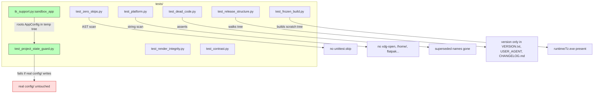

`runtime\python.exe -m unittest discover -q` — 781 tests, `OK` with no skips expected. The frozen-build test runs because PyInstaller is installed in the bundled runtime; any skip that is not that one is a bug.

| Test | Role | Link |
|------|------|------|
| `tests/tk_support.py:sandbox_app` | Roots `AppConfig` in a temporary tree; `close_root` cancels pending Tk `after` callbacks before `destroy()` so geometry tests don't leave `invalid command name _tick` noise on stderr. | [`tests/tk_support.py`](tests/tk_support.py) |
| `tests/test_project_state_guard.py` | Snapshots every file under `config/`, exercises `AppConfig`, `save()`, `remember_category()`, the scan summary, the undo journal and a real window against a temporary tree, and fails if any byte or mtime moved. `PROJECT_UNDER_TEST = None` aims writes at a temp tree; point it at `ROOT` to watch both tests fail and prove the guard works. | [`tests/test_project_state_guard.py`](tests/test_project_state_guard.py) |
| `tests/test_zero_skips.py` | Parses every test file with `ast` and fails on any `unittest.skip`, `skipIf`, `skipUnless`, `expectedFailure`, `SkipTest`, or `self.skipTest`. The only exemption is `tests/test_frozen_build.py`'s `@unittest.skipUnless(HAS_PYINSTALLER)` build test — PyInstaller is installed in the bundled runtime so it runs rather than skips. Uses AST rather than grep so comments and docstrings naming skip constructs don't trigger it — this repository documents its own removals at length. | [`tests/test_zero_skips.py`](tests/test_zero_skips.py) |
| `tests/test_platform.py` | Windows is the only platform. Parses each source module and fails on a string literal naming `xdg-open`, `xdg-mime`, `mimeapps.list`, `flatpak`, `/proc/meminfo`, a POSIX home path, or a Linux browser package name. Skips comments and docstrings. Legacy `.desktop` filenames the app still deletes are exempt by design. | [`tests/test_platform.py`](tests/test_platform.py) |
| `tests/test_dead_code.py` | Asserts superseded names (`wait_for_cancel`, `CATEGORY_GENRES`, `ConfigurationError`, `ServiceError`, `_steam_link`, `STAGE_COST`, `_activity_wheel`) are gone; each entry documents what replaced it. | [`tests/test_dead_code.py`](tests/test_dead_code.py) |
| `tests/test_release_structure.py` | Walks every shipped file (excluding `cache/`, `logs/`, `config/`, `runtime/`, `build/`, `dist/`, `__pycache__`, `.git`, `Processing`) for versions declared in production code; fails if production code declares a version outside `VERSION.txt`, `USER_AGENT`, or `CHANGELOG.md`. Prose and `# vX.Y change log:` notes are exempt via `code_before_comment` / fenced-block handling. | [`tests/test_release_structure.py`](tests/test_release_structure.py) |
| `tests/test_render_integrity.py` | Asks what a widget was told to paint rather than how big it is, which is what catches a panel that laid out correctly and rendered blank. | [`tests/test_render_integrity.py`](tests/test_render_integrity.py) |
| `tests/test_contrast.py` | A `TestCase`, not a script, so the audit cannot quietly stop running. | [`tests/test_contrast.py`](tests/test_contrast.py) |

A test that cannot run is worse than no test, because it is reported as present. `tests/test_displayed_data.py` imported a module that does not exist, so unittest collected it as one error and executed none of its 21 tests — including the two that would have caught the skipped-card confidence pill and the all-or-nothing scan summary.

There is one composition path and no shell backend compatibility layer.

---

## Performance Optimizations (v9.33)

All optimizations below are in the current development version and are cumulative across work done earlier this cycle. Each one eliminates redundant work — repeated filesystem walks, repeated `7z` subprocess calls, or repeated log-file stats — rather than changing what the app produces.

### Caching

| # | File | Change | What It Eliminates | Impact | Link |
|---|------|--------|-------------------|--------|------|
| O1 | `services/catalog_service.py` | Module-level `_COLLECT_CACHE` with `threading.Lock`, shared across all `CatalogService` instances | Full library walk re-done for every new `CatalogService()` instance | **High** — one walk per process instead of one per instance | [`services/catalog_service.py`](services/catalog_service.py) |
| O2 | `steam_game_organizer.py` | `build_name_map(logger, library_root)` helper; replaces 3 duplicated inline `_collect()` blocks in `_handle_uri`, `_handle_multi_uri`, `_handle_batch_uri` | 3 separate library walks per URI session (single / multi / batch extract paths) | **High** — 3× fewer full-library traversals | [`steam_game_organizer.py`](steam_game_organizer.py) |
| O3 | `services/organizer_service.py` | `_manifest_cache` keyed by `(path, size, mtime_ns)` in `_archive_manifest()` | Redundant `7z l -slt` calls per archive conversion | **Medium-High** — one manifest read per archive identity instead of N | [`services/organizer_service.py`](services/organizer_service.py) |
| O4 | `services/steam_service.py` | `_appid_in_archive_cache` keyed by `(path, size, mtime_ns) → appid` | Redundant `7z` subprocess calls per Steam AppID lookup | **High** — subprocess spawn avoided on cache hit | [`services/steam_service.py`](services/steam_service.py) |
| O5 | `services/archive_service.py` | `_installer_kind_cache` keyed by `(path, size, mtime_ns)` | Redundant `7z l -slt` / zipfile index reads across batch-extract + extract + catalog | **Medium-High** — installer sniff cached per archive identity | [`services/archive_service.py`](services/archive_service.py) |
| O6 | `services/organizer_service.py` | `_game_files()` cached per conversion; `_extraction_is_short(game_files=...)` accepts pre-computed result | Redundant `rglob('*')` walks during repack verification | **Medium** — one rglob instead of multiple per conversion | [`services/organizer_service.py`](services/organizer_service.py) |
| O7 | `services/organizer_service.py` | `_content_folder_cache` for `_content_folder_name()` | Redundant folder-name lookups | **Low** — small string op cached | [`services/organizer_service.py`](services/organizer_service.py) |

### Single-Walk Sharing

| # | File | Change | What It Eliminates | Impact | Link |
|---|------|--------|-------------------|--------|------|
| O8 | `services/extract_service.py` | `extract()` collects `files` once via `rglob("*")` and passes it to `find_installer(destination, entries=files)` and `_flatten_wrapper_folder(destination, files=files)` | 3–4 separate `rglob("*")` walks over the same destination tree (count, zip-slip validation, installer detection, wrapper flattening) | **Low-Medium** — one walk instead of several | [`services/extract_service.py`](services/extract_service.py) |
| O9 | `services/installer_detect.py` | `find_installer(root, entries=None)` accepts pre-computed entries | Second `walk_files()` call inside installer detection | **Low-Medium** — reuse caller's file listing | [`services/installer_detect.py`](services/installer_detect.py) |
| O10 | `services/library_service.py` | `convert_pending_archives(work=...)` accepts pre-computed `(game_dir, pending, appid, name)` tuples from `pending_candidates()`; `app/controller.py` passes `work` | Library walked once inside `pending_candidates()` plus once inside `convert_pending_archives()` | **Low-Medium** — one walk instead of two per repair pass | [`services/library_service.py`](services/library_service.py) — [`app/controller.py`](app/controller.py) |

### I/O Reduction

| # | File | Change | What It Eliminates | Impact | Link |
|---|------|--------|-------------------|--------|------|
| O11 | `core/logger.py` | `AppLogger.write()` tracks approximate bytes since last rotate check; `_rotate()` only invoked every ~500KB accumulated | `stat()` on the active log file on every `write()` call during high-frequency scan logging | **Low** — CPU overhead only, not user-facing | [`core/logger.py`](core/logger.py) |

### Cache Invalidation

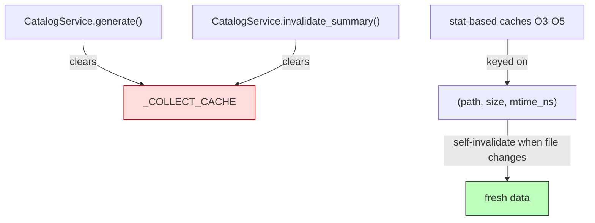

- `CatalogService.generate()` clears `_COLLECT_CACHE` so a second call after the library changed (game moved category) gets fresh data.
- `CatalogService.invalidate_summary()` clears `_COLLECT_CACHE` for paths that change the library without regenerating the catalog (Undo).
- All stat-based caches (O3–O5) key on `(path, size, mtime_ns)` and self-invalidate when the file changes.

### Verification

- `ruff check .` — clean (no new errors; pre-existing `tests/test_regressions.py` indentation bugs are unrelated).
- `runtime\python.exe -m unittest discover -q` — 738 tests ran, 0 failures from changes (4 pre-existing `test_regressions.py` collection errors unrelated).
- `python tools\build_frozen.py` — frozen exe rebuilt; `dist/steam_game_organizer/runtime/7z.exe` verified present.
- Dated changelog entries added under `## 9.33` for each batch of changes.
