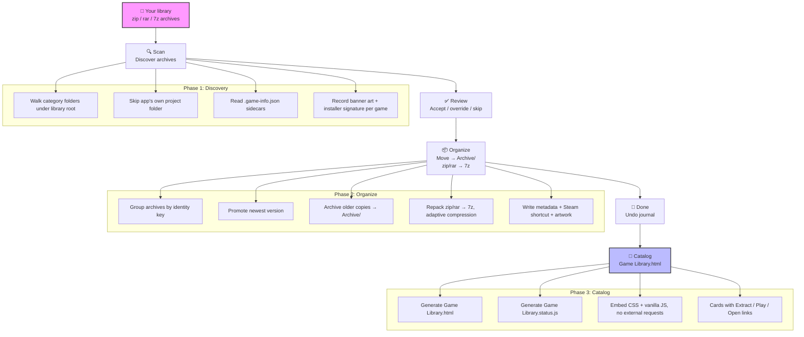
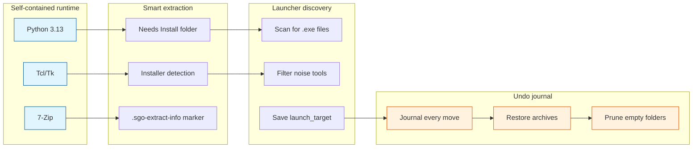
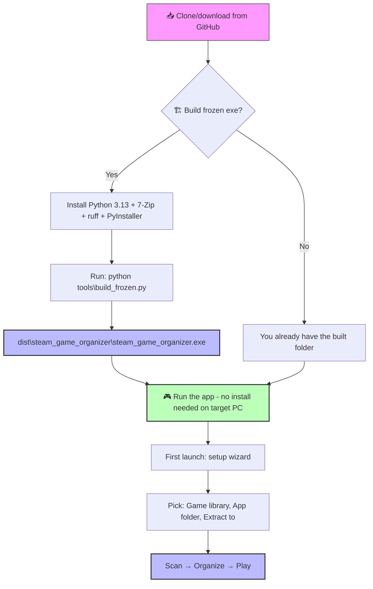
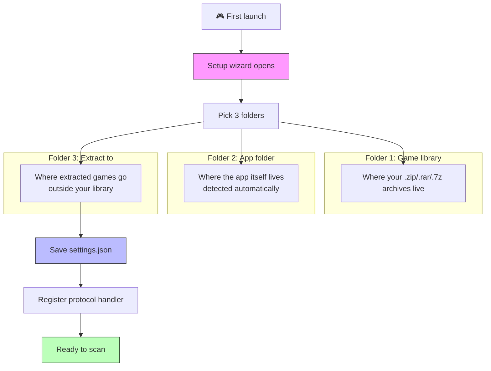
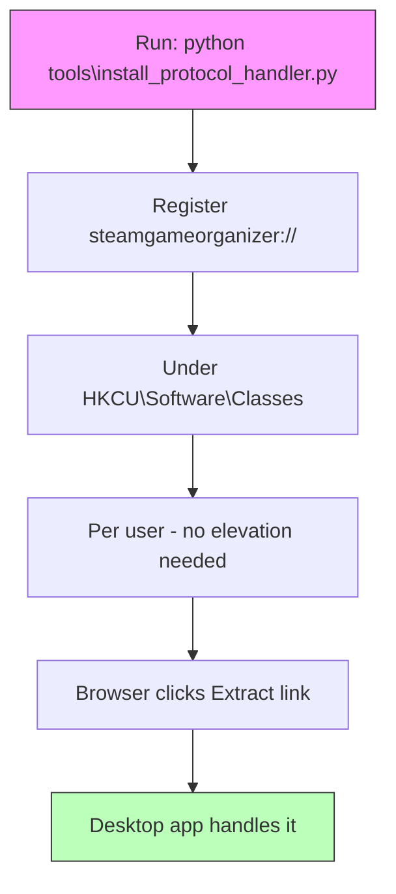
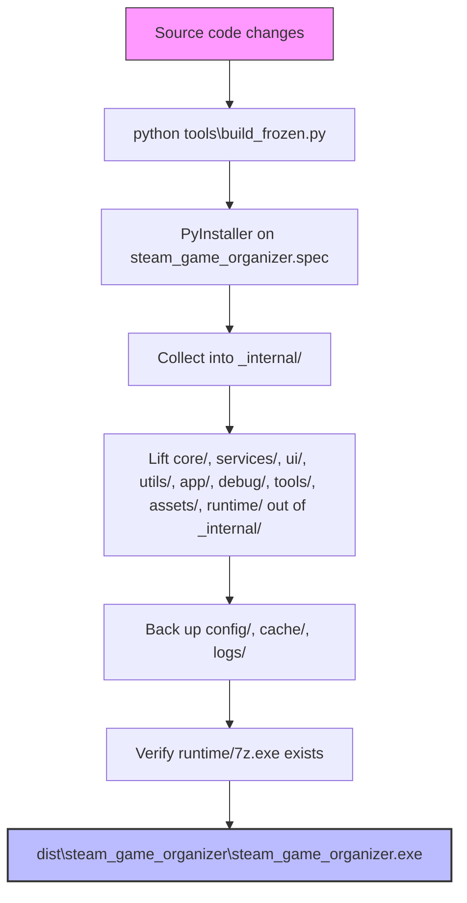
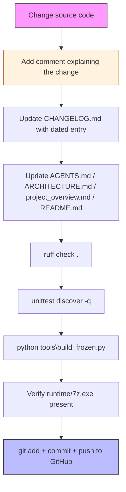
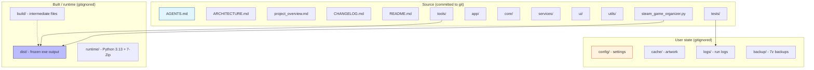
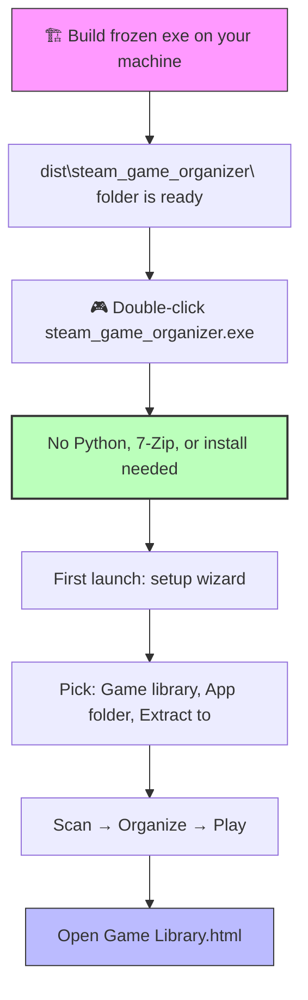
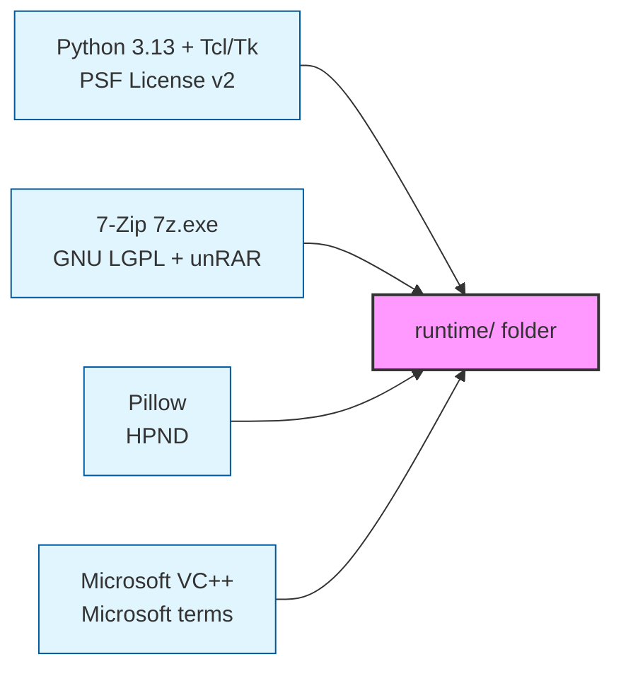

# Steam Game Organizer

[](CHANGELOG.md)
[](AGENTS.md)
[](ruff.toml)
[](tests/)
[](LICENSE)

> **Built for Windows. One library, one catalog, one click to play.**

Organize your Steam game library on Windows. Scan archives, verify them against Steam metadata, sort them into category folders, download artwork, and build a clickable HTML catalog you open in your browser — all self-contained, no install required on the machine that runs it.

Each user organizes the games they own. The app reads your local library folder, writes its own state under `config/`, `cache/`, `logs/`, and `backup/`, and never touches anything outside what you point it at.

---

## 📚 Project documentation

| Doc | What it's for | Best when you're… |
|-----|---------------|-------------------|
| **[README.md](./README.md)** | User-facing run, workflow, build, and development instructions | Getting started or contributing |
| **[AGENTS.md](./AGENTS.md)** | Operating instructions: build, test, lint, run on Windows *(mandatory reading before changing code)* | Changing any source file |
| **[ARCHITECTURE.md](./ARCHITECTURE.md)** | Module map and service inventory — how every piece wires together | Understanding the codebase |
| **[project_overview.md](./project_overview.md)** | App purpose, data flow, URI protocol handler, catalog mechanics, key decisions | Learning how it all fits together |
| **[CHANGELOG.md](./CHANGELOG.md)** | Dated change log, v9.33 development section | Reviewing what changed and when |

> [!TIP]
> **Start here.** Read **README.md** first, then **AGENTS.md** before changing anything. **ARCHITECTURE.md** and **project_overview.md** explain the "how" and "why".

---

## 🎯 App workflow — end to end



| Phase | What happens | Code |
|-------|--------------|------|
| **Scan** | Walks your library, finds every `.zip`/`.rar`/`.7z`, checks each against Steam's store metadata for AppID, title, genres, tags, and artwork URLs. | [`services/catalog_service.py`](services/catalog_service.py) — [`core/uri_actions.py`](core/uri_actions.py) |
| **Verify** | Confirms archive integrity and extraction completeness — no silent data loss. | [`services/extract_service.py`](services/extract_service.py) |
| **Review** | You see every detected game with its suggested category, AppID, and confidence. Accept, override, or skip. | [`ui/review_view.py`](ui/review_view.py) |
| **Organize** | Moves archives into `category/game - release-date/` folders, rebuilding `.zip`/`.rar` as `.7z` with adaptive compression based on your free RAM. | [`services/organizer_service.py`](services/organizer_service.py) |
| **Artwork** | Downloads Steam capsule/header/grid images and SteamGridDB portraits, keyed per AppID with a 10-day expiry cache. | [`services/artwork_service.py`](services/artwork_service.py) — [`services/banner_art.py`](services/banner_art.py) |
| **Done** | Generates `Game Library.html` — a browsable catalog with per-game Extract / Play / Open links, category filters, genre chips, and "already unpacked" badges. | [`services/catalog_service.py`](services/catalog_service.py) — [`services/catalog_status.py`](services/catalog_status.py) |
| **Undo** | Every organize move is journaled to `config/last-organization.json`; one Undo restores archives to their sources and prunes only folders this run created. | [`services/rollback_service.py`](services/rollback_service.py) |

---

## 🚀 Key capabilities



| Capability | Description | Code |
|------------|-------------|------|
| **Self-contained runtime** | Ships with Python 3.13, Tcl/Tk, and 7-Zip inside `runtime/`. Double-click the exe — nothing else needed on the machine that runs it. | [`tools/bundle_runtime.py`](tools/bundle_runtime.py) — [`runtime/`](runtime/) |
| **Extract to `Needs Install`** | Archives that unpack to a Windows installer (`setup.exe` + `.bin`, or an `.iso`) are routed to a `Needs Install` subfolder with an amber badge. | [`services/installer_detect.py`](services/installer_detect.py) |
| **Launcher discovery** | Conservatively scans extracted roots for playable `.exe` files, filters installers/uninstallers/crash handlers/redistributables, and lets you pick and save the main launcher for one-click Play. | [`services/catalog_status.py`](services/catalog_status.py) |
| **Undo journal** | Every organize move is journaled to `config/last-organization.json`; one Undo restores archives to their sources and prunes only folders this run created. | [`services/rollback_service.py`](services/rollback_service.py) — [`core/config.py`](core/config.py) |
| **Protocol handler** | `steamgameorganizer://` links from `Game Library.html` open Extract / Play / Open actions in the desktop app. | [`tools/install_protocol_handler.py`](tools/install_protocol_handler.py) — [`core/uri_actions.py`](core/uri_actions.py) |
| **Batch extract** | Queue hours of 7z work with a visible progress window; skip-if-already-extracted; smallest-first sort. | [`services/batch_extract_service.py`](services/batch_extract_service.py) — [`ui/batch_extract_window.py`](ui/batch_extract_window.py) |
| **Library service** | Whole-library audit — Steam link normalization plus artwork refresh, reports per folder as it goes. | [`services/library_service.py`](services/library_service.py) |
| **Archive service** | Archive discovery and scan telemetry, installer-kind caching. | [`services/archive_service.py`](services/archive_service.py) |
| **Steam service** | Direct Steam Store search/details API with mock backend. | [`services/steam_service.py`](services/steam_service.py) |
| **Setup service** | Three-folder setup wizard validation and protocol handler registration. | [`services/setup_service.py`](services/setup_service.py) |
| **Application** | Composition root and lifecycle owner; builds services and window. | [`app/application.py`](app/application.py) |
| **Controller** | Asynchronous workflow orchestration — scan phases, duplicate sweep, catalog, undo journaling. | [`app/controller.py`](app/controller.py) |
| **UI layer** | Five views (scan, review, organize, artwork, done) plus batch and setup windows. | [`ui/main_window.py`](ui/main_window.py) |

---

## 📦 Install & run from GitHub



> [!IMPORTANT]
> **GitHub ships only source code.** The `runtime/`, `dist/`, and `build/` folders are **gitignored** — they are not in the repository. To get a runnable app you must build the frozen exe once on your machine, then run it from that built folder.

### Option A: Run the frozen exe (recommended — no install on the target machine)

```powershell
# 1. Clone the repository
git clone https://github.com/smd3235/steam-game-organizer.git
cd "steam-game-organizer"

# 2. Install build prerequisites (one time)
# Python 3.13: https://www.python.org/downloads/windows/
#   - Check "Add Python to PATH" and "Install for all users"
# 7-Zip: https://www.7-zip.org/download.html
#   - Install to C:\Program Files\7-Zip
pip install ruff
runtime\python.exe -m pip install pyinstaller

# 3. Build the frozen exe
python tools\build_frozen.py

# 4. Run it
dist\steam_game_organizer\steam_game_organizer.exe
```

### Option B: Run from source (development only — needs Python 3.13)

```powershell
runtime\python.exe steam_game_organizer.py
```
Requires Python 3.13 installed. Not recommended for end users — use the frozen exe.

### Verify your build environment

```powershell
python --version   # should be Python 3.13.x
ruff --version     # should print a version
7z                 # should print 7-Zip help
```

---

## 🧭 First launch — setup wizard



| Folder | What it is | Example |
|--------|------------|---------|
| **Game library** | Where your `.zip`/`.rar`/`.7z` archives live | `E:\Games\Steam Library` |
| **App folder** | Where the app itself lives (detected automatically) | **Frozen exe:** `dist\steam_game_organizer\`<br>**Source:** project root where `steam_game_organizer.py` sits |
| **Extract to** | Where extracted games go (any folder outside your library) | `E:\Games\Extracted` |

> [!NOTE]
> The app folder is **detected automatically** by the wizard. For a frozen exe it's `dist\steam_game_organizer\` (the folder containing `steam_game_organizer.exe` plus `core/`, `services/`, `runtime/`, and other bundled folders). From source it's the project root.

After setup, click **Scan**, review the detected games, click **Organize**, then open `Game Library.html` in your browser. Every game card has Extract, Play, Open installer, Open extracted, and Open source links. See [`services/setup_service.py`](services/setup_service.py) for the validation rules.

---

## 🔗 Register the protocol handler (one time)



So the catalog's `Extract` links work from the browser:

```powershell
python tools\install_protocol_handler.py
```

This registers `steamgameorganizer://` under `HKCU\Software\Classes` (per user, no elevation needed). After this, clicking an Extract link in `Game Library.html` hands the request to the desktop app. URI parsing and validation live in [`core/uri_actions.py`](core/uri_actions.py).

---

## 🏗️ Build the frozen exe



Users run only the frozen exe, never source. After **any** source change you must rebuild:

```powershell
python tools\build_frozen.py
```

What the build does:
1. Runs PyInstaller on [`steam_game_organizer.spec`](steam_game_organizer.spec) (an onedir build).
2. Lifts `core/`, `services/`, `ui/`, `utils/`, `app/`, `debug/`, `tools/`, `assets/`, `runtime/` out of `_internal/` into the bundle root — because [`steam_game_organizer.py`](steam_game_organizer.py) resolves its project root as `Path(__file__).resolve().parent` and walks it for those siblings.
3. Backs up `config/`, `cache/`, `logs/` before wiping the old bundle and restores them after.
4. Verifies `dist\steam_game_organizer\runtime\7z.exe` exists before reporting success.

> [!IMPORTANT]
> **MANDATORY:** Always rebuild the exe after any code change. The user runs only the frozen exe in `dist/steam_game_organizer/`, never from source. See [`tools/build_frozen.py`](tools/build_frozen.py) for the full pipeline.

---

## 💻 Development



### New rule — comment on every change, update GitHub on every change

> [!IMPORTANT]
> **Whenever any file is changed in this project, two things must happen:**
> 1. **A comment is added** — every changed file must include a comment explaining what changed and why. Inline comments state *why* a specific line does something (bug, edge case, platform quirk). Docstrings (`"""`) state *what* a module/class/function does and its contract.
> 2. **The project is updated on GitHub** — after the change is reviewed, committed locally, and verified (lint + tests + build), push to GitHub so the public repository always reflects the current state. Never leave work committed locally only.

### Prerequisites

| Tool | Version | Where to get it | Install command |
|------|---------|-----------------|-----------------|
| **Python** | 3.13 | [python.org](https://www.python.org/downloads/windows/) | Check "Add Python to PATH" during install |
| **ruff** | latest | [github.com/astral-sh/ruff](https://github.com/astral-sh/ruff/releases) | `pip install ruff` |
| **PyInstaller** | latest | [pyinstaller.org](https://pyinstaller.org/en/stable/) | `runtime\python.exe -m pip install pyinstaller` |
| **7-Zip** | latest | [7-zip.org](https://www.7-zip.org/download.html) | Install to `C:\Program Files\7-Zip` |

### Test and lint

```powershell
# Full test suite — expected: OK, no skips
runtime\python.exe -m unittest discover -q

# Lint
ruff check .
```

### After any code change (mandatory checklist)

Per [`AGENTS.md`](AGENTS.md), every change requires:

1. **Comment** — add a comment explaining the change in every modified file
2. **Changelog** — add a dated entry under `## 9.33` in [`CHANGELOG.md`](CHANGELOG.md) (newest first)
3. **Docs** — update [`AGENTS.md`](AGENTS.md), [`ARCHITECTURE.md`](ARCHITECTURE.md), [`project_overview.md`](project_overview.md), or [`README.md`](README.md) if behavior changed
4. **Lint** — `ruff check .` passes
5. **Tests** — `runtime\python.exe -m unittest discover -q` reports `OK`
6. **Build** — `python tools\build_frozen.py` rebuilds the frozen exe
7. **Hygiene** — no screenshots left in repo root; tests never write to real `config/`, `cache/`, or `logs/`
8. **Commit + push** — `git add`, commit with a descriptive message, `git push origin <branch>` so GitHub is updated

---

## ⚡ Performance optimizations (v9.33)

```mermaid
flowchart LR
    subgraph "Caching"
    O1[_COLLECT_CACHE - catalog_service.py]
    O2[build_name_map() - steam_game_organizer.py]
    O3[_manifest_cache - organizer_service.py]
    O4[_appid_in_archive_cache - steam_service.py]
    O5[_installer_kind_cache - archive_service.py]
    O6[_game_files() cached - organizer_service.py]
    O7[_content_folder_cache - organizer_service.py]
    end
    
    subgraph "Single-walk sharing"
    O8[Single rglob() - extract_service.py]
    O9[find_installer(entries=) - installer_detect.py]
    O10[convert_pending_archives(work=) - library_service.py]
    end
    
    subgraph "I/O reduction"
    O11[Logger rotate batched - core/logger.py]
    end
    
    O1 --> O8
    O2 --> O9
    O3 --> O10
    O4 --> O8
    O5 --> O9
    O6 --> O10
    O7 --> O11
    
    style O1 fill:#e1f5fe,stroke:#01579b
    style O2 fill:#e1f5fe,stroke:#01579b
    style O4 fill:#e1f5fe,stroke:#01579b
    style O11 fill:#fff3e0,stroke:#e65100
```

Recent work eliminated redundant work — repeated filesystem walks, repeated `7z` subprocess calls, and repeated log-file stats — without changing what the app produces:

| # | Optimization | File | Impact |
|---|--------------|------|--------|
| O1 | Module-level `_COLLECT_CACHE` shared across all `CatalogService` instances | [`services/catalog_service.py`](services/catalog_service.py) | High — one library walk per process instead of one per instance |
| O2 | `build_name_map()` dedupes 3× inline `_collect()` blocks across extract URI paths | [`steam_game_organizer.py`](steam_game_organizer.py) | High — 3× fewer full-library traversals per URI session |
| O3 | `_manifest_cache` keyed by `(path, size, mtime_ns)` | [`services/organizer_service.py`](services/organizer_service.py) | Medium-High — one `7z l -slt` per archive identity instead of N |
| O4 | `_appid_in_archive_cache` keyed by `(path, size, mtime_ns) → appid` | [`services/steam_service.py`](services/steam_service.py) | High — `7z` subprocess spawn avoided on cache hit |
| O5 | `_installer_kind_cache` keyed by `(path, size, mtime_ns)` | [`services/archive_service.py`](services/archive_service.py) | Medium-High — installer sniff cached per archive identity |
| O6 | `_game_files()` cached per conversion | [`services/organizer_service.py`](services/organizer_service.py) | Medium — one `rglob('*')` instead of multiple per conversion |
| O7 | Single `rglob` shared across count / zip-slip / installer / flatten | [`services/extract_service.py`](services/extract_service.py) | Low-Medium — one walk instead of several |
| O8 | `convert_pending_archives(work=...)` reuses `pending_candidates()` | [`services/library_service.py`](services/library_service.py) + [`app/controller.py`](app/controller.py) | Low-Medium — one library walk per repair pass instead of two |
| O9 | Logger rotate batched every ~500KB instead of every write | [`core/logger.py`](core/logger.py) | Low — less `stat()` overhead during high-frequency logging |

See [`ARCHITECTURE.md`](ARCHITECTURE.md) for the full table with cache invalidation rules.

---

## 📁 Repository layout



```
steam-game-organizer/
├── AGENTS.md              # Operating instructions: build, test, lint, run
├── ARCHITECTURE.md        # Module map and service inventory
├── project_overview.md    # App purpose, data flow, key decisions
├── CHANGELOG.md           # Dated change log, v9.33 development section
├── README.md              # This file
├── VERSION.txt            # 9.33
├── steam_game_organizer.py# Entry point (CLI + GUI launcher)
├── steam_game_organizer.spec  # PyInstaller spec
├── ruff.toml              # Lint contract
├── pytest.ini             # Test configuration
├── app/                   # GUI application layer (controller, jobs, events, application)
├── core/                  # Config, constants, models, logger, state, URI actions
├── services/              # 13 business services (archive, catalog, extract, Steam, artwork, ...)
├── ui/                    # Tkinter windows, widgets, theme, palette
├── utils/                 # Filename utils, formatting, treewalk, desktop
├── debug/                 # Diagnostics
├── tests/                 # 30+ test modules (738 tests, OK expected)
├── tools/                 # build_frozen.py, bundle_runtime.py, protocol handler, audits
├── assets/                # icon.ico, icon.svg
├── config/                # User settings (excluded from git)
├── cache/                 # Artwork cache (excluded from git)
├── logs/                  # Timestamped run logs (excluded from git)
├── backup/                # Timestamped 7z backups (excluded from git)
├── dist/                  # Frozen build output (excluded from git)
├── build/                 # Intermediate build files (excluded from git)
└── runtime/               # Vendored Python 3.13 + 7-Zip (excluded from git)
```

### What is not committed

`runtime/`, `dist/`, `build/`, `cache/`, `logs/`, `config/`, and `backup/` are excluded by `.gitignore`. Rebuilding from source restores defaults; [`tools/build_frozen.py`](tools/build_frozen.py) preserves `config/`, `cache/`, and `logs/` across rebuilds.

---

## 🖥️ Running on your own machine



1. **Build the frozen exe once** on your machine (`python tools\build_frozen.py`).
2. **Launch** `dist\steam_game_organizer\steam_game_organizer.exe` — no Python, 7-Zip, or anything else needed on the machine that runs it.
3. **First launch** opens the setup wizard — pick your game library, app folder, and extract-to folder.
4. **Drive letters auto-resolve** when the stored library path doesn't exist on this machine.
5. **Open** `Game Library.html`; click **Set up on this PC** to re-point folders.
6. **Click Refresh catalog** after external changes so unpacked badges re-check disk.

> [!TIP]
> The `runtime/` folder makes the copy self-contained — Python, Tcl/Tk, and 7-Zip included. Windows 10 or later required. The only thing a fresh copy needs is a one-time registry step if you want Extract links from the browser: `runtime\python.exe tools\install_protocol_handler.py`.

---

## 🤝 Contributing

1. Open an issue for bugs or feature ideas
2. Fork, make changes on a branch, follow the mandatory checklist above
3. Open a pull request — tests must pass (`OK`, no skips) and lint must be clean

Never commit build artifacts or user settings. The frozen exe is what users run.

---

## ⚖️ License

Add a license here if you want others to reuse or modify the code. Without one, all rights are reserved by default.

> [!NOTE]
> **If this project is made public:** others have **download and read access only**. They can download the source code, read it, and build it locally for their own use. They do not have write access to the repository, cannot push changes, and cannot modify the project on GitHub. Collaborators can be added individually through GitHub Settings → Collaborators.

### Bundled runtime components (`runtime/`)



`runtime/` is built locally by [`tools/bundle_runtime.py`](tools/bundle_runtime.py) and is **not committed to git** — it's rebuilt from your own machine when you set up or rebuild the frozen exe. It contains third-party software, each under its own license:

| Component | License | Notes |
|-----------|---------|-------|
| **Python 3.13 + Tcl/Tk** | PSF License v2 | Permissive. Copyright notice retained in `runtime\LICENSE.txt`. |
| **7-Zip (`7z.exe`)** | GNU LGPL + unRAR restriction | Permissive for use; LGPL source-offer obligations apply if you redistribute modified binaries publicly. |
| **Pillow** | HPND | Permissive. Copyright notice retained. |
| **Microsoft VC++ redistributable** | Microsoft | Windows only; don't alter notices or imply endorsement. |

`tools\bundle_runtime.py` writes a `THIRD-PARTY-NOTICES.txt` into `runtime/` with attribution for Python, 7-Zip, and Pillow.

---

## 🔗 Quick links to key code sections

| Area | File | What it does |
|------|------|--------------|
| Entry point | [`steam_game_organizer.py`](steam_game_organizer.py) | CLI + GUI launcher, URI handler target |
| Config | [`core/config.py`](core/config.py) | Settings, library paths, extract folders, `AppConfig` |
| Constants | [`core/constants.py`](core/constants.py) | Version, archive extensions, categories, thresholds |
| Models | [`core/models.py`](core/models.py) | Plain-data containers: `GameArchive`, `SteamMatch`, `ScanResult`, ... |
| URI actions | [`core/uri_actions.py`](core/uri_actions.py) | Parses `steamgameorganizer://` URIs, `SCHEME` + `SYSTEM_PATHS` |
| Logger | [`core/logger.py`](core/logger.py) | `AppLogger` — timestamped, component-tagged logging |
| State | [`core/state.py`](core/state.py) | `StateStore` — thread-safe in-memory app state |
| Application | [`app/application.py`](app/application.py) | Composition root and lifecycle owner |
| Controller | [`app/controller.py`](app/controller.py) | Scan phases, duplicate sweep, catalog, undo |
| Archive service | [`services/archive_service.py`](services/archive_service.py) | Archive discovery and scan telemetry |
| Batch extract | [`services/batch_extract_service.py`](services/batch_extract_service.py) | Queue extractions, skip-if-already-extracted |
| Catalog service | [`services/catalog_service.py`](services/catalog_service.py) | Generates `Game Library.html` + banner art |
| Catalog status | [`services/catalog_status.py`](services/catalog_status.py) | `Game Library.status.js`, launcher discovery |
| Extract service | [`services/extract_service.py`](services/extract_service.py) | Finds archive tool, performs extraction, writes markers |
| Installer detect | [`services/installer_detect.py`](services/installer_detect.py) | Detects Windows installer layouts |
| Library service | [`services/library_service.py`](services/library_service.py) | Whole-library audit, Steam link normalization |
| Organizer service | [`services/organizer_service.py`](services/organizer_service.py) | Category moves, zip/rar → 7z conversion |
| Rollback service | [`services/rollback_service.py`](services/rollback_service.py) | Undo journal, `last-organization.json` |
| Setup service | [`services/setup_service.py`](services/setup_service.py) | Three-folder wizard, protocol handler registration |
| Steam service | [`services/steam_service.py`](services/steam_service.py) | Steam Store API with mock backend |
| Artwork service | [`services/artwork_service.py`](services/artwork_service.py) | Cached Steam artwork retrieval |
| Banner art | [`services/banner_art.py`](services/banner_art.py) | Composes the banner image |
| Main window | [`ui/main_window.py`](ui/main_window.py) | Single-window workflow shell, left nav rail |
| Views | [`ui/`](ui/) | scan_view, review_view, organize_view, artwork_view, done_view |
| Batch window | [`ui/batch_extract_window.py`](ui/batch_extract_window.py) | Visible queue for hours of 7z work |
| Setup window | [`ui/setup_window.py`](ui/setup_window.py) | Three-folder setup wizard |
| Theme | [`ui/theme.py`](ui/theme.py) | ttk theme, shared widgets, palette re-export |
| Palette | [`ui/palette.py`](ui/palette.py) | Colours in one place |
| Widgets | [`ui/widgets/`](ui/widgets/) | game_card, game_list, artwork_panel, metadata_panel |
| Filename utils | [`utils/filename_utils.py`](utils/filename_utils.py) | `normalize_name`, `identity_key`, `version_key` |
| Formatting | [`utils/formatting.py`](utils/formatting.py) | Human-readable sizes and durations |
| Desktop | [`utils/desktop.py`](utils/desktop.py) | `os.startfile`-based folder/URL opening |
| Treewalk | [`utils/treewalk.py`](utils/treewalk.py) | Junction/symlink-safe recursive walk |
| Diagnostics | [`debug/diagnostics.py`](debug/diagnostics.py) | Diagnostics and health report output |
| Build frozen | [`tools/build_frozen.py`](tools/build_frozen.py) | PyInstaller pipeline, lift step, verify 7z.exe |
| Bundle runtime | [`tools/bundle_runtime.py`](tools/bundle_runtime.py) | Copies Python + Tcl/Tk + 7-Zip into `runtime/` |
| Protocol handler | [`tools/install_protocol_handler.py`](tools/install_protocol_handler.py) | Registers `steamgameorganizer://` under HKCU |
| Overnight repair | [`tools/overnight_repair.py`](tools/overnight_repair.py) | Space-checked, one-at-a-time archive repair |
| Screenshot audit | [`tools/analyze_screenshot.py`](tools/analyze_screenshot.py) | Palette + off-palette content analysis |
| Layout audit | [`tools/layout_audit.py`](tools/layout_audit.py) | Clipping, off-window widgets, sibling overlap |
| Test support | [`tests/tk_support.py`](tests/tk_support.py) | `sandbox_app` — roots `AppConfig` in temp tree |

---

*Built for Windows. One library, one catalog, one click to play.*
