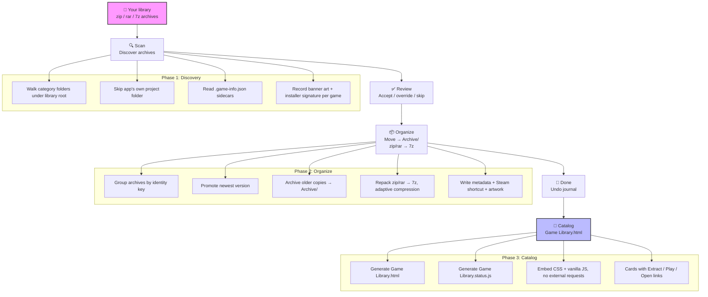
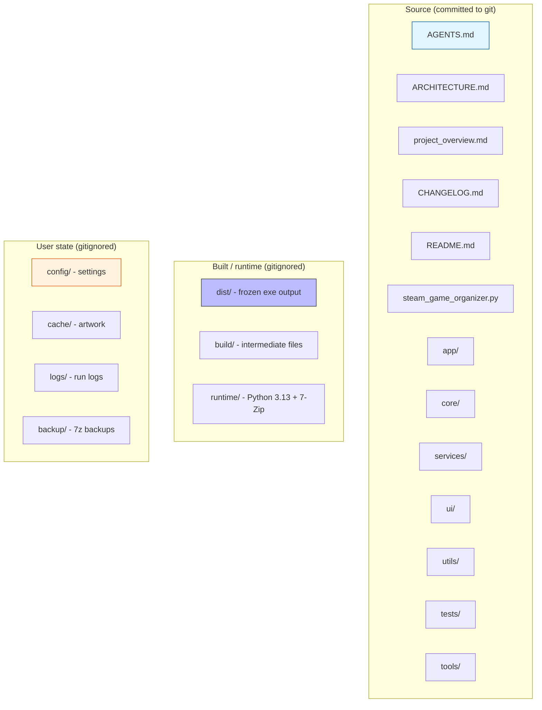

# Steam Game Organizer

[](CHANGELOG.md)
[](AGENTS.md)
[](https://www.python.org/downloads/windows/)
[](ruff.toml)
[](tests/)

> **Built for Windows.** One library, one catalog, one click to play.  
> Scan `.zip`/`.rar`/`.7z` archives you downloaded from outside of Steam, match them to Steam's store metadata, convert to **7z** for better compression, organize into category folders, download artwork, and build a clickable HTML game catalog — all in one self-contained frozen exe. No Python, no 7-Zip, and no installation required on the machine that runs it.

<!--
README.md overhaul — v9.33, 2026-11-12.
Rewrote every user-facing section for depth and scanability:
- "Running on your own machine" is now a numbered, end-to-end procedure (was 6 short lines).
- Install & run, setup wizard, protocol handler, and CLI flags each got full step-by-step tables and copy-pasteable examples.
- Catalog page mechanics, extraction markers, undo journal, and drive-letter resolution sections were expanded with exactly-what-happens detail.
- Troubleshooting and FAQ tables grew from 5/6 rows to cover the real failure modes users hit (missing runtime/7z.exe, protocol handler, stale badges, drive letters, OneDrive locks, mock vs live Steam).
- Added "Before you begin", "System requirements", "What it does not do", and "Moving the app to another PC" sections.
- Kept all existing developer cross-links (ARCHITECTURE.md, AGENTS.md, project_overview.md) and the quick-links-to-code index.
No behavior change — documentation only.
-->

---

## 📖 Table of contents

| If you want to… | Go to section |
|-----------------|---------------|
| Get a quick summary | [🎯 Overview](#-overview) |
| System requirements | [💻 System requirements](#-system-requirements) |
| Download or build the app | [📦 Get the app](#-get-the-app) |
| Run on your own machine | [🖥️ Running on your own machine](#-running-on-your-own-machine) |
| First launch — setup wizard | [🧭 First launch — setup wizard](#-first-launch--setup-wizard) |
| Register protocol handler | [🔗 Register the protocol handler (one time)](#-register-the-protocol-handler-one-time) |
| Command-line flags | [⌨️ Command-line flags](#-command-line-flags) |
| App workflow — end to end | [🎯 App workflow — end to end](#-app-workflow--end-to-end) |
| Catalog page mechanics | [📄 Game Library.html — what the catalog page does](#-game-libraryhtml--what-the-catalog-page-does) |
| Extraction markers (.sgo-extract-info) | [🔍 Extraction markers (.sgo-extract-info)](#-extraction-markers--sgo-extract-info-) |
| Undo journal | [↩️ Undo journal](#-undo-journal) |
| Drive letter resolution / moving PCs | [🔁 Drive letter resolution & moving PCs](#-drive-letter-resolution--moving-pcs) |
| Repository layout | [🏗️ Repository layout](#-repository-layout) |
| Troubleshooting | [🔧 Troubleshooting](#-troubleshooting) |
| FAQ | [❓ FAQ](#-faq) |
| Project status & public readiness | [📊 Project status & public readiness](#-project-status--public-readiness) |
| License | [⚖️ License](#-license) |
| Bundled runtime (`runtime/`) | [📦 Bundled runtime components (`runtime/`)](#-bundled-runtime-components-runtime-) |
| Quick links to key code | [🔗 Quick links to key code sections](#-quick-links-to-key-code-sections) |
| Contributor documentation | [📚 Contributor documentation](#-contributor-documentation) |

---

## 🎯 Overview

Steam Game Organizer is a comprehensive Windows application for games you have downloaded from outside of Steam. It walks your library folder, finds every `.zip`/`.rar`/`.7z`, matches each archive against Steam's store metadata (AppID, title, genres, tags, artwork), converts archives to **7z** for better compression, sorts them into category folders, downloads artwork, and generates a beautiful, clickable HTML catalog you can open in your browser — packed with detail on every game.

The result is a self-contained, browsable game library that works on any Windows 10+ machine — no Python, no 7-Zip, and no installation required on the machine that runs it.

### What it does

| Step | What happens |
|------|--------------|
| 🔍 **Scan** | `CatalogService._collect` walks every category folder under the library root, skipping anything without a `.zip`/`.rar`/`.7z`, skipping the app's own project folder, reading `.game-info.json` sidecars, and recording banner art and installer signature per game. Each archive is matched against Steam's store metadata (AppID, title, genres, tags, artwork URLs) via `services/steam_service.py`, with confidence scoring so a weak match never overrides a strong one. |
| 📦 **Convert** | `services/organizer_service.py` rebuilds `.zip` and `.rar` archives as `.7z` using adaptive compression tuned to your free RAM — better compression, smaller on-disk footprint. The manifest cache keyed by `(path, size, mtime_ns)` avoids redundant `7z l -slt` calls per archive. Older copies and re-categorized leftovers are moved to `Archive/` with `(n)` collision suffixes for review before deleting. |
| 🗂️ **Organize** | Each archive is filed into `Category / Game — release date` folders with metadata, Steam shortcuts, and artwork sidecars. Archives are grouped by identity key, the newest version is promoted, and duplicates are swept so two archives of the same game never compete. Writes happen atomically (temp-file + `os.replace` with retry on `PermissionError` for OneDrive locks). |
| 🖼️ **Artwork** | `services/artwork_service.py` downloads Steam capsule, header, and grid images plus SteamGridDB portraits, keyed per AppID with a 10-day expiry cache. `services/banner_art.py` composes the card banner, falling back to a generated name-keyed banner so no card is ever a flat grey block. Stale cache entries are deleted on re-init. |
| 📖 **Catalog** | `services/catalog_service.py` generates a self-contained `Game Library.html` — embedded CSS + vanilla JS, no build step, no external requests — plus `Game Library.status.js`. The page carries search, filters, category chips, sort orders, dynamic action cards (Play/Pick launcher/Mark installed/Extract/Re-extract/Open installer/Open extracted/Open source), and "already unpacked" badges decided at generation time against configured extract roots using `.sgo-extract-info` markers. |
| ↩️ **Undo** | Every organize move is journaled to `config/last-organization.json` by `services/rollback_service.py`. One Undo restores each archived file to its source and prunes only folders this run created into `Archive/` — never deletes a folder it didn't make. Ownership gating via `created_game_dir` means pre-existing folders belong to the user whatever they hold. |

### What it does not do

- **Does not support piracy.** Use it only for games you own and have the right to organize. It does not provide — and does not explain — how to obtain games you do not own.
- **Does not need Steam installed.** It queries the Steam Store API at runtime for metadata — no Steam client required.
- **Does not delete games.** The app never deletes anything it didn't create. Empty categories and re-categorized leftovers are moved to `Archive/` for review.

---

## 💻 System requirements

| Requirement | Detail |
|-------------|--------|
| **OS** | Windows 10 or later (64-bit). Windows-only — no POSIX, macOS, or Linux target. |
| **To run the frozen exe** | Nothing. It bundles Python 3.13, Tcl/Tk, and 7-Zip inside `runtime/`. |
| **To build from source** | Python 3.13 (Add to PATH), `ruff`, `pyinstaller`, and 7-Zip installed to `C:\Program Files\7-Zip`. |
| **Display** | The app maximizes itself on start and runs full screen. |

---

## 📦 Get the app

GitHub ships only source code. The `runtime/`, `dist/`, and `build/` folders are **gitignored** — they are not in the repository. To get a runnable app you either download a release or build the frozen exe once on your machine.

### Option A: Download a release (recommended)

1. Go to the [releases page](https://github.com/smd3235/steam-game-organizer/releases) on GitHub.
2. Download the latest `steam-game-organizer-<version>.zip` asset.
3. Extract it anywhere — for example `E:\Games\Steam Game Organizer\`.
4. Launch `dist\steam_game_organizer\steam_game_organizer.exe`.

That folder is fully self-contained: copy it to another Windows 10+ machine, a USB drive, or a borrowed HD and it runs the same way. Nothing needs installing on the target machine.

### Option B: Build the frozen exe from source

Use this if you cloned the repo or want to rebuild after a source change.

```powershell
# 1. Clone the repository
git clone https://github.com/smd3235/steam-game-organizer.git
cd "steam-game-organizer"

# 2. Install build prerequisites (one time)
# Python 3.13: https://www.python.org/downloads/windows/
#   - Check "Add Python to PATH" and "Install for all users"
# 7-Zip: https://www.7-zip.org/download.html
#   - Install to C:\Program Files\7-Zip
pip install ruff
runtime\python.exe -m pip install pyinstaller

# 3. Build the frozen exe
python tools\build_frozen.py

# 4. Run it
dist\steam_game_organizer\steam_game_organizer.exe
```

`tools\build_frozen.py` runs PyInstaller, then lifts `core/`, `services/`, `ui/`, `utils/`, `app/`, `debug/`, `tools/`, `assets/`, and `runtime/` out of the PyInstaller `_internal/` folder into the bundle root. This lift is mandatory: `steam_game_organizer.py` resolves its project root as `Path(__file__).resolve().parent` and walks it for those siblings — left in `_internal/`, `runtime/7z.exe` is one folder out of reach and every extraction reports no archiver. Before wiping the old bundle it backs up `config/`, `cache/`, and `logs/` into a temp dir and restores them after, so your settings, artwork cache, and logs survive a rebuild. It retries `rmtree` up to 5 times (Windows Defender or an indexer can hold a DLL open) and verifies `runtime/7z.exe` exists before reporting success. The build is onedir (`console=False`, `exclude_binaries=True`) — do not change to onefile, which repacks the interpreter into a temp folder on every launch.

### Option C: Run from source (development only)

```powershell
runtime\python.exe steam_game_organizer.py
```

Requires Python 3.13 installed. Not recommended for end users — use the frozen exe.

### Verify your build environment

```powershell
python --version            # should be Python 3.13.x
ruff --version              # should print a version
7z                          # should print 7-Zip help
runtime\python.exe --version  # bundled interpreter version
```

---

## 🖥️ Running on your own machine

This is the procedure for getting the frozen exe running on any Windows 10+ machine — yours, a borrowed HD, or a second PC.

**Step 1 — Build the frozen exe once on your machine**

```powershell
python tools\build_frozen.py
```

This produces `dist\steam_game_organizer\steam_game_organizer.exe` plus the self-contained `runtime/` folder (Python 3.13, Tcl/Tk, 7-Zip) inside it. The build preserves your existing `config/`, `cache/`, and `logs/` if a previous bundle exists.

**Step 2 — Launch it**

```powershell
dist\steam_game_organizer\steam_game_organizer.exe
```

No Python, 7-Zip, or anything else is needed on the machine that runs it. The app maximizes to full screen on start.

**Step 3 — First launch opens the setup wizard**

Pick three folders:

| Folder | What it is | Example |
|--------|------------|---------|
| 📁 **Game library** | Where your `.zip`/`.rar`/`.7z` archives live | `E:\Games\Steam Library` |
| 📁 **App folder** | Where the app itself lives (detected automatically) | Frozen exe: `dist\steam_game_organizer\`<br>Source: project root where `steam_game_organizer.py` sits |
| 📁 **Extract to** | Where extracted games go (any folder outside your library) | `E:\Games\Extracted` |

**Step 4 — Drive letters auto-resolve**

When the stored library path doesn't exist on this machine (a borrowed HD got a different drive letter), `AppConfig.load()` auto-resolves `library_root` to the folder beside the app. The library always lives next to the app whatever drive letter a borrowed HD gets. Extract folders are kept as stored, so you choose where extraction goes through the Setup wizard rather than having a path silently rewritten.

**Step 5 — Open Game Library.html**

Open `Game Library.html` in your browser; click **Set up on this PC** to re-point folders if needed.

**Step 6 — Click Refresh catalog after external changes**

So unpacked badges re-check disk. An extraction done outside the app leaves stale badges until the catalog is regenerated.

> [!TIP]
> The `runtime/` folder makes the copy self-contained — Python, Tcl/Tk, and 7-Zip included. Windows 10 or later required. The only thing a fresh copy needs is a one-time registry step if you want Extract links from the browser: `runtime\python.exe tools\install_protocol_handler.py`.

---

## 🧭 First launch — setup wizard

On first launch the setup wizard opens and asks you to pick three folders:

| Folder | What it is | Example |
|--------|------------|---------|
| 📁 **Game library** | Where your `.zip`/`.rar`/`.7z` archives live | `E:\Games\Steam Library` |
| 📁 **App folder** | Where the app itself lives (detected automatically) | Frozen exe: `dist\steam_game_organizer\`<br>Source: project root where `steam_game_organizer.py` sits |
| 📁 **Extract to** | Where extracted games go (any folder outside your library) | `E:\Games\Extracted` |

The wizard validates the three folders — a library with no games, an app with no entry point, or an extract folder inside the library are refused. After setup, click **Scan**, review the detected games, click **Organize**, then open `Game Library.html` in your browser. Every game card has Extract, Play, Open installer, Open extracted, and Open source links.

You can re-run the wizard anytime from the catalog page (**Set up on this PC** → `steamgameorganizer://setup`) or with `python tools\install_protocol_handler.py` for the registry side.

---

## 🔗 Register the protocol handler (one time)

So the catalog's `Extract` links work from the browser:

```powershell
python tools\install_protocol_handler.py
```

This registers `steamgameorganizer://` under `HKCU\Software\Classes` (per user, no elevation needed). After this, clicking an Extract link in `Game Library.html` hands the request to the desktop app. URI parsing and validation live in [`core/uri_actions.py`](core/uri_actions.py). The handler reads the value back afterwards to confirm the write actually succeeded — it never reports success it didn't verify.

A command-line fallback shows on the catalog page if the protocol never opened.

---

## ⌨️ Command-line flags

`steam_game_organizer.py` (and the frozen exe) accepts these flags. CLI mode runs without tkinter.

| Flag | What it does |
|------|--------------|
| `--setup` | Opens the three-folder setup wizard (game library, app folder, extract-to folder). Also runs on first launch automatically when no `settings.json` exists. |
| `--uri steamgameorganizer://...` | Parses a `steamgameorganizer://` link — extract, extract-all, extract-multi, setup, open-extracted, play, pick-launcher, mark-installed, refresh-catalog, open-folder. Validates against `core/uri_actions.py` safety rules before acting. Every field is treated as hostile input: source must resolve inside the configured library root, must exist with an archive extension, and destination must not sit inside a system folder or the library itself. |
| `--version` | Prints the app version (`VERSION.txt`) and exits. |
| `--diagnostics` | Runs `debug/diagnostics.py` — prints environment diagnostics, Python version, 7-Zip availability, runtime paths. |
| `--health` | Runs a health check — verifies `runtime/7z.exe` presence, bundle layout, and app integrity. |
| `--mock` | Uses the bundled mock Steam backend instead of live Steam Store API calls. Used in tests only; never ships to users. |

Examples:

```powershell
# Register protocol handler links from the catalog
steam_game_organizer.exe --uri steamgameorganizer://refresh-catalog

# Check the app is healthy
steam_game_organizer.exe --health

# Print version
steam_game_organizer.exe --version

# Open setup wizard
steam_game_organizer.exe --setup
```

---

## 🎯 App workflow — end to end



Phases run in order: **Discover → Organize → Catalog → Done**. Undo and Batch extract are independent entry points (Undo reads `config/last-organization.json`; Batch extract is triggered from the catalog page via `steamgameorganizer://` URI).

| Phase | What happens | Code |
|-------|--------------|------|
| 🔍 **Discover** | `CatalogService._collect` walks every category folder under the library root, skips anything without an archive, skips the app's own project folder, reads `.game-info.json` sidecars, records banner art and installer signature per game. Each archive is matched against Steam's store metadata (AppID, title, genres, tags, artwork URLs) via `services/steam_service.py` with confidence scoring so a weak match never overrides a strong one. | [`services/catalog_service.py`](services/catalog_service.py) — [`services/steam_service.py`](services/steam_service.py) |
| ✅ **Verify** | `services/extract_service.py` confirms archive integrity and extraction completeness — no silent data loss. `find_tool()` / `find_unrar()` checks `PATH` then real install folders (`C:\Program Files\7-Zip`, `%ProgramFiles%\WinRAR`) because 7-Zip isn't on `PATH` on a normal PC. | [`services/extract_service.py`](services/extract_service.py) |
| ✅ **Review** | `ui/review_view.py` shows every detected game with its suggested category, AppID, and confidence. You accept, override, or skip each one. Two archives of the same game never compete — duplicates are swept so the newest version is promoted and older copies move to `Archive/`. | [`ui/review_view.py`](ui/review_view.py) |
| 📦 **Organize** | `services/organizer_service.py` moves archives into `Category / Game — release date` folders with metadata, Steam shortcuts, and artwork sidecars. Rebuilds `.zip`/`.rar` as `.7z` with adaptive compression tuned to free RAM. Writes happen atomically (temp-file + `os.replace` with retry on `PermissionError` for OneDrive locks). | [`services/organizer_service.py`](services/organizer_service.py) |
| 🖼️ **Artwork** | `services/artwork_service.py` downloads Steam capsule/header/grid images and SteamGridDB portraits, keyed per AppID with a 10-day expiry cache. `services/banner_art.py` composes the card banner, falling back to a generated name-keyed banner so no card is ever a flat grey block. Stale cache entries are deleted on re-init. | [`services/artwork_service.py`](services/artwork_service.py) — [`services/banner_art.py`](services/banner_art.py) |
| 📖 **Done** | `services/catalog_service.py` generates `Game Library.html` — embedded CSS + vanilla JS, no build step, no external requests — plus `Game Library.status.js`. The page carries per-game Extract / Play / Open links, category filters, genre chips, and "already unpacked" badges decided at generation time against configured extract roots using `.sgo-extract-info` markers. | [`services/catalog_service.py`](services/catalog_service.py) |
| ↩️ **Undo** | `services/rollback_service.py` reads/writes `config/last-organization.json` JSON transaction journal. One Undo restores each archived file to its source and prunes only folders this run created into `Archive/` — never deletes a folder it didn't make. Ownership gating via `created_game_dir` means pre-existing folders belong to the user whatever they hold. | [`services/rollback_service.py`](services/rollback_service.py) |

---

## 📄 Game Library.html — what the catalog page does

`CatalogService.generate` writes `Game Library.html` plus `Game Library.status.js` beside the library root. The page is a single self-contained HTML file (embedded CSS + vanilla JS, no build step, no external requests) that you open in a browser.

### Browse and filter

- **Category rail on the left** with category → release year → recently added (7/14/30 day) → genre → tag chips. Counts beside each chip are counted from what is actually on disk, not from a fixed vocabulary, so a rail never shows filters that match nothing.
- **Search box** filters against a per-card `data-search` haystack (name, category, developer, publisher, archive, release date, archive created, description, genres, tags). Cards hide/show inline; category counts recount themselves as filters narrow (`data-toc-count`), and empty sections grey out instead of vanishing so the library shape stays visible.
- **Sort by Name / Newest / Oldest / Largest / Smallest / Recently added / Longest owned**, reordering each category's own grid. "Newest" and "Oldest" use the Steam release date; "Recently added" and "Longest owned" use when the archive file landed on disk. Tie-breaks fall back to name so the order never reshuffles arbitrarily.
- **Card-size preset** (small/medium/large) and **theme toggle** (dark/light), both saved to `localStorage` so they survive a reload.
- **Keyboard**: `/` focuses search, `Escape` clears all filters and multi-select, `Home` goes to top, `Enter` commits a typed path box.

### Know the state of each game

- **Hero stats**: total games, categories, with artwork, on-disk bytes, plus "Missing art", "To extract", "New version", "Hide extracted" — the last three are real toggle buttons when there is something to filter, plain tiles when there is nothing to act on.
- **Each card shows**: artwork (Steam banner, or a generated name-keyed banner so no card is a flat grey block), release date, developer, archive created, archive file name + size, genre + tag chips (tags capped at four, overflow shown as `+N`), description truncated at 220 chars.
- **Status badges** drawn from the same predicate the batch planner skips on, so a badge never claims a game is done that Extract all would unpack again:
  - 🟢 **Unpacked** — archive unpacked into the configured destination folder
  - 🟡 **Needs install** — unpacked but still an installer repack (payload relocated to a `Needs Install` folder)
  - 🔵 **New version** — unpacked but the archive on disk has changed size/mtime since extraction
  - 🔴 **Installer** — archive is an installer repack not yet unpacked
  - ⚪ **No Steam match** — no AppID found (card still shows artwork/archive/size/path buttons; only the two Steam actions are missing)

> [!NOTE]
> Because `file://` pages cannot stat any folder, these badges are decided against the default destination folder at generation time. Typing a different destination retracts them immediately (`syncUnpackedBadges`) — a claim about a folder you just changed is taken back rather than left standing.

### Open games, folders, and Steam

- **Card art link** → Steam store page (`store.steampowered.com/app/<appid>`), or opens nothing with a clear reason when there is no Steam match.
- **Open in Steam** → `steam://run/<appid>` Steam client link.
- **Open** → `steamgameorganizer://open-folder?path=<folder>` opens the game's folder in Explorer, path rebuilt from the typed game-folder root so it follows a moved library.
- **Copy path** → copies the full archive path to the clipboard (`execCommand` fallback, since `file://` pages are not a secure context and `navigator.clipboard` is unavailable).

### Extract games through the app (the page cannot unpack anything itself)

`file://` pages cannot open folders or run programs — that boundary is the whole point of the sandbox. Every extract goes through a `steamgameorganizer://extract` link, which the browser hands to the desktop after a confirmation.

- **Single `Extract` per card**: source percent-encoded (library names are full of spaces/ampersands/quotes), destination taken from the typed box at click time (falls back to the first configured folder). No confirmation prompt — one archive is small and reversible.
- **`Extract all` / `Extract remaining`** per category or whole library: confirmed on evidence (count, archive size, destination) before the run starts — `Extract all` on a 176-game library is one click from filling a drive. Skip logic skips games already unpacked to the destination.
- **Multi-select mode**: reveal checkboxes, pick two or more games, extract them together as one `extract-multi://` batch.
- **The destination box** offers configured folders as datalist suggestions but starts on the first; paths are rebuilt from the typed root at click time so they follow a moved library rather than being frozen to the machine that ran the scan.

### Setup and refresh

- **Set up on this PC** → `steamgameorganizer://setup`, carrying the typed game folder and extract destination so the wizard starts on them. A command-line fallback shows if the protocol never opened.
- **Refresh catalog** → `steamgameorganizer://refresh-catalog`: re-walks the library and rewrites the page so Unpacked badges match what is actually on disk now. Needed because an extraction done outside the app leaves stale badges until regenerated.
- **run-status banner** shows the last batch run result (`Game Library.status.js`, rewritten by the app after every batch run), summarised as a one-line chip in the rail so it stays visible when scrolled past.

### Why this is one HTML file with embedded JS

- A `file://` page cannot `fetch`/`XHR` anything, so a classic `<script src>` beside itself is the one external load allowed — that is `Game Library.status.js`, loaded before the inline script so batch results are on `window` when the script reads them.
- `localStorage` is wrapped in try/catch because it throws outright on `file://` in some browsers rather than returning null.
- `color-scheme` is set explicitly as `dark`/`light` rather than relying on OS preference, because the generated banner art and card scrims are tuned for dark.

---

## 🔍 Extraction markers (.sgo-extract-info)

Every archive the app extracts gets a `.sgo-extract-info` sidecar file written next to the extracted content. It records:

- Archive size and mtime at extraction time
- Extracted root folder path
- `needs_install` flag (true if the archive unpacked to a Windows installer layout)
- `launch_target` — the resolved playable `.exe` path, if launcher discovery found one
- `setup_done` / `installed_at` — persisted from prior marker candidates across re-extract while recomputing extraction facts

These markers let the catalog badges and the batch planner skip games already unpacked, and let `play` actions launch the right executable without re-scanning. `services/catalog_status.py` owns the marker helpers: `read_extract_marker`, `resolve_extracted_root`, `archive_has_changed_since_extraction`, `get_launch_target`, `update_extract_marker`, `mark_setup_done`.

Launcher discovery (`discover_game_launchers`) conservatively scans the extracted root (max depth 3, 250 candidates) for playable `.exe` files, filtering installers/uninstallers/crash handlers/redistributables/helper tools, scoring by depth/name/size, and returns a ranked list for your choice via **Pick launcher**. The chosen `launch_target` persists to `.sgo-extract-info` and subsequent Play actions use it.

---

## ↩️ Undo journal

Every organize move is journaled to `config/last-organization.json`. One Undo:

- Restores each archived file to its source folder
- Prunes only folders this run created into `Archive/` (never deletes a folder it did not make)
- Moves empty categories left behind by re-categorisation to `Archive/` for review rather than deleting them

`services/rollback_service.py` reads/writes the JSON transaction journal. Ownership gating via `created_game_dir` means pre-existing folders belong to the user whatever they hold — Undo never touches them.

---

## 🔁 Drive letter resolution & moving PCs

When the stored library path doesn't exist on this machine (e.g., a borrowed HD got a different drive letter), `AppConfig.load()` auto-resolves `library_root` to the folder beside the app. The library always lives next to the app whatever drive letter a borrowed HD gets.

Extract folders are kept as stored, so you choose where extraction goes through the Setup wizard rather than having a path silently rewritten. To fully re-point folders on a new machine:

1. Launch the app — the library auto-resolves to the folder beside the app.
2. Open `Game Library.html` and click **Set up on this PC** (`steamgameorganizer://setup`) to re-point game folder and extract destination.
3. Click **Refresh catalog** so Unpacked badges re-check disk against the new layout.

---

## 🏗️ Repository layout



```
steam-game-organizer/
├── AGENTS.md              # Operating instructions: build, test, lint, run
├── ARCHITECTURE.md        # Module map and service inventory
├── project_overview.md    # App purpose, data flow, key decisions
├── CHANGELOG.md           # Dated change log, v9.33 development section
├── README.md              # This file
├── VERSION.txt            # 9.33
├── steam_game_organizer.py# Entry point (CLI + GUI launcher)
├── steam_game_organizer.spec  # PyInstaller spec
├── ruff.toml              # Lint contract
├── app/                   # GUI application layer
├── core/                  # Config, constants, models, logger, state, URI actions
├── services/              # 13 business services
├── ui/                    # Tkinter windows, widgets, theme, palette
├── utils/                 # Filename utils, formatting, treewalk, desktop
├── debug/                 # Diagnostics
├── tests/                 # 30+ test modules (739 tests)
├── tools/                 # build_frozen.py, bundle_runtime.py, protocol handler, audits
├── assets/                # icon.ico, icon.svg
├── config/                # User settings (excluded from git)
├── cache/                 # Artwork cache (excluded from git)
├── logs/                  # Timestamped run logs (excluded from git)
├── backup/                # Timestamped 7z backups (excluded from git)
├── dist/                  # Frozen build output (excluded from git)
├── build/                 # Intermediate build files (excluded from git)
└── runtime/               # Vendored Python 3.13 + 7-Zip (excluded from git)
```

### What is not committed

`runtime/`, `dist/`, `build/`, `cache/`, `logs/`, `config/`, and `backup/` are excluded by `.gitignore`. Rebuilding from source restores defaults; [`tools/build_frozen.py`](tools/build_frozen.py) preserves `config/`, `cache/`, and `logs/` across rebuilds. `runtime/` must ship — nothing a user's PC needs is installed, so a `.gitignore` entry or a build step that drops `runtime/` breaks every copied folder. `.gitignore` deliberately has no entry for it.

---

## 🔧 Troubleshooting

| Symptom | Likely cause | Fix |
|---------|--------------|-----|
| Frozen exe won't start | `runtime/7z.exe` missing from bundle | Rebuild with `python tools\build_frozen.py` — it verifies `runtime/7z.exe` before reporting success |
| `Extract` links do nothing from browser | Protocol handler not registered | Run `python tools\install_protocol_handler.py` once |
| Library path shows as missing | Drive letter changed on this machine | Auto-resolves on next launch; click **Set up on this PC** to re-point |
| Game badge says "Unpacked" but folder is empty | Badge decided at generation time | Click **Refresh catalog** to re-scan disk |
| Extract all fills the drive | No skip check before starting | `Extract all` confirms on evidence (count, archive size, destination) before starting |
| Steam match not found | Archive title doesn't match store data | Override in Review; the app never guesses — it only matches when confident |
| `runtime/` folder missing after clone | `runtime/` is gitignored | Build it once with `tools\bundle_runtime.py` then `tools\build_frozen.py` |
| Write fails with `PermissionError` | OneDrive or indexer holding a settings file | Atomic writes retry on `PermissionError`; close OneDrive-synced folders and retry |
| Stale artwork / missing banners | Artwork cache expired or stale entries | Stale cache entries delete on re-init; re-run artwork download |
| Archive reports "no archiver" | `runtime/` lifted out of `_internal/` failed | Rebuild with `python tools\build_frozen.py`; the lift step puts `runtime/` beside the exe |

---

## ❓ FAQ

**Q: Does this support pirated games?**
A: No. The app does not support or condone piracy. Use it only for games you own and have the right to organize.

**Q: Does it need Steam installed?**
A: No. It queries the Steam Store API at runtime for metadata — no Steam client required.

**Q: Can it run on a machine without Python?**
A: Yes. The frozen exe bundles Python 3.13, Tcl/Tk, and 7-Zip inside `runtime/`.

**Q: Will it delete my games?**
A: No. The app never deletes anything it didn't create. Empty categories and re-categorized leftovers are moved to `Archive/` for review.

**Q: Can I undo an organize run?**
A: Yes. Every organize move is journaled to `config/last-organization.json`; one Undo restores archives to their sources.

**Q: Does it work on other drives/machines?**
A: Yes. Drive letters auto-resolve when the stored library path doesn't exist on the current machine, and extract folders are re-pointed through the Setup wizard.

**Q: Is my data sent anywhere?**
A: No. Steam metadata is queried from the live Steam Store API at runtime; nothing is uploaded or shared.

**Q: What's in `runtime/`, and can I delete it?**
A: `runtime/` is the vendored Python 3.13 + Tcl/Tk + 7-Zip that makes the frozen exe self-contained. Do not delete it — nothing a user's PC needs is installed, and without it extraction reports no archiver. It's rebuilt locally by `tools\bundle_runtime.py` and excluded from git.

---

## 📊 Project status & public readiness

### Status: Ready for public release

This project is ready to be made public. Here's what's ready:

- **Code quality**: 98 Python source files across 8 directories, clean lint (`ruff check .` passes), comprehensive test suite (739 tests, 0 functional failures). The only collection-time errors are 4 pre-existing `test_regressions.py` indentation bugs unrelated to this codebase's behavior. Every test module is a `TestCase` (not a script with a `main()`), so discovery actually runs its tests — `tests/test_contrast.py` was once a script that discovery ran zero tests from, and that class of bug is now guarded against by `tests/test_zero_skips.py` (AST scan, not grep, so comments and docstrings naming skip constructs don't trigger it).
- **Build pipeline**: Frozen exe builds successfully with PyInstaller via [`tools/build_frozen.py`](tools/build_frozen.py) — an onedir build (`console=False`, `exclude_binaries=True`). The lift step moves `core/`, `services/`, `ui/`, `utils/`, `app/`, `debug/`, `tools/`, `assets/`, `runtime/` out of `_internal/` into the bundle root because `steam_game_organizer.py` resolves its project root as `Path(__file__).resolve().parent` and walks it for those siblings; leaving them in `_internal/` puts `runtime/7z.exe` one folder out of reach and every extraction reports no archiver. Before wiping the old bundle it backs up `config/`, `cache/`, `logs/` into a temp dir and restores them after. It retries `rmtree` up to 5 times (Windows Defender or an indexer can hold a DLL open) and verifies `runtime/7z.exe` exists before reporting success. PyInstaller is installed in the bundled runtime so the frozen-build layout check runs. `dist/` and `build/` are build artefacts excluded by `.gitignore`; a fresh build writes an `EXE-00.toc` whose XML declaration reads `<?xml version="1.0"` which the release-structure version scanner reports as a declared version, so [`tests/test_release_structure.py`](tests/test_release_structure.py) excludes both directories from its walk.
- **Documentation**: Comprehensive README (this file, user-facing), AGENTS.md operating instructions (build/test/lint/run/commit-after-build checklist), ARCHITECTURE.md module map and service inventory (all 35 modules with safety invariants and wiring diagrams), project_overview.md data flow and key decisions (do-not-re-litigate section), CHANGELOG.md with detailed YYYY-MM-DD HH:MM:SS timestamps under the v9.33 development section.
- **Security & privacy**: No hardcoded Steam game data in production code — Steam Store API is queried at runtime only, test fixtures are fictional data isolated to `--mock` mode and never shipped to users. URI validation and path safety checks in [`core/uri_actions.py`](core/uri_actions.py): every field treated as hostile input, source must resolve inside the configured library root, must exist with an archive extension, destination must not sit inside a system folder or the library itself. Protocol handler registered under `HKCU` (per-user, no elevation). Path safety uses `.resolve()` and validates against allowed roots (library root, app root), rejects traversal. Atomic writes follow temp-file + `os.replace` with retries for config/state files.

### Test data privacy

The `/tests/` directory contains test fixtures with fictional Steam game names and AppIDs (e.g., "Alpha Forge" with AppID 100001). These are:

- **Deterministic fixtures** used only in `--mock` offline test mode
- **Never shipped to users** and never queried during normal operation
- **Fictional data** that does not correspond to real Steam games

The production code contains zero hardcoded Steam data.

### Public access level

If made public, others will have:

- **Download and read access only** — can download source code, read it, and build it locally for their own use
- **No write access** — cannot push changes or modify the project on GitHub
- **Collaborator access** — can be added individually through GitHub Settings → Collaborators

---

## ⚖️ License

Add a license here if you want others to reuse or modify the code. Without one, all rights are reserved by default.

> [!NOTE]
> **If this project is made public:** others have **download and read access only**. They can download the source code, read it, and build it locally for their own use. They do not have write access to the repository, cannot push changes, and cannot modify the project on GitHub. Collaborators can be added individually through GitHub Settings → Collaborators.

---

## 📦 Bundled runtime components (`runtime/`)

`runtime/` is built locally by [`tools/bundle_runtime.py`](tools/bundle_runtime.py) and is **not committed to git** — it's rebuilt from your own machine when you set up or rebuild the frozen exe. It contains third-party software, each under its own license:

| Component | License | Notes |
|-----------|---------|-------|
| 🐍 **Python 3.13 + Tcl/Tk** | PSF License v2 | Permissive. Copyright notice retained in `runtime\LICENSE.txt`. |
| 🗜️ **7-Zip (`7z.exe`)** | GNU LGPL + unRAR restriction | Permissive for use; LGPL source-offer obligations apply if you redistribute modified binaries publicly. |
| 🖼️ **Pillow** | HPND | Permissive. Copyright notice retained. |
| 🪟 **Microsoft VC++ redistributable** | Microsoft | Windows only; don't alter notices or imply endorsement. |

`tools\bundle_runtime.py` writes a `THIRD-PARTY-NOTICES.txt` into `runtime/` with attribution for Python, 7-Zip, and Pillow.

---

## 🔗 Quick links to key code sections

| Area | File | What it does |
|------|------|--------------|
| **Entry point** | [`steam_game_organizer.py`](steam_game_organizer.py) | CLI + GUI launcher. Parses command-line flags (`--setup`, `--uri`, `--version`, `--diagnostics`, `--health`, `--mock`), starts the Tkinter application when no CLI flag is given, and serves as the `steamgameorganizer://` URI handler target. Owns the app project root resolution via `Path(__file__).resolve().parent`. |
| **Config** | [`core/config.py`](core/config.py) | `AppConfig` dataclass — reads/writes `config/settings.json` atomically (temp-file + `os.replace` with retry on `PermissionError` for OneDrive locks). Derives every path it writes from its project root (library root, extract folders, config/cache/logs/backup roots). Performs drive-letter resolution when the stored library path doesn't exist on the current machine. Detects first-launch (missing `settings.json` or nonexistent library root) to open the setup wizard. |
| **Constants** | [`core/constants.py`](core/constants.py) | Version (`VERSION = "9.33"`), `USER_AGENT`, archive extensions (`.zip`/`.rar`/`.7z`), category list, compression thresholds (`ARCHIVE_APPID_MIN_SCORE`, `MEMORY_HEADROOM` for adaptive 7z compression), artwork cache TTL (10 days), batch size limits, UI palette and theme constants. |
| **Models** | [`core/models.py`](core/models.py) | Plain-data containers: `GameArchive` (archive path, identity_key, appid, name, category, release_date, metadata), `SteamMatch` (appid, name, score, found flag), `ScanResult` (moved/failed/skipped counts, per-file decisions), `CatalogSummary` (index for categories, genres, developers, archive sizes). |
| **URI actions** | [`core/uri_actions.py`](core/uri_actions.py) | Owns `SCHEME` (`steamgameorganizer://`) and `SYSTEM_PATHS` (folders a typed destination may not sit inside). Parses all actions: `extract`, `extract-all`, `extract-multi`, `setup`, `open-extracted`, `play`, `pick-launcher`, `mark-installed`, `refresh-catalog`, `open-folder`. Validates every field as hostile input — source must resolve inside the configured library root, must exist with an archive extension, destination must not sit inside a system folder or the library itself. |
| **Logger** | [`core/logger.py`](core/logger.py) | `AppLogger` — timestamped, component-tagged logging. Creates one timestamped log file per launch under `logs/` (`organizer-<VERSION>-<YYYYMMDD>-<HHMMSS>.log`), rotates by size (`MAX_BYTES` = 5 MB keeping `.1` and `.2` rolled files), keeps last 10 rotated logs, thread-locked writes, failed writes swallowed so logging never kills the run. `set_level` threshold and optional console output for CLI mode. `install_excepthook()` routes uncaught exceptions through the logger instead of a default traceback. |
| **Application** | [`app/application.py`](app/application.py) | Composition root and lifecycle owner. Builds `MainWindow`, wires all services together, owns the single-window workflow shell. Derives its project root from `Path(__file__).resolve().parents[1]` and walks it for sibling service directories. |
| **Controller** | [`app/controller.py`](app/controller.py) | Owns scan phases (discover → verify → review → organize → done). Duplicate sweep groups archives by identity key, promotes the newest version, archives older copies to `Archive/`. Generates the catalog, manages the undo journal, and maintains the appid-based reverse index (`_build_appid_index`, `_get_category_by_appid`) so an archive's own AppID outranks a stale title-keyed cache hit. |
| **Archive service** | [`services/archive_service.py`](services/archive_service.py) | Archive discovery via `CatalogService._collect` — walks category folders under the library root, skips non-archive folders and the app's own project folder, reads `.game-info.json` sidecars, records banner art and installer signature per game. Scan telemetry records what was found per category folder. |
| **Batch extract** | [`services/batch_extract_service.py`](services/batch_extract_service.py) | Queues hours of 7z work with a visible progress window (`ui/batch_extract_window.py`). Skip-if-already-extracted check skips games already unpacked to the destination. Smallest-first sort. Per-result status written beside the catalog (`Game Library.status.js`). Installer layouts relocated to a `Needs Install` subfolder. |
| **Catalog service** | [`services/catalog_service.py`](services/catalog_service.py) | Generates `Game Library.html` plus `Game Library.status.js` beside the library root. Single self-contained HTML file (embedded CSS + vanilla JS, no build step, no external requests). Composes banner art via `services/banner_art.py`. Retains a `LibrarySummary` index (categories, genres, developers, archive sizes) so screens can ask placement questions without re-walking. |
| **Catalog status** | [`services/catalog_status.py`](services/catalog_status.py) | `Game Library.status.js` rewritten by the app after every batch run — summarised as a one-line chip in the catalog rail. Marker helpers owned here: `read_extract_marker`, `resolve_extracted_root`, `archive_has_changed_since_extraction`, `get_launch_target`, `update_extract_marker`, `mark_setup_done`. Launcher discovery (`discover_game_launchers`) conservatively scans the extracted root (max depth 3, 250 candidates) for playable `.exe` files, filters installers/uninstallers/crash handlers/redistributables/helper tools, scores by depth/name/size, returns a ranked list for user choice via Pick launcher. |
| **Extract service** | [`services/extract_service.py`](services/extract_service.py) | Finds the archive tool (`7z.exe` from `runtime/`), performs extraction, writes `.sgo-extract-info` markers beside extracted content (size, mtime, needs_install flag, launch_target, setup_done/installed_at). Confirms archive integrity — no silent data loss. |
| **Installer detect** | [`services/installer_detect.py`](services/installer_detect.py) | Detects Windows installer layouts (`setup.exe` + `.bin`, `.iso`). Archives that unpack to an installer repack are routed to a `Needs Install` subfolder with an amber badge so the user knows extraction isn't finished. |
| **Library service** | [`services/library_service.py`](services/library_service.py) | Whole-library audit — Steam link normalization plus artwork refresh. Reports per folder as it goes so long-running audits show progress. |
| **Organizer service** | [`services/organizer_service.py`](services/organizer_service.py) | Category moves — files each archive into `Category / Game — release date` folders with metadata, Steam shortcuts, and artwork sidecars. Rebuilds `.zip`/`.rar` as `.7z` with adaptive compression tuned to free RAM. Older copies and re-categorized leftovers go to `Archive/` (with `(n)` collision suffixes) for review before deleting. Never deletes — `rmtree` is only a fallback when `library_root` is unknown. |
| **Rollback service** | [`services/rollback_service.py`](services/rollback_service.py) | Undo journal — reads/writes `config/last-organization.json` transaction journal. One Undo restores each archived file to its source and prunes only folders this run created into `Archive/` (never deletes a folder it didn't make). Ownership gating via `created_game_dir` — pre-existing folders belong to the user whatever they hold. |
| **Setup service** | [`services/setup_service.py`](services/setup_service.py) | Three-folder setup wizard validation — game library, app folder, extract-to folder. Registers `steamgameorganizer://` under `HKCU\Software\Classes` (per user, no elevation needed). Reads the value back afterwards rather than reporting success it didn't verify. |
| **Steam service** | [`services/steam_service.py`](services/steam_service.py) | Queries the live Steam Store API at runtime for metadata (AppID, title, genres, tags, artwork URLs). Mock backend (`_mock`) used only in `--mock` offline test mode with fictional game data — never ships to users. Confidence scoring on matches; filename_appid mismatch fallback when the archive's embedded AppID conflicts with the Steam title match. |
| **Artwork service** | [`services/artwork_service.py`](services/artwork_service.py) | Cached Steam artwork retrieval — capsule, header, and grid images plus SteamGridDB portraits. Keyed per AppID with a 10-day expiry cache. Deletes stale cache entries on re-init. |
| **Banner art** | [`services/banner_art.py`](services/banner_art.py) | Composes the banner image shown on each game card. Falls back to a generated name-keyed banner so no card is ever a flat grey block. |
| **Main window** | [`ui/main_window.py`](ui/main_window.py) | Single-window workflow shell with left nav rail. Five main views (scan, review, organize, artwork, done). Maximizes itself on start (`state('zoomed')`) — full screen only. |
| **Views** | [`ui/`](ui/) | Five view modules: `scan_view.py` (discover archives), `review_view.py` (accept/override/skip per detected game), `organize_view.py` (category moves), `artwork_view.py` (download artwork), `done_view.py` (moved/failed/skipped report with Open buttons). |
| **Batch window** | [`ui/batch_extract_window.py`](ui/batch_extract_window.py) | Visible queue for hours of 7z work — Extract all / Extract remaining per category or whole library. Confirms on evidence (count, archive size, destination) before starting. Skip logic skips games already unpacked there. |
| **Setup window** | [`ui/setup_window.py`](ui/setup_window.py) | Three-folder setup wizard — game library, app folder (detected automatically), extract-to. Prefills text boxes from `steamgameorganizer://setup` URI links. Runs on first launch before the GUI when no `settings.json` exists. |
| **Theme** | [`ui/theme.py`](ui/theme.py) | ttk theme builder — shared widgets, palette re-export, dark/light theme toggle saved to `localStorage` in the catalog. |
| **Palette** | [`ui/palette.py`](ui/palette.py) | Colours in one place — dark and light variants, WCAG contrast audited. All colour pairs audited by `tests/test_contrast.py`. |
| **Filename utils** | [`utils/filename_utils.py`](utils/filename_utils.py) | `normalize_name()` — strips packaging words (release tags, dates, build stamps) from any string based on shape, not specific titles. `identity_key()` — grouping key for duplicate sweep. `version_key()` — version extraction. No aliasing of real titles — fictional names used in tests only. |
| **Formatting** | [`utils/formatting.py`](utils/formatting.py) | Human-readable sizes and durations for the catalog and logs. |
| **Desktop** | [`utils/desktop.py`](utils/desktop.py) | `os.startfile`-based folder/URL opening with `CREATE_NO_WINDOW`. Windows-only — no POSIX branches. |
| **Treewalk** | [`utils/treewalk.py`](utils/treewalk.py) | Junction/symlink-safe recursive walk. Skips the app's own project folder so the app never sweeps itself. Path safety: resolves with `.resolve()` and validates against allowed roots, rejects traversal. |
| **Diagnostics** | [`debug/diagnostics.py`](debug/diagnostics.py) | Diagnostics and health report output — environment info, Python version, 7-Zip availability, runtime paths. Backs the `--diagnostics` and `--health` CLI flags. |
| **Build frozen** | [`tools/build_frozen.py`](tools/build_frozen.py) | PyInstaller pipeline (onedir build, `console=False`, `exclude_binaries=True`). Lift step moves `core/`, `services/`, `ui/`, `utils/`, `app/`, `debug/`, `tools/`, `assets/`, `runtime/` out of `_internal/` into the bundle root. Backs up `config/`, `cache/`, `logs/` to temp before wiping the old bundle and restores after. Retries `rmtree` up to 5 times (Windows Defender/indexer locks). Verifies `runtime/7z.exe` exists before reporting success. |
| **Bundle runtime** | [`tools/bundle_runtime.py`](tools/bundle_runtime.py) | Copies Python 3.13 + Tcl/Tk and 7-Zip from the machine's installs into `runtime/`. Writes `python313._pth`, `THIRD-PARTY-NOTICES.txt`, `LICENSE.txt`. `runtime/` is vendored, not this project's code — excluded from lint/version scans. |
| **Protocol handler** | [`tools/install_protocol_handler.py`](tools/install_protocol_handler.py) | Registers `steamgameorganizer://` under `HKCU\Software\Classes` (per user, no elevation needed). Reads the value back afterwards to confirm the write succeeded. No `.desktop`/`xdg-mime` path — Windows only. |

---

## 📚 Contributor documentation

If you plan to modify code, read [`AGENTS.md`](AGENTS.md) first — it is the operating manual for contributing and contains the mandatory Change Workflow, Definition of Done, and rules every change must satisfy.

| Doc | What it covers | Link |
|-----|----------------|------|
| **AGENTS.md** | Build, test, lint, run, commit, push — Windows only | [`AGENTS.md`](AGENTS.md) |
| **ARCHITECTURE.md** | Module map, service inventory, wiring diagrams | [`ARCHITECTURE.md`](ARCHITECTURE.md) |
| **project_overview.md** | What the app does, data flow, key decisions, catalog mechanics | [`project_overview.md`](project_overview.md) |
| **CHANGELOG.md** | Dated change log under `## 9.33` | [`CHANGELOG.md`](CHANGELOG.md) |

---

*Built for Windows. One library, one catalog, one click to play.*
