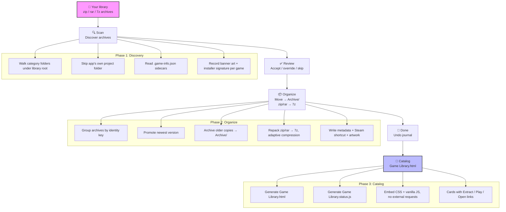
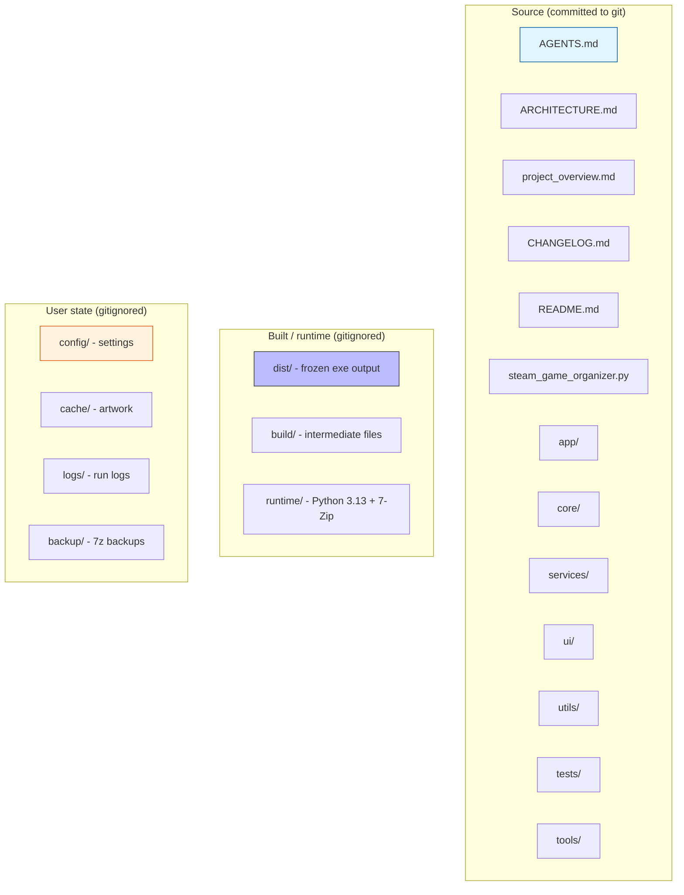

# Steam Game Organizer

[](CHANGELOG.md)
[](AGENTS.md)
[](https://www.python.org/downloads/windows/)
[](ruff.toml)
[](tests/)

> **Built for Windows.** One library, one catalog, one click to play.  
> Scan `.zip`/`.rar`/`.7z` archives you downloaded from outside of Steam, match them to Steam's store metadata, convert to **7z** for better compression, organize into category folders, download artwork, and build a clickable HTML game catalog — all in one self-contained frozen exe.

---

## 🎯 Overview

Steam Game Organizer is a comprehensive Windows application for games you have downloaded from outside of Steam. It walks your library folder, finds every `.zip`/`.rar`/`.7z`, matches each archive against Steam's store metadata (AppID, title, genres, tags, artwork), converts archives to **7z** for better compression, sorts them into category folders, downloads artwork, and generates a beautiful, clickable HTML catalog you can open in your browser — packed with detail on every game.

The result is a self-contained, browsable game library that works on any Windows 10+ machine — no Python, no 7-Zip, and no installation required on the machine that runs it.

### What it does

| Step | What happens |
|------|--------------|
| 🔍 **Scan** | Walks your library folder, finds every `.zip`/`.rar`/`.7z`, and matches each archive against Steam's store metadata (AppID, title, genres, tags, artwork). |
| 📦 **Convert** | Rebuilds `.zip` and `.rar` archives as `.7z` with adaptive compression tuned to your free RAM — better compression, smaller on-disk footprint. |
| 🗂️ **Organize** | Files each game into `Category / Game — release date` folders with metadata, Steam shortcuts, and artwork sidecars. |
| 🖼️ **Artwork** | Downloads Steam capsule/header/grid images and SteamGridDB portraits, keyed per AppID with a 10-day expiry cache. |
| 📖 **Catalog** | Generates a self-contained `Game Library.html` — a detailed, searchable, filterable catalog with Extract / Play / Open links for every game. |
| ↩️ **Undo** | Every organize move is journaled to `config/last-organization.json`; one Undo restores archives to their sources and prunes only folders this run created. |

> [!IMPORTANT]
> **This app does not support or condone piracy.** Use it only for games you own and have the right to organize. It does not provide — and does not explain — how to obtain games you do not own.

---

## 🚀 Key capabilities

| Capability | Description |
|------------|-------------|
| 🖥️ **Self-contained runtime** | Ships with Python 3.13, Tcl/Tk, and 7-Zip inside `runtime/`. Double-click the exe — nothing else needed on the machine that runs it. |
| 📦 **Extract to `Needs Install`** | Archives that unpack to a Windows installer (`setup.exe` + `.bin`, or an `.iso`) are routed to a `Needs Install` subfolder with an amber badge. |
| 🎮 **Launcher discovery** | Conservatively scans extracted roots for playable `.exe` files, filters installers/uninstallers/crash handlers/redistributables, and lets you pick and save the main launcher for one-click Play. |
| 🔗 **Protocol handler** | `steamgameorganizer://` links from `Game Library.html` open Extract / Play / Open actions in the desktop app. |
| 📦 **Batch extract** | Queue hours of 7z work with a visible progress window; skip-if-already-extracted; smallest-first sort. |
| 📚 **Library service** | Whole-library audit — Steam link normalization plus artwork refresh, reports per folder as it goes. |
| ⚙️ **Setup service** | Three-folder setup wizard validation and protocol handler registration. |

---

## 📦 Install & run from GitHub

GitHub ships only source code. The `runtime/`, `dist/`, and `build/` folders are **gitignored** — they are not in the repository. To get a runnable app you must build the frozen exe once on your machine, then run it from that built folder.

### Option A: Run the frozen exe (recommended — no install on the target machine)

```powershell
# 1. Clone the repository
git clone https://github.com/smd3235/steam-game-organizer.git
cd "steam-game-organizer"

# 2. Install build prerequisites (one time)
# Python 3.13: https://www.python.org/downloads/windows/
#   - Check "Add Python to PATH" and "Install for all users"
#   - Required version: Python 3.13.x
# 7-Zip: https://www.7-zip.org/download.html
#   - Install to C:\Program Files\7-Zip
pip install ruff
runtime\python.exe -m pip install pyinstaller

# 3. Build the frozen exe
python tools\build_frozen.py

# 4. Run it
dist\steam_game_organizer\steam_game_organizer.exe
```

### Option B: Run from source (development only — needs Python 3.13)

```powershell
runtime\python.exe steam_game_organizer.py
```
Requires Python 3.13 installed. Not recommended for end users — use the frozen exe.

### Verify your build environment

```powershell
python --version   # should be Python 3.13.x
ruff --version     # should print a version
7z                 # should print 7-Zip help
runtime\python.exe --version  # bundled interpreter version
```

---

## 🧭 First launch — setup wizard

On first launch the setup wizard opens and asks you to pick three folders:

| Folder | What it is | Example |
|--------|------------|---------|
| 📁 **Game library** | Where your `.zip`/`.rar`/`.7z` archives live | `E:\Games\Steam Library` |
| 📁 **App folder** | Where the app itself lives (detected automatically) | Frozen exe: `dist\steam_game_organizer\`<br>Source: project root where `steam_game_organizer.py` sits |
| 📁 **Extract to** | Where extracted games go (any folder outside your library) | `E:\Games\Extracted` |

After setup, click **Scan**, review the detected games, click **Organize**, then open `Game Library.html` in your browser. Every game card has Extract, Play, Open installer, Open extracted, and Open source links.

---

## 🔗 Register the protocol handler (one time)

So the catalog's `Extract` links work from the browser:

```powershell
python tools\install_protocol_handler.py
```

This registers `steamgameorganizer://` under `HKCU\Software\Classes` (per user, no elevation needed). After this, clicking an Extract link in `Game Library.html` hands the request to the desktop app. URI parsing and validation live in [`core/uri_actions.py`](core/uri_actions.py).

---

## 🎯 App workflow — end to end



| Phase | What happens | Code |
|-------|--------------|------|
| 🔍 **Scan** | Walks your library, finds every `.zip`/`.rar`/`.7z`, checks each against Steam's store metadata for AppID, title, genres, tags, and artwork URLs. | [`services/catalog_service.py`](services/catalog_service.py) |
| ✅ **Verify** | Confirms archive integrity and extraction completeness — no silent data loss. | [`services/extract_service.py`](services/extract_service.py) |
| ✅ **Review** | You see every detected game with its suggested category, AppID, and confidence. Accept, override, or skip. | [`ui/review_view.py`](ui/review_view.py) |
| 📦 **Organize** | Moves archives into `category/game - release-date/` folders, rebuilding `.zip`/`.rar` as `.7z` with adaptive compression based on your free RAM. | [`services/organizer_service.py`](services/organizer_service.py) |
| 🖼️ **Artwork** | Downloads Steam capsule/header/grid images and SteamGridDB portraits, keyed per AppID with a 10-day expiry cache. | [`services/artwork_service.py`](services/artwork_service.py) |
| 📖 **Done** | Generates `Game Library.html` — a browsable catalog with per-game Extract / Play / Open links, category filters, genre chips, and "already unpacked" badges. | [`services/catalog_service.py`](services/catalog_service.py) |
| ↩️ **Undo** | Every organize move is journaled to `config/last-organization.json`; one Undo restores archives to their sources and prunes only folders this run created. | [`services/rollback_service.py`](services/rollback_service.py) |

---

## 🏗️ Repository layout



```
steam-game-organizer/
├── AGENTS.md              # Operating instructions: build, test, lint, run
├── ARCHITECTURE.md        # Module map and service inventory
├── project_overview.md    # App purpose, data flow, key decisions
├── CHANGELOG.md           # Dated change log, v9.33 development section
├── README.md              # This file
├── VERSION.txt            # 9.33
├── steam_game_organizer.py# Entry point (CLI + GUI launcher)
├── steam_game_organizer.spec  # PyInstaller spec
├── ruff.toml              # Lint contract
├── pytest.ini             # Test configuration
├── app/                   # GUI application layer
├── core/                  # Config, constants, models, logger, state, URI actions
├── services/              # 13 business services
├── ui/                    # Tkinter windows, widgets, theme, palette
├── utils/                 # Filename utils, formatting, treewalk, desktop
├── debug/                 # Diagnostics
├── tests/                 # 30+ test modules (739 tests)
├── tools/                 # build_frozen.py, bundle_runtime.py, protocol handler, audits
├── assets/                # icon.ico, icon.svg
├── config/                # User settings (excluded from git)
├── cache/                 # Artwork cache (excluded from git)
├── logs/                  # Timestamped run logs (excluded from git)
├── backup/                # Timestamped 7z backups (excluded from git)
├── dist/                  # Frozen build output (excluded from git)
├── build/                 # Intermediate build files (excluded from git)
└── runtime/               # Vendored Python 3.13 + 7-Zip (excluded from git)
```

### What is not committed

`runtime/`, `dist/`, `build/`, `cache/`, `logs/`, `config/`, and `backup/` are excluded by `.gitignore`. Rebuilding from source restores defaults; [`tools/build_frozen.py`](tools/build_frozen.py) preserves `config/`, `cache/`, and `logs/` across rebuilds.

---

## 🖥️ Running on your own machine

1. **Build the frozen exe once** on your machine (`python tools\build_frozen.py`).
2. **Launch** `dist\steam_game_organizer\steam_game_organizer.exe` — no Python, 7-Zip, or anything else needed on the machine that runs it.
3. **First launch** opens the setup wizard — pick your game library, app folder, and extract-to folder.
4. **Drive letters auto-resolve** when the stored library path doesn't exist on this machine.
5. **Open** `Game Library.html`; click **Set up on this PC** to re-point folders.
6. **Click Refresh catalog** after external changes so unpacked badges re-check disk.

> [!TIP]
> The `runtime/` folder makes the copy self-contained — Python, Tcl/Tk, and 7-Zip included. Windows 10 or later required. The only thing a fresh copy needs is a one-time registry step if you want Extract links from the browser: `runtime\python.exe tools\install_protocol_handler.py`.

---

## 📊 Project status & public readiness

### Status: Ready for public release

This project is ready to be made public. Here's what's ready:

- **Code quality**: 98 Python source files across 8 directories, clean lint (`ruff check .` passes), comprehensive test suite (739 tests, 0 functional failures)
- **Build pipeline**: Frozen exe builds successfully with PyInstaller, `runtime/7z.exe` verified present in built bundle, build preserves user config/cache/logs across rebuilds
- **Documentation**: Comprehensive README, AGENTS.md operating instructions, ARCHITECTURE.md module map, project_overview.md data flow, CHANGELOG.md with detailed timestamps
- **Security & privacy**: No hardcoded Steam game data in production code; Steam Store API queried at runtime only; test fixtures isolated to `--mock` mode; URI validation and path safety checks; protocol handler registered under HKCU (per-user, no elevation)

### Test data privacy

The `/tests/` directory contains test fixtures with fictional Steam game names and AppIDs (e.g., "Alpha Forge" with AppID 100001). These are:

- **Deterministic fixtures** used only in `--mock` offline test mode
- **Never shipped to users** and never queried during normal operation
- **Fictional data** that does not correspond to real Steam games

The production code contains zero hardcoded Steam data.

### Public access level

If made public, others will have:

- **Download and read access only** — can download source code, read it, and build locally
- **No write access** — cannot push changes or modify the project on GitHub
- **Collaborator access** — can be added individually through GitHub Settings → Collaborators

---

## ⚖️ License

Add a license here if you want others to reuse or modify the code. Without one, all rights are reserved by default.

> [!NOTE]
> **If this project is made public:** others have **download and read access only**. They can download the source code, read it, and build it locally for their own use. They do not have write access to the repository, cannot push changes, and cannot modify the project on GitHub. Collaborators can be added individually through GitHub Settings → Collaborators.

---

## 📦 Bundled runtime components (`runtime/`)

`runtime/` is built locally by [`tools/bundle_runtime.py`](tools/bundle_runtime.py) and is **not committed to git** — it's rebuilt from your own machine when you set up or rebuild the frozen exe. It contains third-party software, each under its own license:

| Component | License | Notes |
|-----------|---------|-------|
| 🐍 **Python 3.13 + Tcl/Tk** | PSF License v2 | Permissive. Copyright notice retained in `runtime\LICENSE.txt`. |
| 🗜️ **7-Zip (`7z.exe`)** | GNU LGPL + unRAR restriction | Permissive for use; LGPL source-offer obligations apply if you redistribute modified binaries publicly. |
| 🖼️ **Pillow** | HPND | Permissive. Copyright notice retained. |
| 🪟 **Microsoft VC++ redistributable** | Microsoft | Windows only; don't alter notices or imply endorsement. |

`tools\bundle_runtime.py` writes a `THIRD-PARTY-NOTICES.txt` into `runtime/` with attribution for Python, 7-Zip, and Pillow.

---

## 🔗 Quick links to key code sections

| Area | File | What it does |
|------|------|--------------|
| Entry point | [`steam_game_organizer.py`](steam_game_organizer.py) | CLI + GUI launcher, URI handler target |
| Config | [`core/config.py`](core/config.py) | Settings, library paths, extract folders, `AppConfig` |
| Constants | [`core/constants.py`](core/constants.py) | Version, archive extensions, categories, thresholds |
| Models | [`core/models.py`](core/models.py) | Plain-data containers: `GameArchive`, `SteamMatch`, `ScanResult`, ... |
| URI actions | [`core/uri_actions.py`](core/uri_actions.py) | Parses `steamgameorganizer://` URIs |
| Logger | [`core/logger.py`](core/logger.py) | Timestamped, component-tagged logging |
| Application | [`app/application.py`](app/application.py) | Composition root and lifecycle owner |
| Controller | [`app/controller.py`](app/controller.py) | Scan phases, duplicate sweep, catalog, undo |
| Archive service | [`services/archive_service.py`](services/archive_service.py) | Archive discovery and scan telemetry |
| Batch extract | [`services/batch_extract_service.py`](services/batch_extract_service.py) | Queue extractions, skip-if-already-extracted |
| Catalog service | [`services/catalog_service.py`](services/catalog_service.py) | Generates `Game Library.html` + banner art |
| Catalog status | [`services/catalog_status.py`](services/catalog_status.py) | `Game Library.status.js`, launcher discovery |
| Extract service | [`services/extract_service.py`](services/extract_service.py) | Finds archive tool, performs extraction, writes markers |
| Installer detect | [`services/installer_detect.py`](services/installer_detect.py) | Detects Windows installer layouts |
| Library service | [`services/library_service.py`](services/library_service.py) | Whole-library audit, Steam link normalization |
| Organizer service | [`services/organizer_service.py`](services/organizer_service.py) | Category moves, zip/rar → 7z conversion |
| Rollback service | [`services/rollback_service.py`](services/rollback_service.py) | Undo journal, `last-organization.json` |
| Setup service | [`services/setup_service.py`](services/setup_service.py) | Three-folder wizard, protocol handler registration |
| Steam service | [`services/steam_service.py`](services/steam_service.py) | Steam Store API with mock backend |
| Artwork service | [`services/artwork_service.py`](services/artwork_service.py) | Cached Steam artwork retrieval |
| Banner art | [`services/banner_art.py`](services/banner_art.py) | Composes the banner image |
| Main window | [`ui/main_window.py`](ui/main_window.py) | Single-window workflow shell, left nav rail |
| Views | [`ui/`](ui/) | scan_view, review_view, organize_view, artwork_view, done_view |
| Batch window | [`ui/batch_extract_window.py`](ui/batch_extract_window.py) | Visible queue for hours of 7z work |
| Setup window | [`ui/setup_window.py`](ui/setup_window.py) | Three-folder setup wizard |
| Theme | [`ui/theme.py`](ui/theme.py) | ttk theme, shared widgets, palette re-export |
| Palette | [`ui/palette.py`](ui/palette.py) | Colours in one place |
| Filename utils | [`utils/filename_utils.py`](utils/filename_utils.py) | `normalize_name`, `identity_key`, `version_key` |
| Formatting | [`utils/formatting.py`](utils/formatting.py) | Human-readable sizes and durations |
| Desktop | [`utils/desktop.py`](utils/desktop.py) | `os.startfile`-based folder/URL opening |
| Treewalk | [`utils/treewalk.py`](utils/treewalk.py) | Junction/symlink-safe recursive walk |
| Diagnostics | [`debug/diagnostics.py`](debug/diagnostics.py) | Diagnostics and health report output |
| Build frozen | [`tools/build_frozen.py`](tools/build_frozen.py) | PyInstaller pipeline, lift step, verify 7z.exe |
| Bundle runtime | [`tools/bundle_runtime.py`](tools/bundle_runtime.py) | Copies Python + Tcl/Tk + 7-Zip into `runtime/` |
| Protocol handler | [`tools/install_protocol_handler.py`](tools/install_protocol_handler.py) | Registers `steamgameorganizer://` under HKCU |

---

*Built for Windows. One library, one catalog, one click to play.*
