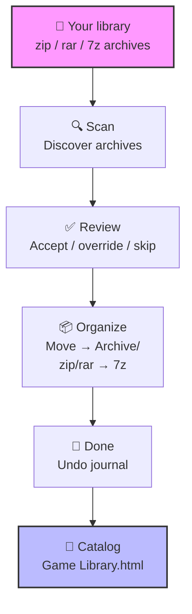
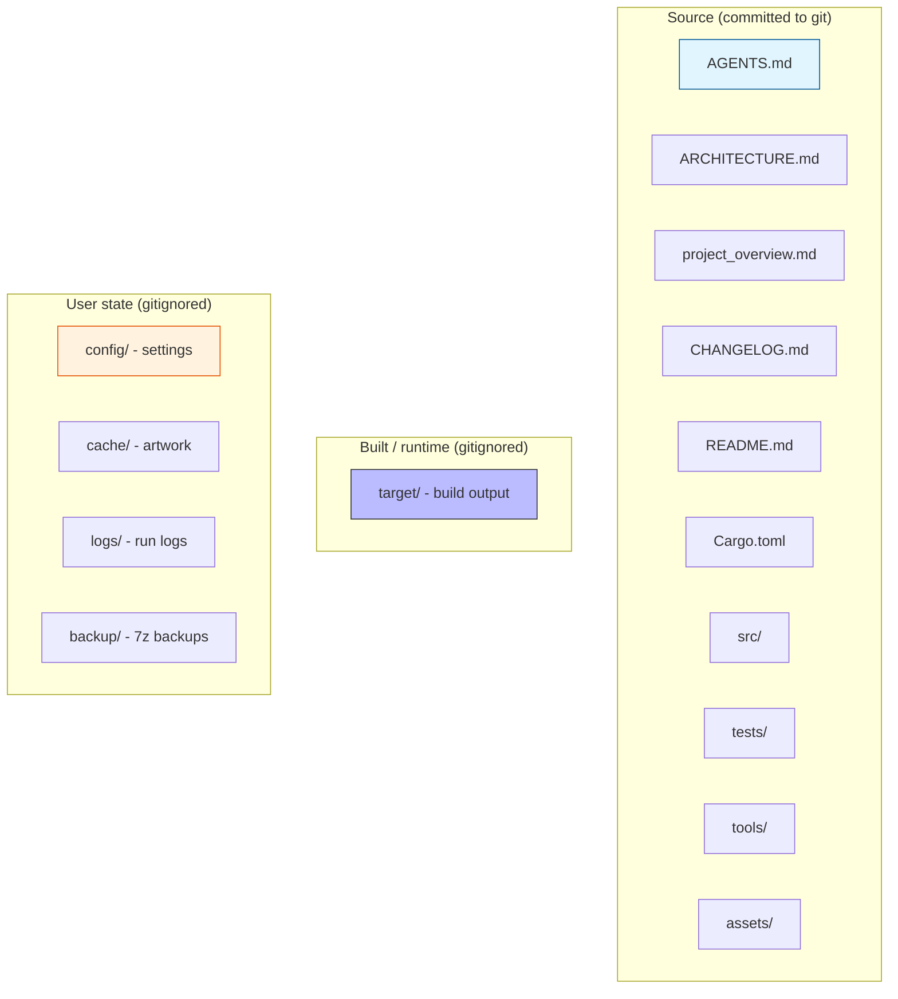

# Steam Game Organizer

[](CHANGELOG.md)
[](AGENTS.md)
[](https://www.rust-lang.org/)
[](LICENSE)
[](.cargo/config.toml)
[](src/)
[](.github/workflows/ci.yml)
[](.cargo/deny.toml)

> **Built for Windows.** One library, one catalog, one click to play.  
> Scan `.zip`/`.rar`/`.7z` archives you downloaded from outside of Steam, match them to Steam's store metadata, convert to **7z** for better compression, organize into category folders, download artwork, and build a clickable HTML game catalog — all in one self-contained application. Windows-only.

---

## 📖 Table of contents

| If you want to… | Go to section |
|-----------------|---------------|
| Get a quick summary | [🎯 Overview](#-overview) |
| System requirements | [💻 System requirements](#-system-requirements) |
| Build the app | [📦 Get the app](#-get-the-app) |
| Run on your own machine | [🖥️ Running on your own machine](#-running-on-your-own-machine) |
| App workflow — end to end | [🎯 App workflow — end to end](#-app-workflow--end-to-end) |
| Repository layout | [🏗️ Repository layout](#-repository-layout) |
| Troubleshooting | [🔧 Troubleshooting](#-troubleshooting) |
| FAQ | [❓ FAQ](#-faq) |
| Project status & public readiness | [📊 Project status & public readiness](#-project-status--public-readiness) |
| Rust Conversion | [🦀 Rust Conversion](#-rust-conversion) |
| License | [⚖️ License](#-license) |
| Quick links to key code | [🔗 Quick links to key code sections](#-quick-links-to-key-code-sections) |
| Contributor documentation | [📚 Contributor documentation](#-contributor-documentation) |

---

## 🎯 Overview

Steam Game Organizer is a comprehensive Windows application for games you have downloaded from outside of Steam. It walks your library folder, finds every `.zip`/`.rar`/`.7z`, matches each archive against Steam's store metadata (AppID, title, genres, tags, artwork), converts archives to **7z** for better compression, sorts them into category folders, downloads artwork, and generates a beautiful, clickable HTML catalog you can open in your browser — packed with detail on every game.

The result is a self-contained, browsable game library that works on any Windows 10+ machine — no installation required on the machine that runs it.

### What it does

| Step | What happens |
|------|--------------|
| 🔍 **Scan** | Walks every category folder under the library root, finds every `.zip`/`.rar`/`.7z`, matches each archive against Steam's store metadata (AppID, title, genres, tags, artwork URLs) with confidence scoring so a weak match never overrides a strong one. |
| 📦 **Convert** | Rebuilds `.zip` and `.rar` archives as `.7z` using adaptive compression tuned to your free RAM — better compression, smaller on-disk footprint. Older copies and re-categorized leftovers are moved to `Archive/` with `(n)` collision suffixes for review before deleting. |
| 🗂️ **Organize** | Each archive is filed into `Category / Game — release date` folders with metadata, Steam shortcuts, and artwork sidecars. Archives are grouped by identity key, the newest version is promoted, and duplicates are swept so two archives of the same game never compete. Writes happen atomically. |
| 🖼️ **Artwork** | Downloads Steam capsule, header, and grid images plus SteamGridDB portraits, keyed per AppID with a cache. Composes card banners so no card is ever a flat grey block. |
| 📖 **Catalog** | Generates a self-contained `Game Library.html` — embedded CSS + vanilla JS, no build step, no external requests — plus status data. The page carries search, filters, category chips, sort orders, dynamic action cards, and "already unpacked" badges. |
| ↩️ **Undo** | Every organize move is journaled. One Undo restores each archived file to its source and prunes only folders this run created into `Archive/` — never deletes a folder it didn't make. |

### What it does not do

- **Does not support piracy.** Use it only for games you own and have the right to organize.
- **Does not need Steam installed.** It queries the Steam Store API at runtime for metadata — no Steam client required.
- **Does not delete games.** The app never deletes anything it didn't create. Empty categories and re-categorized leftovers are moved to `Archive/` for review.

---

## 💻 System requirements

| Requirement | Detail |
|-------------|--------|
| **OS** | Windows 10 or later (64-bit). Windows-only — no POSIX, macOS, or Linux target. |
| **To build from source** | Rust toolchain (`cargo`, `rustc`, `clippy`), MinGW-w64 for the GNU target, 7-Zip installed to `C:\Program Files\7-Zip`. |
| **To run the built app** | Nothing. The built executable is self-contained. |
| **Display** | The app maximizes itself on start and runs full screen. |

---

## 📦 Get the app

The `target/` folder is **gitignored** — build artifacts are not in the repository. To get a runnable app you build it yourself from the source code. The resulting executable is self-contained.

### Build from source

Requires the Rust toolchain and 7-Zip on the machine doing the build.

#### Step 1 — Install the Rust toolchain

1. Install Rust from https://www.rust-lang.org/.
2. Confirm it works:

   ```powershell
   cargo --version
   rustc --version
   ```

3. Install clippy:

   ```powershell
   rustup component add clippy
   ```

#### Step 2 — Install 7-Zip

1. Download 7-Zip from https://www.7-zip.org/download.html.
2. Install it to the default location, `C:\Program Files\7-Zip`.
3. Confirm it is available:

   ```powershell
   7z
   ```

   It should print 7-Zip help text.

#### Step 3 — Clone the repository

```powershell
git clone https://github.com/smd3235/steam-game-organizer.git
cd "steam-game-organizer"
```

#### Step 4 — Build

```powershell
cargo build --release
```

The runnable app is at:

```
target\release\steam-game-organizer.exe
```

#### Step 5 — Run it

```powershell
target\release\steam-game-organizer.exe
```

No Python, 7-Zip, or anything else is needed on the machine that runs it.

#### Verify your build environment

Before building, confirm your machine has everything:

```powershell
cargo --version         # should print a version
clippy --version        # should print a version
7z                      # should print 7-Zip help
```

---

## 🖥️ Running the app on your own machine

This is the full, step-by-step procedure for getting the app running on any Windows 10+ machine — yours, a second PC, or a borrowed hard drive. Nothing needs to be installed on the machine that runs it; the built executable is self-contained.

### Step 1 — Get the app onto the machine

Copy the built `target\release\steam-game-organizer.exe` (or a pre-built release) to a permanent location, for example `E:\Games\Steam Game Organizer\`.

### Step 2 — Launch the app

Open the folder and double-click:

```
steam-game-organizer.exe
```

The app maximizes to full screen on start. On first launch it opens the setup wizard automatically — there is nothing to configure before this point.

### Step 3 — Complete the setup wizard

The wizard asks for three folders. Fill in each one, then click **Save setup**.

| Folder | What it is | Example |
|--------|------------|---------|
| 📁 **Game library** | The folder your `.zip`/`.rar`/`.7z` game archives live in. | `E:\Games\Steam Library` |
| 📁 **App folder** | Where this copy of the app lives. | `E:\Games\Steam Game Organizer\target\release\` |
| 📁 **Extract to** | Where games are unpacked to when you click Extract. Must be outside your game library. | `E:\Games\Extracted` |

### Step 4 — Drive letters auto-resolve (borrowed drives)

If you are running from a borrowed hard drive whose drive letter changed, the app detects that the stored library path no longer exists and auto-resolves `library_root` to the folder beside the app.

### Step 5 — Scan your library

Back in the main window, click **Scan**. The app walks every category folder under your library root, finds every `.zip`/`.rar`/`.7z`, matches each archive against Steam's store metadata, and builds a list of detected games.

### Step 6 — Review the detected games

Open the **Review** screen. Each detected game shows its suggested category, matched AppID, and confidence. You can accept, override, or skip each game.

### Step 7 — Organize the library

Click **Organize**. The app files each accepted archive into `Category / Game — release date` folders, rebuilds `.zip`/`.rar` archives as `.7z` for better compression, writes metadata and Steam shortcuts, and downloads artwork. Every move is journaled so it can be undone.

### Step 8 — Open your catalog

Click **Open catalog** (or open `Game Library.html` in your browser directly). This is a single self-contained HTML file with embedded CSS and vanilla JavaScript — no build step, no external requests.

### Step 9 — Extract games (optional)

From any game card, click **Extract** to unpack the archive to your chosen extract folder. You can also extract whole categories or the entire library.

---

## 🎯 App workflow — end to end



Phases run in order: **Discover → Organize → Catalog → Done**. Undo is an independent entry point.

---

## 🏗️ Repository layout



```
steam-game-organizer/
├── AGENTS.md              # Operating instructions: build, test, lint, run
├── ARCHITECTURE.md        # Module map and service inventory
├── project_overview.md    # App purpose, data flow, key decisions
├── CHANGELOG.md           # Dated change log
├── README.md              # This file
├── Cargo.toml             # Rust crate manifest
├── .cargo/                # Rust config (deny.toml, config.toml)
├── src/                   # Rust source (converted modules)
│   ├── lib.rs             # Crate root
│   ├── errors.rs          # OrganizerError, CancellationError
│   ├── state.rs           # Thread-safe StateStore
│   ├── models.rs          # Data models (GameArchive, SteamMatch, etc.)
│   ├── naming_utils.rs    # safe_name, release_label, game_name, version_key
│   ├── library_summary.rs # Library index
│   ├── logger.rs          # AppLogger with rotation
│   ├── within.rs          # Path containment
│   ├── safe_folder_name.rs # Windows-safe folder names
│   ├── configured_bases.rs # Approved extract folders
│   ├── system_paths.rs    # Protected system folders
│   ├── setup_hint.rs      # Fresh-PC setup message
│   ├── uri_actions.rs     # URI request dataclasses
│   ├── path_safety.rs     # DeletionGuard, protected roots
│   ├── typed_destination.rs # User-typed destination validation
│   ├── destination_parent.rs # Extract destination resolution
│   ├── prefill.rs         # Query value cleaning
│   ├── category_folder.rs # Batch category validation
│   ├── catalog_utils.rs   # Catalog helpers (safe_name, anchor, etc.)
│   ├── organizer_utils.rs # zip encryption, process management
│   ├── scan_view_utils.rs # Scan telemetry helpers
│   ├── steam_query_utils.rs # Steam name scoring
│   ├── parse_uri.rs       # URI parser
│   ├── parse_open_folder_uri.rs
│   ├── parse_setup_uri.rs
│   ├── parse_extract_root_action.rs
│   ├── parse_multi_uri.rs
│   ├── parse_pick_launcher_uri.rs
│   ├── parse_open_extracted_uri.rs
│   ├── parse_mark_installed_uri.rs
│   ├── parse_batch_uri.rs
│   ├── treewalk.rs        # Junction-safe directory walk
│   ├── desktop.rs         # open_folder, open_url
│   └── formatting.rs      # human_size, human_duration
├── tests/                 # Rust unit tests
├── tools/                 # Build and utility scripts
├── assets/                # icon.ico, icon.svg
├── config/                # User settings (excluded from git)
├── cache/                 # Artwork cache (excluded from git)
├── logs/                  # Timestamped run logs (excluded from git)
├── backup/                # Timestamped 7z backups (excluded from git)
└── target/                # Build output (excluded from git)
```

### What is not committed

`target/`, `config/`, `cache/`, `logs/`, and `backup/` are excluded by `.gitignore`.

---

## 🔧 Troubleshooting

| Symptom | Likely cause | Fix |
|---------|--------------|-----|
| Build fails linking | MinGW-w64 not on PATH | Add `C:\tools\mingw64\mingw64\bin` to PATH |
| `cargo-audit` finds vulns | Outdated dependency | Update crate in `Cargo.toml` |
| `cargo-deny` blocks license | Non-permissive license | Review and add to `.cargo/deny.toml` |
| Library path shows as missing | Drive letter changed | Auto-resolves on next launch |
| Write fails with PermissionError | OneDrive or indexer lock | Atomic writes retry; close synced folders and retry |

---

## ❓ FAQ

**Q: Does this support pirated games?**
A: No. The app does not support or condone piracy. Use it only for games you own and have the right to organize.

**Q: Does it need Steam installed?**
A: No. It queries the Steam Store API at runtime for metadata — no Steam client required.

**Q: Can it run on a machine without Rust installed?**
A: Yes. The built executable is self-contained.

**Q: Will it delete my games?**
A: No. The app never deletes anything it didn't create. Empty categories and re-categorized leftovers are moved to `Archive/` for review.

**Q: Can I undo an organize run?**
A: Yes. Every organize move is journaled; one Undo restores archives to their sources.

**Q: Does it work on other drives/machines?**
A: Yes. Drive letters auto-resolve when the stored library path doesn't exist on the current machine, and extract folders are re-pointed through the Setup wizard.

**Q: Is my data sent anywhere?**
A: No. Steam metadata is queried from the live Steam Store API at runtime; nothing is uploaded or shared.

---

## 📊 Project status & public readiness

### Status: In Rust conversion

This project is being converted from Python to Rust, one file at a time. Pure `core/` and `utils/` modules have been converted to `src/`. Services, app layer, and UI remain to be converted.

| Status | Meaning |
|--------|---------|
| `python` | File still exists as `.py` — not yet converted |
| `rust` | File replaced by a `.rs` module in `src/` |

Rust source lives in `src/` alongside the Python tree. `Cargo.toml` is at the project root. Python files that have not yet been converted remain the source of truth until their Rust replacement passes `cargo test` and is lint-clean.

Until the Rust entry point itself is converted, Python source changes still trigger the frozen-exe rebuild pipeline.

---

## ⚖️ License

Add a license here if you want others to reuse or modify the code. Without one, all rights are reserved by default.

> [!NOTE]
> **If this project is made public:** others have **download and read access only**. They can download the source code, read it, and build it locally for their own use. They do not have write access to the repository, cannot push changes, and cannot modify the project on GitHub. Collaborators can be added individually through GitHub Settings → Collaborators.

---

## 🔗 Quick links to key code sections

| Area | File | What it does |
|------|------|--------------|
| **Crate root** | [`src/lib.rs`](src/lib.rs) | Module declarations for all converted modules |
| **Data models** | [`src/models.rs`](src/models.rs) | `GameArchive`, `SteamMatch`, `ScanResult`, `OrganizationDecision`, `ArtworkResult`, `ConversionResult`, `AppState` |
| **Naming** | [`src/naming_utils.rs`](src/naming_utils.rs) | `safe_name`, `release_label`, `game_name`, `asset_prefix`, `modified_at`, `unique_dir`, `version_key` |
| **Library index** | [`src/library_summary.rs`](src/library_summary.rs) | `LibrarySummary` with `categories_for_genres` and `precedent_for` |
| **Logging** | [`src/logger.rs`](src/logger.rs) | `AppLogger` with size-based rotation, level thresholds, thread-safe writes |
| **URI actions** | [`src/uri_actions.rs`](src/uri_actions.rs) | `ExtractRequest`, `BatchExtractRequest`, `MultiBatchRequest`, `UriRefused` |
| **Path safety** | [`src/path_safety.rs`](src/path_safety.rs) | `DeletionGuard`, `is_within`, `protected_roots`, `safe_rmtree`, `safe_unlink` |
| **URI parsing** | [`src/parse_uri.rs`](src/parse_uri.rs) | `parse_uri()` — `steamgameorganizer://extract` |
| **Filename utils** | [`src/filename_utils.rs`](src/filename_utils.rs) | `normalize_name`, `identity_key`, `version_key` |
| **Formatting** | [`src/formatting.rs`](src/formatting.rs) | `human_size`, `human_duration`, `clock_stamp` |
| **Treewalk** | [`src/treewalk.rs`](src/treewalk.rs) | Junction-safe recursive directory walk |
| **Desktop** | [`src/desktop.rs`](src/desktop.rs) | `open_folder`, `open_url` |
| **Organizer utils** | [`src/organizer_utils.rs`](src/organizer_utils.rs) | `zip_is_encrypted`, `looks_like_resource_failure`, `defender_flagged`, `still_running`, `stop_tool`, `pid_is_alive` |
| **Catalog utils** | [`src/catalog_utils.rs`](src/catalog_utils.rs) | `safe_name`, `clean_tags`, `archive_size`, `find_banner`, `store_url`, `anchor`, `batch_uri`, `batch_button` |

---

## 📚 Contributor documentation

If you plan to modify code, read [`AGENTS.md`](AGENTS.md) first — it is the operating manual for contributing and contains the mandatory Change Workflow, Definition of Done, and rules every change must satisfy.

| Doc | What it covers | Link |
|-----|----------------|------|
| **AGENTS.md** | Build, test, lint, run, commit, push — Windows only | [`AGENTS.md`](AGENTS.md) |
| **ARCHITECTURE.md** | Module map, service inventory, wiring diagrams | [`ARCHITECTURE.md`](ARCHITECTURE.md) |
| **project_overview.md** | What the app does, data flow, key decisions, catalog mechanics | [`project_overview.md`](project_overview.md) |
| **CHANGELOG.md** | Dated change log (newest first) | [`CHANGELOG.md`](CHANGELOG.md) |

### GitHub CI

Every push and pull request runs quality checks via GitHub Actions:

| Step | Tool | Fails the gate? |
|------|------|-----------------|
| 1 | cargo clippy --all-targets | Yes |
| 2 | cargo test | Yes |
| 3 | cargo-audit | Yes |
| 4 | cargo-deny | Yes |

### Quality tools installed

- `cargo-audit` — Rust dependency vulnerability scanning
- `cargo-deny` — License and dependency policy checking
- `cargo-expand` — Macro expansion for debugging
- `cargo-llvm-cov` — Code coverage
- `cargo-watch` — Auto-rebuild on file changes
- `rustfmt` — Code formatting
- `clippy` — Linting
- MinGW-w64 — GNU target compilation (`dlltool.exe`)
- Tesseract OCR — External tool for OCR UI verification

### Pushing changes to GitHub

Every change goes through the full quality gate before it lands on `main`. Push to a feature branch and open a pull request:

```powershell
git checkout -b feature/your-change
# ... edit files ...
cargo fmt
cargo clippy --all-targets
cargo test
cargo-audit
cargo-deny check
git add <changed-files>
git commit -m "type(scope): short summary"
git push origin feature/your-change
```

CI runs cargo clippy, cargo test, cargo-audit, and cargo-deny on every push and pull request. All checks must pass before merging.

See [`AGENTS.md`](AGENTS.md) for the complete contributor workflow, commit message conventions, and Definition of Done.

---

*Built for Windows. One library, one catalog, one click to play.*
