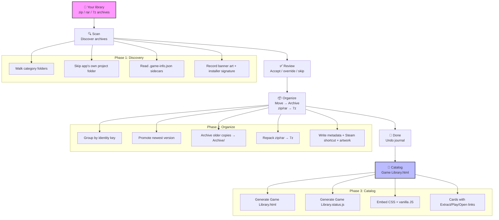
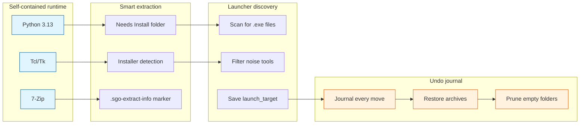
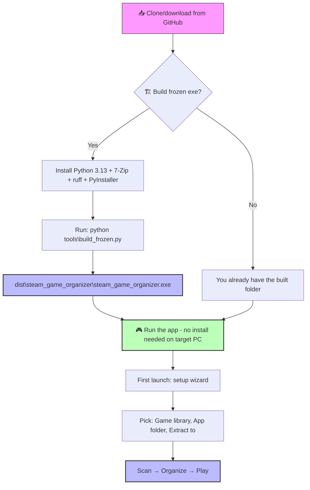
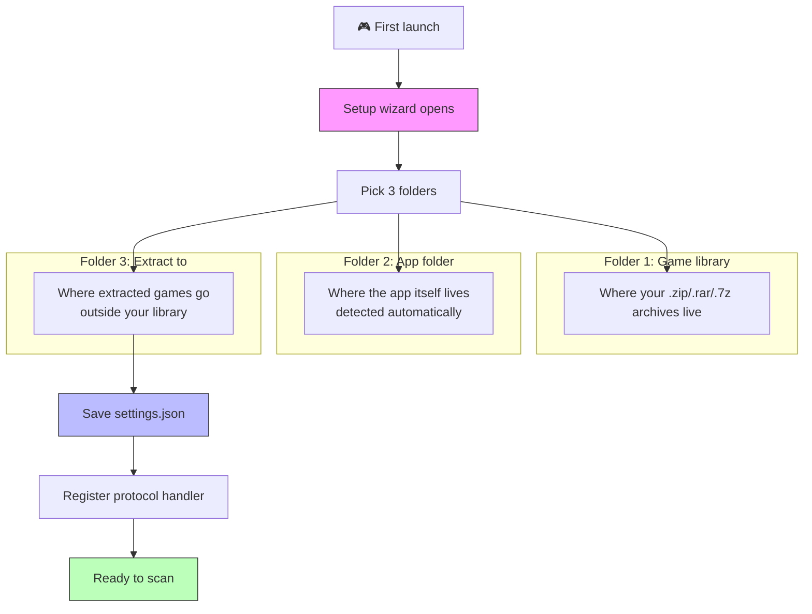
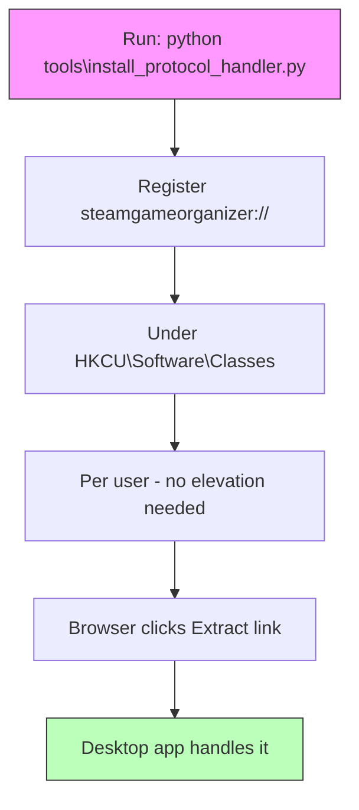
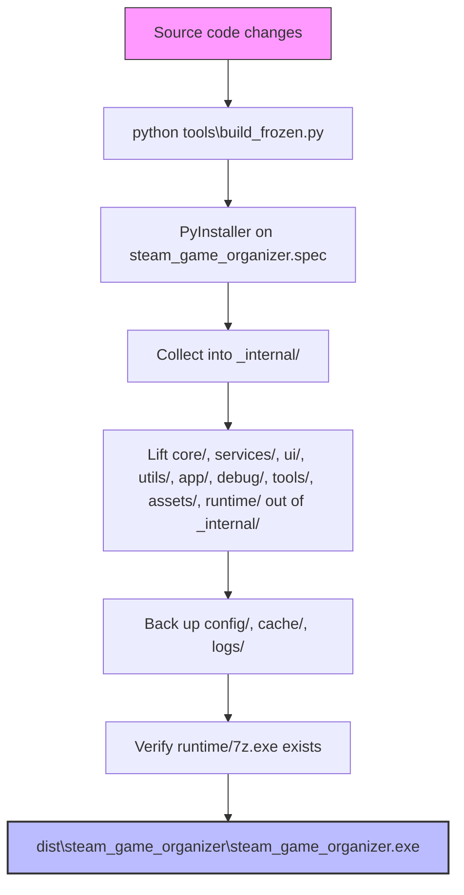
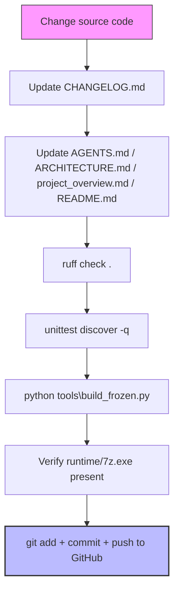
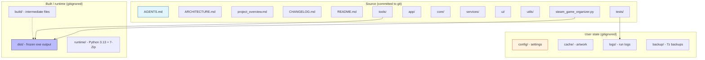
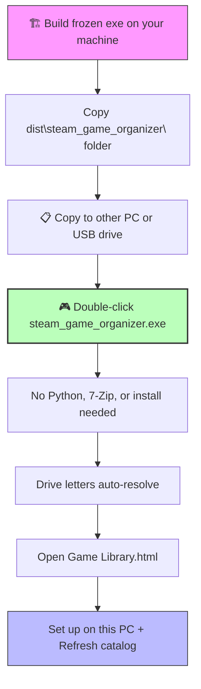
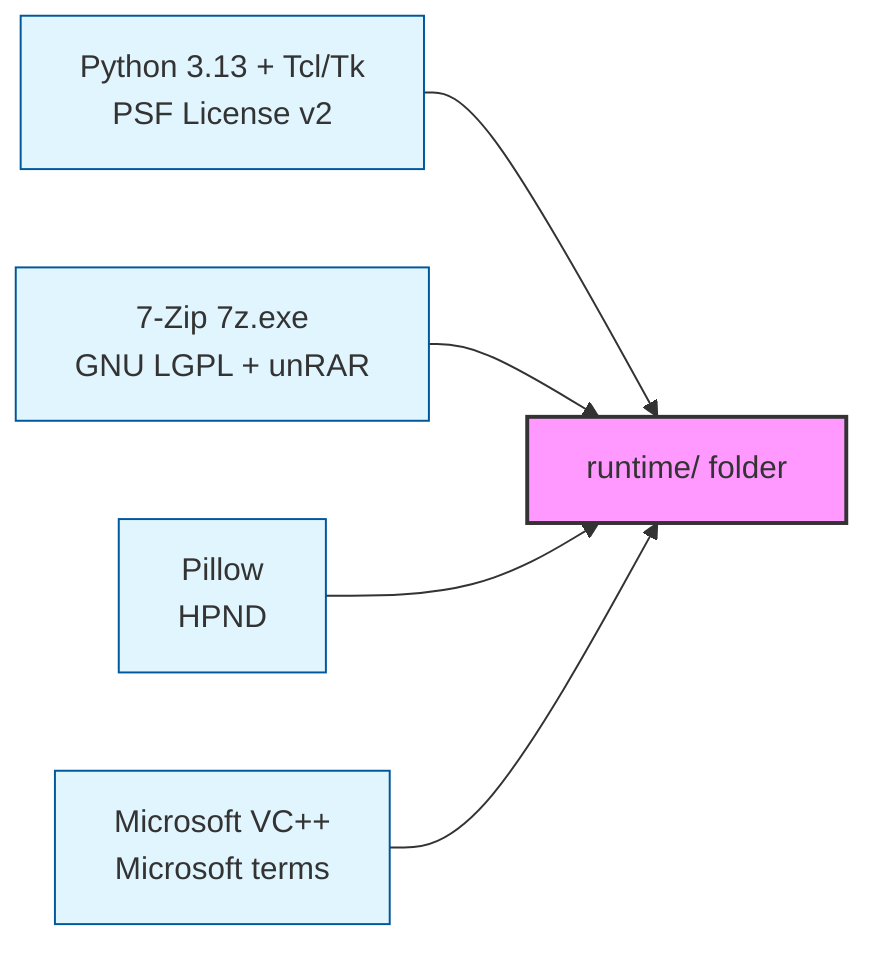

# Steam Game Organizer

[](CHANGELOG.md)
[](AGENTS.md)
[](ruff.toml)
[](tests/)
[](LICENSE)

> **Built for Windows. One library, one catalog, one click to play.**

Organize your Steam game library on Windows. Scan archives, verify them against Steam metadata, sort them into category folders, download artwork, and build a clickable HTML catalog you open in your browser — all self-contained, no install required on the machine that runs it.

---

## 📚 Project documentation

| Doc | What it's for | Best when you're… |
|-----|---------------|-------------------|
| **[README.md](./README.md)** | User-facing run, workflow, other-PC, and development-check instructions | Getting started or contributing |
| **[AGENTS.md](./AGENTS.md)** | Operating instructions: build, test, lint, run on Windows | Changing code (mandatory reading first) |
| **[ARCHITECTURE.md](./ARCHITECTURE.md)** | What each module does and how they wire together (service inventory) | Understanding the codebase |
| **[project_overview.md](./project_overview.md)** | App purpose, data flow, URI handler, catalog mechanics, key decisions | Learning how it all fits together |
| **[CHANGELOG.md](./CHANGELOG.md)** | Dated change log, v9.33 development section | Reviewing what changed and when |

> [!TIP]
> **Start here.** Read **README.md** first, then **AGENTS.md** before changing anything. **ARCHITECTURE.md** and **project_overview.md** explain the "how" and "why".

---

## 🎯 App workflow — end to end



| Phase | What happens |
|-------|--------------|
| **Scan** | Walks your library, finds every `.zip`/`.rar`/`.7z`, and checks each against Steam's store metadata for AppID, title, genres, tags, and artwork URLs. |
| **Verify** | Confirms archive integrity and extraction completeness — no silent data loss. |
| **Review** | You see every detected game with its suggested category, AppID, and confidence. Accept, override, or skip. |
| **Organize** | Moves archives into `category/game - release-date/` folders, rebuilding `.zip`/`.rar` as `.7z` with adaptive compression based on your free RAM. |
| **Artwork** | Downloads Steam capsule/header/grid images and SteamGridDB portraits, keyed per AppID with a 10-day expiry cache. |
| **Done** | Generates `Game Library.html` — a browsable catalog with per-game Extract / Play / Open links, category filters, genre chips, and "already unpacked" badges. |

---

## 🚀 Key capabilities



| Capability | Description |
|------------|-------------|
| **Self-contained runtime** | Ships with Python 3.13, Tcl/Tk, and 7-Zip inside `runtime/`. A friend's PC with nothing installed runs it by double-clicking the exe. |
| **Extract to `Needs Install`** | Archives that unpack to a Windows installer (`setup.exe` + `.bin`, or an `.iso`) are routed to a `Needs Install` subfolder with an amber badge. |
| **Launcher discovery** | Conservatively scans extracted roots for playable `.exe` files, filters installers/uninstallers/crash handlers/redistributables, and lets you pick and save the main launcher for one-click Play. |
| **Undo journal** | Every organize move is journaled to `config/last-organization.json`; one Undo restores archives to their sources and prunes only folders this run created. |
| **Portable library** | Copy the whole app + games folder to another disk or PC; drive letters are auto-resolved and the wizard re-points everything. |

---

## 📦 Install & run from GitHub



> [!IMPORTANT]
> **GitHub ships only source code.** The `runtime/`, `dist/`, and `build/` folders are **gitignored** — they are not in the repository. To get a runnable app you must build the frozen exe once on your machine, then you can copy that built folder anywhere (including to a friend's PC with nothing installed).

### Option A: Run the frozen exe (recommended — no install on the target PC)

```powershell
# 1. Clone the repository
git clone https://github.com/smd3235/steam-game-organizer.git
cd "steam-game-organizer"

# 2. Install build prerequisites (one time)
# Python 3.13: https://www.python.org/downloads/windows/
#   - Check "Add Python to PATH" and "Install for all users"
# 7-Zip: https://www.7-zip.org/download.html
#   - Install to C:\Program Files\7-Zip
pip install ruff
runtime\python.exe -m pip install pyinstaller

# 3. Build the frozen exe
python tools\build_frozen.py

# 4. Run it
dist\steam_game_organizer\steam_game_organizer.exe
```

### Option B: Run from source (development only — needs Python 3.13)

```powershell
runtime\python.exe steam_game_organizer.py
```
Requires Python 3.13 installed. Not recommended for end users — use the frozen exe.

### Verify your build environment

```powershell
python --version   # should be Python 3.13.x
ruff --version     # should print a version
7z                 # should print 7-Zip help
```

---

## 🧭 First launch — setup wizard



| Folder | What it is | Example |
|--------|------------|---------|
| **Game library** | Where your `.zip`/`.rar`/`.7z` archives live | `E:\Games\Steam Library` |
| **App folder** | Where the app itself lives (detected automatically) | **Frozen exe:** `E:\...steam-game-organizer\dist\steam_game_organizer\`<br>**Source:** `E:\...steam-game-organizer\` |
| **Extract to** | Where extracted games go (any folder outside your library) | `E:\Games\Extracted` |

> [!NOTE]
> The app folder is **detected automatically** by the wizard, but it's useful to know exactly what it points to:
> - **Frozen exe:** `dist\steam_game_organizer\` — the folder that contains `steam_game_organizer.exe` plus `core/`, `services/`, `runtime/`, and the other bundled folders.
> - **From source:** the project root — where `steam_game_organizer.py` sits.

After setup, click **Scan**, review the detected games, click **Organize**, then open `Game Library.html` in your browser. Every game card has Extract, Play, Open installer, Open extracted, and Open source links.

---

## 🔗 Register the protocol handler (one time)



So the catalog's `Extract` links work from the browser:

```powershell
python tools\install_protocol_handler.py
```

This registers `steamgameorganizer://` under `HKCU\Software\Classes` (per user, no elevation needed). After this, clicking an Extract link in `Game Library.html` hands the request to the desktop app.

---

## 🏗️ Build the frozen exe



Users run only the frozen exe, never source. After **any** source change you must rebuild:

```powershell
python tools\build_frozen.py
```

What the build does:
1. Runs PyInstaller on `steam_game_organizer.spec` (an onedir build).
2. Lifts `core/`, `services/`, `ui/`, `utils/`, `app/`, `debug/`, `tools/`, `assets/`, `runtime/` out of `_internal/` into the bundle root — because `steam_game_organizer.py` resolves its project root as `Path(__file__).resolve().parent` and walks it for those siblings.
3. Backs up `config/`, `cache/`, `logs/` before wiping the old bundle and restores them after.
4. Verifies `dist\steam_game_organizer\runtime\7z.exe` exists before reporting success.

> [!IMPORTANT]
> **MANDATORY:** Always rebuild the exe after any code change. The user runs only the frozen exe in `dist/steam_game_organizer/`, never from source.

---

## 💻 Development



### Prerequisites

| Tool | Version | Where to get it | Install command |
|------|---------|-----------------|-----------------|
| **Python** | 3.13 | [python.org](https://www.python.org/downloads/windows/) | Check "Add Python to PATH" during install |
| **ruff** | latest | [github.com/astral-sh/ruff](https://github.com/astral-sh/ruff/releases) | `pip install ruff` |
| **PyInstaller** | latest | [pyinstaller.org](https://pyinstaller.org/en/stable/) | `runtime\python.exe -m pip install pyinstaller` |
| **7-Zip** | latest | [7-zip.org](https://www.7-zip.org/download.html) | Install to `C:\Program Files\7-Zip` |

### Test and lint

```powershell
# Full test suite — expected: OK, no skips
runtime\python.exe -m unittest discover -q

# Lint
ruff check .
```

### After any code change (mandatory checklist)

Per `AGENTS.md`, every change requires:

1. **Changelog** — add a dated entry under `## 9.33` in `CHANGELOG.md` (newest first)
2. **Docs** — update `AGENTS.md`, `ARCHITECTURE.md`, `project_overview.md`, or `README.md` if behavior changed
3. **Lint** — `ruff check .` passes
4. **Tests** — `runtime\python.exe -m unittest discover -q` reports `OK`
5. **Build** — `python tools\build_frozen.py` rebuilds the frozen exe
6. **Hygiene** — no screenshots left in repo root; tests never write to real `config/`, `cache/`, or `logs/`
7. **Commit + push** — `git add`, commit with a descriptive message, `git push origin <branch>` so GitHub is updated

---

## ⚡ Performance optimizations (v9.33)

```mermaid
flowchart LR
    subgraph "Caching"
    O1[_COLLECT_CACHE - catalog_service.py]
    O2[build_name_map() - steam_game_organizer.py]
    O3[_manifest_cache - organizer_service.py]
    O4[_appid_in_archive_cache - steam_service.py]
    O5[_installer_kind_cache - archive_service.py]
    O6[_game_files() cached - organizer_service.py]
    O7[_content_folder_cache - organizer_service.py]
    end
    
    subgraph "Single-walk sharing"
    O8[Single rglob() - extract_service.py]
    O9[find_installer(entries=) - installer_detect.py]
    O10[convert_pending_archives(work=) - library_service.py]
    end
    
    subgraph "I/O reduction"
    O11[Logger rotate batched - core/logger.py]
    end
    
    O1 --> O8
    O2 --> O9
    O3 --> O10
    O4 --> O8
    O5 --> O9
    O6 --> O10
    O7 --> O11
    
    style O1 fill:#e1f5fe,stroke:#01579b
    style O2 fill:#e1f5fe,stroke:#01579b
    style O4 fill:#e1f5fe,stroke:#01579b
    style O11 fill:#fff3e0,stroke:#e65100
```

Recent work eliminated redundant work — repeated filesystem walks, repeated `7z` subprocess calls, and repeated log-file stats — without changing what the app produces:

| # | Optimization | File | Impact |
|---|--------------|------|--------|
| O1 | Module-level `_COLLECT_CACHE` shared across all `CatalogService` instances | `services/catalog_service.py` | High — one library walk per process instead of one per instance |
| O2 | `build_name_map()` dedupes 3× inline `_collect()` blocks across extract URI paths | `steam_game_organizer.py` | High — 3× fewer full-library traversals per URI session |
| O3 | `_manifest_cache` keyed by `(path, size, mtime_ns)` | `services/organizer_service.py` | Medium-High — one `7z l -slt` per archive identity instead of N |
| O4 | `_appid_in_archive_cache` keyed by `(path, size, mtime_ns) → appid` | `services/steam_service.py` | High — `7z` subprocess spawn avoided on cache hit |
| O5 | `_installer_kind_cache` keyed by `(path, size, mtime_ns)` | `services/archive_service.py` | Medium-High — installer sniff cached per archive identity |
| O6 | `_game_files()` cached per conversion | `services/organizer_service.py` | Medium — one `rglob('*')` instead of multiple per conversion |
| O7 | Single `rglob` shared across count / zip-slip / installer / flatten | `services/extract_service.py` | Low-Medium — one walk instead of several |
| O8 | `convert_pending_archives(work=...)` reuses `pending_candidates()` | `services/library_service.py` + `app/controller.py` | Low-Medium — one library walk per repair pass instead of two |
| O9 | Logger rotate batched every ~500KB instead of every write | `core/logger.py` | Low — less `stat()` overhead during high-frequency logging |

See `ARCHITECTURE.md` for the full table with cache invalidation rules.

---

## 📁 Repository layout



```
steam-game-organizer/
├── AGENTS.md              # Operating instructions: build, test, lint, run
├── ARCHITECTURE.md        # Module map and service inventory
├── project_overview.md    # App purpose, data flow, key decisions
├── CHANGELOG.md           # Dated change log, v9.33 development section
├── README.md              # This file
├── VERSION.txt            # 9.33
├── steam_game_organizer.py# Entry point (CLI + GUI launcher)
├── steam_game_organizer.spec  # PyInstaller spec
├── ruff.toml              # Lint contract
├── pytest.ini             # Test configuration
├── app/                   # GUI application layer (controller, jobs, events, application)
├── core/                  # Config, constants, models, logger, state, URI actions
├── services/              # 13 business services (archive, catalog, extract, Steam, artwork, ...)
├── ui/                    # Tkinter windows, widgets, theme, palette
├── utils/                 # Filename utils, formatting, treewalk, desktop
├── debug/                 # Diagnostics
├── tests/                 # 30+ test modules (738 tests, OK expected)
├── tools/                 # build_frozen.py, bundle_runtime.py, protocol handler, audits
├── assets/                # icon.ico, icon.svg
├── config/                # User settings (excluded from git)
├── cache/                 # Artwork cache (excluded from git)
├── logs/                  # Timestamped run logs (excluded from git)
├── backup/                # Timestamped 7z backups (excluded from git)
├── dist/                  # Frozen build output (excluded from git)
├── build/                 # Intermediate build files (excluded from git)
└── runtime/               # Vendored Python 3.13 + 7-Zip (excluded from git)
```

### What is not committed

`runtime/`, `dist/`, `build/`, `cache/`, `logs/`, `config/`, and `backup/` are excluded by `.gitignore`. Rebuilding from source restores defaults; `build_frozen.py` preserves `config/`, `cache/`, and `logs/` across rebuilds.

---

## 🖥️ Using the library on another PC



Copy the folder that holds both the games and the app together — the copy has everything: archives, organized library, app, and catalog page.

1. **Build the frozen exe once** on your machine (`python tools\build_frozen.py`).
2. **Copy** the whole `dist\steam_game_organizer\` folder to the other PC or a USB drive.
3. **Launch** `dist\steam_game_organizer\steam_game_organizer.exe` — no Python, 7-Zip, or anything else needed on the target PC.
4. **Drive letters auto-resolve** when the stored library path doesn't exist on the new PC.
5. **Open** `Game Library.html`; click **Set up on this PC** to re-point folders.
6. **Click Refresh catalog** after external changes so unpacked badges re-check disk.

> [!TIP]
> The `runtime/` folder makes the copy self-contained — Python, Tcl/Tk, and 7-Zip included. Windows 10 or later required. The only thing a fresh copy needs is a one-time registry step if you want Extract links from the browser: `runtime\python.exe tools\install_protocol_handler.py`.

---

## 🤝 Contributing

1. Open an issue for bugs or feature ideas
2. Fork, make changes on a branch, follow the mandatory checklist above
3. Open a pull request — tests must pass (`OK`, no skips) and lint must be clean

Never commit build artifacts or user settings. The frozen exe is what users run.

---

## ⚖️ License

Add a license here if you want others to reuse or modify the code. Without one, all rights are reserved by default.

### Bundled runtime components (`runtime/`)



`runtime/` is built locally by `tools\bundle_runtime.py` and is **not committed to git** — it's rebuilt from your own machine when you set up or rebuild the frozen exe. It contains third-party software, each under its own license:

| Component | License | Notes |
|-----------|---------|-------|
| **Python 3.13 + Tcl/Tk** | PSF License v2 | Permissive. Copyright notice retained in `runtime\LICENSE.txt`. |
| **7-Zip (`7z.exe`)** | GNU LGPL + unRAR restriction | Permissive for use; LGPL source-offer obligations apply if you redistribute modified binaries publicly. |
| **Pillow** | HPND | Permissive. Copyright notice retained. |
| **Microsoft VC++ redistributable** | Microsoft | Windows only; don't alter notices or imply endorsement. |

For a tiny personal project shared among friends, copying the whole app folder (including `runtime/`) to another PC is fine. If you ever publish a pre-built exe publicly, review the LGPL and Microsoft terms — you may need to include source offers or notices.

`tools\bundle_runtime.py` writes a `THIRD-PARTY-NOTICES.txt` into `runtime/` with attribution for Python, 7-Zip, and Pillow.

---

*Built for Windows. One library, one catalog, one click to play.*
