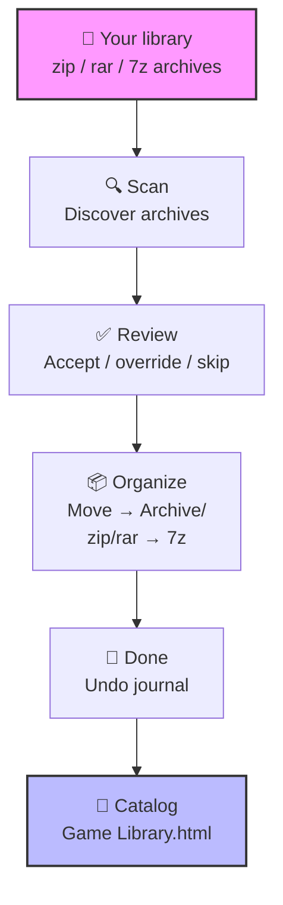

# Steam Game Organizer

[](CHANGELOG.md)
[](AGENTS.md)
[](https://www.rust-lang.org/)
[](Cargo.toml)
[](src/)
[](.github/workflows/ci.yml)
[](.cargo/deny.toml)

> **Built for Windows.** One library, one catalog, one click to play.  
> Scan `.zip`/`.rar`/`.7z` archives you downloaded from outside of Steam, match them to Steam store metadata, convert to **7z** for better compression, organize into category folders, download artwork, and build a clickable HTML game catalog — all in one self-contained application. **Windows-only.**

---

## 📖 Table of contents

| If you want to… | Go to section |
|-----------------|---------------|
| Get a quick summary | [🎯 Overview](#-overview) |
| See how it looks | [📸 UI views & screenshots](#-ui-views--screenshots) |
| System requirements | [💻 System requirements](#-system-requirements) |
| Build & install | [📦 Get the app](#-get-the-app) |
| Run on your machine | [🖥️ Running on your machine](#-running-on-your-machine) |
| App workflow — end to end | [🎯 App workflow — end to end](#-app-workflow--end-to-end) |
| Repository layout | [🏗️ Repository layout](#-repository-layout) |
| Troubleshooting | [🔧 Troubleshooting](#-troubleshooting) |
| FAQ | [❓ FAQ](#-faq) |
| Project status & public readiness | [📊 Project status & public readiness](#-project-status--public-readiness) |
| Rust Conversion | [🦀 Rust Conversion](#-rust-conversion) |
| License | [⚖️ License](#-license) |
| Quick links to key code | [🔗 Quick links to key code sections](#-quick-links-to-key-code-sections) |
| Contributor documentation | [📚 Contributor documentation](#-contributor-documentation) |

---

## 🎯 Overview

Steam Game Organizer is a comprehensive Windows application for games you have downloaded from outside of Steam. It walks your library folder, finds every `.zip`/`.rar`/`.7z`, matches each archive against Steam's store metadata (AppID, title, genres, tags, artwork URLs) with confidence scoring so a weak match never overrides a strong one, converts archives to **7z** for better compression, sorts them into category folders, downloads artwork, and generates a beautiful, clickable HTML catalog you can open in your browser — packed with detail on every game.

The result is a self-contained, browsable game library that works on any Windows 10+ machine — no installation required on the machine that runs it.

### What it does

| Step | What happens |
|------|--------------|
| 🔍 **Scan** | Walks every category folder under the library root, finds every `.zip`/`.rar`/`.7z`, matches each archive against Steam's store metadata (AppID, title, genres, tags, artwork URLs) with confidence scoring so a weak match never overrides a strong one. |
| 📦 **Convert** | Rebuilds `.zip` and `.rar` archives as `.7z` using adaptive compression tuned to your free RAM — better compression, smaller on-disk footprint. Older copies and re-categorized leftovers are moved to `Archive/` with `(n)` collision suffixes for review before deleting. |
| 🗂️ **Organize** | Each archive is filed into `Category / Game — release date` folders with metadata, Steam shortcuts, and artwork sidebars. Archives are grouped by identity key, the newest version is promoted, and duplicates are swept so two archives of the same game never compete. Writes happen atomically. |
| 🖼️ **Artwork** | Downloads Steam capsule, header, and grid images plus SteamGridDB portraits, keyed per AppID with a cache. Composes card banners so no card is ever a flat grey block. |
| 📖 **Catalog** | Generates a self-contained `Game Library.html` — embedded CSS + vanilla JS, no build step, no external requests — plus status data. The page carries search, filters, category chips, sort orders, dynamic action cards, and "already unpacked" badges. |
| ↩️ **Undo** | Every organize move is journaled. One Undo restores each archived file to its source and prunes only folders this run created into `Archive/` — never deletes a folder it didn't make. |

### What it does not do

- **Does not support piracy.** Use it only for games you own and have the right to organize.
- **Does not need Steam installed.** It queries the Steam Store API at runtime for metadata — no Steam client required.
- **Does not delete games.** The app never deletes anything it didn't create. Empty categories and re-categorized leftovers are moved to `Archive/` for review.

---

## 📸 UI views & screenshots

The app runs full screen with a navigation rail on the left and content pane on the right. Each view can be launched individually in isolation for testing or screenshots using `--view <name>`.

### View gallery

| View | `--view` flag | Purpose | Screenshot |
|------|--------------|---------|------------|
| **Scan** | `--view scan` | Discover archives and match them to Steam store metadata | [`docs/screenshots/scan/Scan - Full UI - FULLWINDOW.png`](docs/screenshots/scan/Scan%20-%20Full%20UI%20-%20FULLWINDOW.png) |
| **Review** | `--view review` | Verify matches, pick categories, accept / skip / wrong-match games | [`docs/screenshots/review/Review - Full UI - FULLWINDOW.png`](docs/screenshots/review/Review%20-%20Full%20UI%20-%20FULLWINDOW.png) |
| **Organize** | `--view organize` | Convert archives to 7z, move into category folders, write metadata | [`docs/screenshots/organize/Organize - Full UI - FULLWINDOW.png`](docs/screenshots/organize/Organize%20-%20Full%20UI%20-%20FULLWINDOW.png) |
| **Artwork** | `--view artwork` | Review downloaded Steam artwork assets per game | [`docs/screenshots/artwork/Artwork - Full UI - FULLWINDOW.png`](docs/screenshots/artwork/Artwork%20-%20Full%20UI%20-%20FULLWINDOW.png) |
| **Done** | `--view done` | Show organize run results (converted / skipped / failed) | [`docs/screenshots/done/Done - Full UI - FULLWINDOW.png`](docs/screenshots/done/Done%20-%20Full%20UI%20-%20FULLWINDOW.png) |
| **Setup** | `--view setup` | Configure library root, extract folder, 7-Zip path | [`docs/screenshots/setup/Setup - Full UI - FULLWINDOW.png`](docs/screenshots/setup/Setup%20-%20Full%20UI%20-%20FULLWINDOW.png) |

### View details

#### 🔍 Scan view
Displays discovered archives in a grid with match confidence scores. Each archive card shows:
- Archive filename and detected Steam game title
- Match confidence (high/medium/low) with color coding
- Progress through scan phases: Scan → Match → Review → Catalog
- "Start Scan" / "Scan with Artwork" / "Cancel Scan" buttons

#### 📋 Review view
Presents each matched archive for confirmation:
- Archive name vs. detected Steam game title side by side
- "Accept & Next", "Skip", "Wrong Match" buttons for each archive
- "Approve All Verified", "Add Category", "Use All Suggestions", "Retry Failed" bulk actions
- "Continue to Organization" button when review is complete

#### 🗂️ Organize view
Shows conversion progress:
- Progress bar for archive conversion
- "Archives to Organize" list with category tags (Action, RPG, Strategy, etc.)
- "Start Organize" / "Cancel" buttons
- Converted / skipped / failed counts with progress percentage

#### 🖼️ Artwork view
Displays downloaded artwork per game:
- Game artwork grid with capsule, header, and grid images
- "Open Folder", "View Artwork", "Scan Again", "Review" buttons per game
- "Re-download Missing" button for missing artwork

#### ✅ Done view
Shows organization results:
- Summary cards: converted / skipped / failed counts
- "Open Library Folder", "Undo Last Run", "Scan Again" buttons
- "No results yet" state if no organize run has completed

#### ⚙️ Setup view (new two-column layout)
Left column — configuration fields:
- Library Root with browse button + path validity badge
- Extract Folder with browse button + path validity badge
- 7-Zip Path with browse button + path validity badge
- Developer Mode toggle

Right column — configuration preview:
- Summary of all configured values
- Validation results with ✓/✗ indicators
- "Save & Finish Setup" (enabled only when valid) / "Skip Setup"

### Launch a single view

```powershell
.\target\release\steam-game-organizer.exe --view scan
```

### Screenshot gallery

Detailed per-view screenshots are captured in `docs/screenshots/{ViewName}/` with 4x4 grid quadrants, full window, side-by-side comparison, ASCII art structure maps, dead space audits, and design review checklists:

```
docs/screenshots/
├── scan/
│   ├── Scan - Full UI - FULLWINDOW.png
│   ├── Scan - 4x4 Composite - COMPOSITE.png
│   ├── Scan - Full vs Composite - SIDE-BY-SIDE.png
│   ├── Scan - ASCII Art - UI-STRUCTURE.txt
│   ├── Scan - Dead Space Audit - AUDIT.txt
│   ├── Scan - Design Review Checklist - CHECKLIST.txt
│   └── Scan - R1C1 - Top-Left.png ... R4C4 - Bottom-Right.png
├── review/  (same structure)
├── organize/  (same structure)
├── artwork/  (same structure)
├── done/  (same structure)
└── setup/  (same structure)
```

Capture your own screenshots from within the app using the **📷 Capture Screen** button in the top bar, or run:
```powershell
.\target\release\steam-game-organizer.exe --verify-ui
```


To capture screenshots of each view:

```powershell
cargo build --release
.\target\release\capture_screens.exe --view scan --out docs/screenshots
.\target\release\capture_screens.exe --view review --out docs/screenshots
.\target\release\capture_screens.exe --view organize --out docs/screenshots
.\target\release\capture_screens.exe --view artwork --out docs/screenshots
.\target\release\capture_screens.exe --view done --out docs/screenshots
.\target\release\capture_screens.exe --view setup --out docs/screenshots
```

Screenshots are saved to `docs/screenshots/`.

---

## 💻 System requirements

| Requirement | Detail |
|-------------|--------|
| **OS** | Windows 10 or later (64-bit). Windows-only — no POSIX, macOS, or Linux target. |
| **To build from source** | Rust toolchain (`cargo`, `rustc`, `clippy`), 7-Zip installed to `C:\Program Files\7-Zip`. |
| **To run the built app** | Nothing. The built executable is self-contained. |
| **Display** | The app maximizes itself on start and runs full screen. |

---

## 📦 Get the app

The `target/` folder is **gitignored** — build artifacts are not in the repository. To get a runnable app you build it yourself from the source code. The resulting executable is self-contained.

### Build from source

Requires the Rust toolchain and 7-Zip on the machine doing the build.

#### Step 1 — Install the Rust toolchain

1. Install Rust from https://www.rust-lang.org/.
2. Confirm it works:

   ```powershell
   cargo --version
   rustc --version
   ```

3. Install clippy:

   ```powershell
   rustup component add clippy
   ```

#### Step 2 — Install 7-Zip

1. Download 7-Zip from https://www.7-zip.org/download.html.
2. Install it to the default location, `C:\Program Files\7-Zip`.
3. Confirm it is available:

   ```powershell
   7z
   ```

   It should print 7-Zip help text.

#### Step 3 — Clone the repository

```powershell
git clone https://github.com/smd3235/steam-game-organizer.git
cd "steam-game-organizer"
```

#### Step 4 — Build

```powershell
cargo build --release
```

The runnable app is at:

```
target\release\steam-game-organizer.exe
```

#### Step 5 — Run it

```powershell
target\release\steam-game-organizer.exe
```

No Python, 7-Zip, or anything else is needed on the machine that runs it.

#### Verify your build environment

Before building, confirm your machine has everything:

```powershell
cargo --version         # should print a version
cargo clippy --version   # should print a version
7z                      # should print 7-Zip help
```

---

## 🖥️ Running the app on your own machine

This is the full, step-by-step procedure for getting the app running on any Windows 10+ machine — yours, a second PC, or a borrowed hard drive. Nothing needs to be installed on the machine that runs it; the built executable is self-contained.

### Step 1 — Get the app onto the machine

Copy the built `target\release\steam-game-organizer.exe` (or a pre-built release) to a permanent location, for example `E:\Games\Steam Game Organizer\`.

### Step 2 — Launch the app

Open the folder and double-click:

```
steam-game-organizer.exe
```

The app maximizes to full screen on start. On first launch it opens the setup wizard automatically — there is nothing to configure before this point.

### Step 3 — Complete the setup wizard

The wizard asks for three folders. Fill in each one, then click **Save setup**.

| Folder | What it is | Example |
|--------|------------|---------|
| 📁 **Library root** | The folder your `.zip`/`.rar`/`.7z` game archives live in. | `E:\Games\Steam Library` |
| 📁 **Extract folder** | Where games are unpacked to when you click Extract. Must be outside your game library. | `E:\Games\Extracted` |
| 📁 **App folder** | Where this copy of the app lives. | `E:\Games\Steam Game Organizer\target\release\` |

### Step 4 — Drive letters auto-resolve (borrowed drives)

If you are running from a borrowed hard drive whose drive letter changed, the app detects that the stored library path no longer exists and auto-resolves `library_root` to the folder beside the app.

### Step 5 — Scan your library

Back in the main window, click **Scan**. The app walks every category folder under your library root, finds every `.zip`/`.rar`/`.7z`, matches each archive against Steam's store metadata, and builds a list of detected games.

### Step 6 — Review the detected games

Open the **Review** screen. Each detected game shows its suggested category, matched AppID, and confidence. You can accept, override, or skip each game.

### Step 7 — Organize the library

Click **Organize**. The app files each accepted archive into `Category / Game — release date` folders, rebuilds `.zip`/`.rar` archives as `.7z` for better compression, writes metadata and Steam shortcuts, and downloads artwork. Every move is journaled so it can be undone.

### Step 8 — Open your catalog

Click **Open catalog** (or open `Game Library.html` in your browser directly). This is a single self-contained HTML file with embedded CSS and vanilla JavaScript — no build step, no external requests.

### Step 9 — Extract games (optional)

From any game card, click **Extract** to unpack the archive to your chosen extract folder. You can also extract whole categories or the entire library.

---

## 🎯 App workflow — end to end



Phases run in order: **Discover → Organize → Catalog → Done**. Undo is an independent entry point.

---

## 🏗️ Repository layout

```
steam-game-organizer/
├── AGENTS.md              # Operating instructions: build, test, lint, run, commit
├── ARCHITECTURE.md        # Module map, service inventory, wiring diagrams
├── project_overview.md    # App purpose, data flow, key decisions, catalog mechanics
├── CHANGELOG.md           # Dated change log (newest first)
├── README.md              # This file
├── Cargo.toml             # Rust crate manifest
├── .cargo/                # Rust config (deny.toml, config.toml)
├── src/                   # Rust source (all modules)
│   ├── core/                # config, constants, models, naming, logger, state, exceptions
│   ├── services/            # archive, extract, catalog, library, organizer, rollback, setup
│   ├── ui/                  # egui views: scan, review, organize, artwork, done, setup
│   ├── app/                 # application, controller, jobs, events, windows
│   └── bin.rs               # CLI entry point
├── tools/                   # capture_screens, sandbox, diff_backups
├── assets/                  # icon.ico, icon.svg
├── docs/
│   └── screenshots/         # Committed screenshot gallery for UI views
├── config/                  # User settings (gitignored — runtime state)
├── cache/                   # Artwork cache (gitignored — runtime state)
├── logs/                    # Timestamped run logs (gitignored — runtime state)
├── backup/                  # Timestamped 7z backups (gitignored — runtime state)
└── target/                  # Build output (gitignored)
```

### What is not committed

`target/`, `config/`, `cache/`, `logs/`, and `backup/` are excluded by `.gitignore`. They are created at runtime on the machine that runs the app.

---

## ♿ Accessibility

The app supports multiple visual modes to accommodate different visual needs. Switch between them using the **Theme** and **Accessibility** dropdowns in the top bar:

| Mode | Description | Best for |
|------|-------------|----------|
| **Dark** (default) | Dark theme with vibrant accent colors | General use, low-light environments |
| **Light** | High-contrast light theme | Bright environments, low vision |
| **Normal** | Standard color rendering | Typical color vision |
| **Protanopia** | Red-green blindness simulation (red deficient) | Testing color-coded UI elements |
| **Deuteranopia** | Red-green blindness simulation (green deficient) | Testing color-coded UI elements |
| **Tritanopia** | Blue-yellow blindness simulation | Testing color-coded UI elements |
| **High Contrast** | Maximum contrast between text and background | Low vision, screen magnification |

All color contrast ratios meet WCAG AA (4.5:1) for normal text and WCAG AAA (7:1) for large text where possible. Button text uses 14px minimum font size for readability.

### Accessibility features
- **Screen reader mode** — Toggle in the top bar for screen reader compatibility
- **High contrast text** — Toggle for maximum text contrast
- **Large text support** — Body text at 14px, headings at 18px
- **Keyboard navigation** — All buttons are keyboard-navigable with focus indicators
- **Color-blind safe** — Color is never the sole means of conveying information; icons and text labels accompany color-coded status

---

## 🎨 UI Design Review System

The app includes a built-in UI design review system that captures and analyzes every view. Use the **📷 Capture Screen** button in the top bar, or run:

```powershell
.\target\release\steam-game-organizer.exe --verify-ui
```

### What gets captured

For each view (scan, review, organize, artwork, done, setup), the system captures:

| File | Description |
|------|-------------|
| `{View} - Full UI - FULLWINDOW.png` | Complete UI at 100% resolution |
| `{View} - R1C1 - Top-Left.png` … `R4C4 - Bottom-Right.png` | 16 quadrants (4x4 grid, 25%×25% each) |
| `{View} - 4x4 Composite - COMPOSITE.png` | All 16 quadrants stitched as one photo |
| `{View} - Full vs Composite - SIDE-BY-SIDE.png` | Side-by-side full window vs composite for visual diff |
| `{View} - ASCII Art - UI-STRUCTURE.txt` | Text-based brightness map (`#` = bright content, ` ` = dark/empty) |
| `{View} - Dead Space Audit - AUDIT.txt` | Per-quadrant dark pixel ratio with DEAD SPACE / MOSTLY EMPTY / PARTIALLY EMPTY / CONTENT classification |
| `{View} - Design Review Checklist - CHECKLIST.txt` | Layout issues and pass/fail criteria |

### What gets analyzed

| Analysis | What it checks |
|----------|----------------|
| **Dead space analysis** | Pixel-level measurement of empty space per quadrant; flags areas >80% dark as dead space |
| **Color contrast audit** | WCAG AA (4.5:1) and AAA (7:1) compliance for all key UI color pairs |
| **Element density** | Counts distinct visual elements per quadrant to identify cluttered or empty areas |
| **Fitts's Law** | Measures button sizes and distances from center for reachability analysis |
| **Hot corner detection** | Identifies which screen corners contain UI elements (primary actions should be bottom-right) |
| **Code vs Reality** | Compares buttons defined in source code against what OCR actually detects; reports any buttons in code that are missing from the rendered UI |

All screenshots and analysis reports are saved to `docs/screenshots/{ViewName}/`.

---

## 🔧 Troubleshooting

| Symptom | Likely cause | Fix |
|---------|--------------|-----|
| Build fails linking | MinGW-w64 not on PATH | Add `C:\tools\mingw64\mingw64\bin` to PATH |
| `cargo-audit` finds vulns | Outdated dependency | Update crate in `Cargo.toml` |
| `cargo-deny` blocks license | Non-permissive license | Review and add to `.cargo/deny.toml` |
| Library path shows as missing | Drive letter changed | Auto-resolves on next launch |
| Write fails with PermissionError | OneDrive or indexer lock | Atomic writes retry; close synced folders and retry |

---

## ❓ FAQ

**Q: Does this support pirated games?**  
A: No. The app does not support or condone piracy. Use it only for games you own and have the right to organize.

**Q: Does it need Steam installed?**  
A: No. It queries the Steam Store API at runtime for metadata — no Steam client required.

**Q: Can it run on a machine without Rust installed?**  
A: Yes. The built executable is self-contained.

**Q: Will it delete my games?**  
A: No. The app never deletes anything it didn't create. Empty categories and re-categorized leftovers are moved to `Archive/` for review.

**Q: Can I undo an organize run?**  
A: Yes. Every organize move is journaled; one Undo restores archives to their sources.

**Q: Does it work on other drives/machines?**  
A: Yes. Drive letters auto-resolve when the stored library path doesn't exist on the current machine, and extract folders are re-pointed through the Setup wizard.

**Q: Is my data sent anywhere?**  
A: No. Steam metadata is queried from the live Steam Store API at runtime; nothing is uploaded or shared.

---

## 📊 Project status & public readiness

### Status: Rust conversion complete

All application source code has been converted from Python to Rust. The app builds as a self-contained Windows executable via `cargo build --release`. No Python, PyInstaller, or Tcl/Tk is required to run the app.

---

## ⚖️ License

Add a license here if you want others to reuse or modify the code. Without one, all rights are reserved by default.

> [!NOTE]
> **If this project is made public:** others have **download and read access only**. They can download the source code, read it, and build it locally for their own use. They do not have write access to the repository, cannot push changes, and cannot modify the project on GitHub. Collaborators can be added individually through GitHub Settings → Collaborators.

---

## 🔗 Quick links to key code sections

| Area | File | What it does |
|------|------|--------------|
| Crate root | [`src/lib.rs`](src/lib.rs) | Module declarations for all converted modules |
| Data models | [`src/core/models.rs`](src/core/models.rs) | `GameArchive`, `SteamMatch`, `ScanResult`, `OrganizationDecision`, `ArtworkResult`, `ConversionResult`, `AppState` |
| Naming | [`src/core/naming_utils.rs`](src/core/naming_utils.rs) | `safe_name`, `release_label`, `game_name`, `asset_prefix`, `modified_at`, `unique_dir`, `version_key` |
| Library index | [`src/core/library_summary.rs`](src/core/library_summary.rs) | `LibrarySummary` with `categories_for_genres` and `precedent_for` |
| Logging | [`src/core/logger.rs`](src/core/logger.rs) | `AppLogger` with size-based rotation, level thresholds, thread-safe writes, `HH:MM:SS` timestamps |
| URI actions | [`src/core/uri_actions.rs`](src/core/uri_actions.rs) | `ExtractRequest`, `BatchExtractRequest`, `MultiBatchRequest`, `UriRefused` |
| Path safety | [`src/core/path_safety.rs`](src/core/path_safety.rs) | `DeletionGuard`, `is_within`, `protected_roots`, `safe_rmtree`, `safe_unlink` |
| URI parsing | [`src/core/parse_uri.rs`](src/core/parse_uri.rs) | `parse_uri()` — `steamgameorganizer://extract` |
| Filename utils | [`src/core/filename_utils.rs`](src/core/filename_utils.rs) | `normalize_name`, `identity_key`, `version_key` |
| Formatting | [`src/core/formatting.rs`](src/core/formatting.rs) | `human_size`, `human_duration`, `clock_stamp` |
| Treewalk | [`src/core/treewalk.rs`](src/core/treewalk.rs) | Junction-safe recursive directory walk |
| Desktop | [`src/core/desktop.rs`](src/core/desktop.rs) | `open_folder`, `open_url` |
| Organizer utils | [`src/core/organizer_utils.rs`](src/core/organizer_utils.rs) | `zip_is_encrypted`, `looks_like_resource_failure`, `defender_flagged`, `still_running`, `stop_tool`, `pid_is_alive` |
| Catalog utils | [`src/core/catalog_utils.rs`](src/core/catalog_utils.rs) | `safe_name`, `clean_tags`, `archive_size`, `find_banner`, `store_url`, `anchor`, `batch_uri`, `batch_button` |

---

## 📚 Contributor documentation

If you plan to modify code, read [`AGENTS.md`](AGENTS.md) first — it is the operating manual for contributing and contains the mandatory Change Workflow, Definition of Done, and rules every change must satisfy.

| Doc | What it covers | Link |
|-----|----------------|------|
| **AGENTS.md** | Build, test, lint, run, commit, push — Windows only | [`AGENTS.md`](AGENTS.md) |
| **ARCHITECTURE.md** | Module map, service inventory, wiring diagrams | [`ARCHITECTURE.md`](ARCHITECTURE.md) |
| **project_overview.md** | What the app does, data flow, key decisions, catalog mechanics | [`project_overview.md`](project_overview.md) |
| **CHANGELOG.md** | Dated change log (newest first) | [`CHANGELOG.md`](CHANGELOG.md) |

### GitHub CI

Every push and pull request runs quality checks via GitHub Actions:

| Step | Tool | Fails the gate? |
|------|------|-----------------|
| 1 | cargo clippy --all-targets | Yes |
| 2 | cargo test | Yes |
| 3 | cargo-audit | Yes |
| 4 | cargo-deny | Yes |

### Quality tools installed

- `cargo-audit` — Rust dependency vulnerability scanning
- `cargo-deny` — License and dependency policy checking
- `cargo-expand` — Macro expansion for debugging
- `cargo-llvm-cov` — Code coverage
- `cargo-watch` — Auto-rebuild on file changes
- `rustfmt` — Code formatting
- `clippy` — Linting
- MinGW-w64 — GNU target compilation (`dlltool.exe`)
- Tesseract OCR — External tool for OCR UI verification

### Pushing changes to GitHub

Every change goes through the full quality gate before it lands on `main`. Push to a feature branch and open a pull request:

```powershell
git checkout -b feature/your-change
# ... edit files ...
cargo fmt
cargo clippy --all-targets
cargo test
cargo-audit
cargo-deny check
git add <changed-files>
git commit -m "type(scope): short summary"
git push origin feature/your-change
```

CI runs `cargo clippy`, `cargo test`, `cargo-audit`, and `cargo-deny` on every push and pull request. All checks must pass before merging.

See [`AGENTS.md`](AGENTS.md) for the complete contributor workflow, commit message conventions, and Definition of Done.

---

*Built for Windows. One library, one catalog, one click to play.*